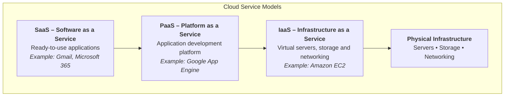
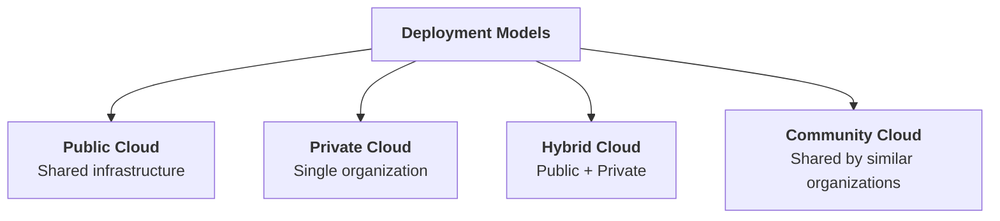
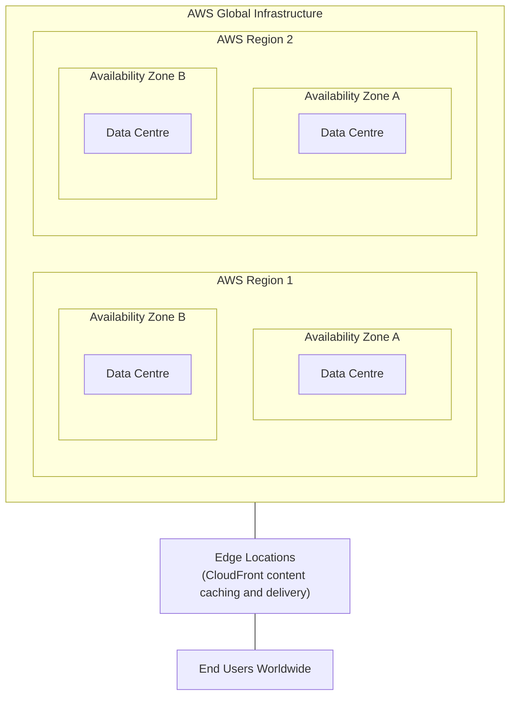

# Unit 1: Cloud Computing & AWS

---

# SECTION A – Very Short Answer Questions

---

## Q1. Define Cloud Computing.

**Definition:**

Cloud Computing is a technology that allows users to access computing resources such as servers, storage, databases, networking and software over the internet without purchasing and maintaining physical hardware.

Users can access these resources whenever required and generally pay according to their usage.

**Example:**

Amazon Web Services (AWS) provides cloud computing services through which a developer can launch a virtual server using Amazon EC2 instead of purchasing a physical server.

**Key Points:**
1. Provides computing resources over the internet.
2. Reduces hardware and maintenance costs.
3. Supports on-demand resource usage.
4. Provides scalability and flexibility.
5. Uses a pay-as-you-go pricing model.

---

## Q2. List any four key benefits of Cloud Computing.

**Definition:**

The benefits of Cloud Computing are the advantages organizations receive by using internet-based computing resources instead of maintaining their own physical infrastructure.

**Four major benefits:**

1. **Cost Reduction:** Users do not need to purchase expensive hardware or maintain physical data centres.
   - *Example:* A startup can use AWS EC2 instead of purchasing its own server.

2. **Scalability:** Cloud resources can be increased or decreased according to application requirements.
   - *Example:* An e-commerce website can increase server capacity during a festival sale.

3. **Accessibility:** Cloud services can be accessed from anywhere using an internet connection.
   - *Example:* Users can access Google Drive from a laptop or mobile phone.

4. **Reliability:** Cloud providers offer infrastructure and features that help applications remain available even when individual resources fail.
   - *Example:* An application can run across multiple AWS Availability Zones.

**Other benefits:**
- High performance.
- Automatic updates.
- Backup and recovery.
- Global availability.

---

## Q3. What are the three Cloud Service Models?

**Definition:**

Cloud Service Models describe the different levels of computing services provided by cloud providers to users.

There are three main Cloud Service Models:

### 1. IaaS (Infrastructure as a Service)
IaaS provides virtualized computing resources such as servers, storage and networking over the internet. Users manage the operating system, applications and data.

*Example:* Amazon EC2.

### 2. PaaS (Platform as a Service)
PaaS provides a platform and environment for developers to build, test and deploy applications without managing the underlying infrastructure.

*Example:* Google App Engine.

### 3. SaaS (Software as a Service)
SaaS provides ready-to-use software applications over the internet. Users do not need to install or maintain the underlying infrastructure.

*Example:* Gmail and Microsoft 365.

---

## Q4. Differentiate between IaaS, PaaS and SaaS.

**Definition:**

IaaS, PaaS and SaaS are three cloud service models that differ according to the level of control and management provided to users.

| Feature | IaaS | PaaS | SaaS |
| :--- | :--- | :--- | :--- |
| **Full form** | Infrastructure as a Service | Platform as a Service | Software as a Service |
| **Provides** | Virtual infrastructure | Application development platform | Ready-to-use software |
| **User manages** | OS, applications and data | Applications and data | Mainly usage and data |
| **Provider manages** | Physical infrastructure | Infrastructure and platform | Entire underlying service |
| **Example** | Amazon EC2 | Google App Engine | Gmail |
| **Main users** | System administrators | Developers | End users |

**Easy way to remember:**
- **IaaS** = Rent a computer/server.
- **PaaS** = Rent a development platform.
- **SaaS** = Use ready-made software.

---

## Q5. What are Cloud Deployment Models? Name their types.

**Definition:**

Cloud Deployment Models describe how cloud infrastructure is owned, managed and made available to users or organizations.

There are four main deployment models:

### 1. Public Cloud
A public cloud is a cloud infrastructure provided by a third-party cloud service provider and shared among multiple customers.

*Example:* AWS, Microsoft Azure and Google Cloud.

### 2. Private Cloud
A private cloud is a cloud infrastructure dedicated to a single organization. It provides greater control over resources and security configurations.

*Example:* A bank operating its own private cloud infrastructure.

### 3. Hybrid Cloud
A hybrid cloud combines public and private cloud environments, allowing data and applications to move between them.

*Example:* A bank stores sensitive customer information in a private cloud and hosts its public website on AWS.

### 4. Community Cloud
A community cloud is shared by multiple organizations that have similar requirements, security needs or objectives.

*Example:* Multiple government departments sharing a cloud infrastructure.

---

## Q6. What is Amazon Web Services (AWS)?

**Definition:**

Amazon Web Services (AWS) is a cloud computing platform provided by Amazon that offers services such as computing, storage, databases, networking, security and artificial intelligence over the internet.

AWS allows individuals and organizations to build, deploy and manage applications without purchasing physical infrastructure.

**Examples of AWS Services:**

| Service           | Purpose                        |
| :---------------- | :----------------------------- |
| Amazon EC2        | Virtual servers                |
| Amazon S3         | Object storage                 |
| Amazon RDS        | Managed relational databases   |
| AWS Lambda        | Serverless computing           |
| Amazon VPC        | Virtual networking             |
| Amazon CloudWatch | Monitoring                     |
| AWS IAM           | Identity and access management |
|                   |                                |

**Example:**

A developer can host a Spring Boot application on Amazon EC2, store images in Amazon S3 and use Amazon RDS for database management.

---

## Q7. Define AWS Global Infrastructure.

**Definition:**

AWS Global Infrastructure refers to the worldwide network of AWS data centres and networking facilities that provide cloud services to customers across different geographical locations.

It consists mainly of Regions, Availability Zones and Edge Locations.

**Main Components:**

### 1. AWS Regions
An AWS Region is a separate geographical area where AWS provides cloud services through multiple Availability Zones.

*Example:* Asia Pacific (Mumbai) – ap-south-1.

### 2. Availability Zones (AZs)
An Availability Zone is one or more physically separate data centres within an AWS Region. Each AZ has independent power, networking and connectivity infrastructure.

*Example:* Multiple Availability Zones within the Mumbai Region.

### 3. Edge Locations
Edge Locations are sites used by AWS services such as CloudFront to deliver content closer to end users and reduce network latency.

*Example:* A user in India can receive website images and videos from a nearby CloudFront edge location.

---

## Q8. What is the difference between an AWS Region and an Availability Zone?

**Definition:**

An AWS Region is a geographical area containing multiple Availability Zones, whereas an Availability Zone is an isolated infrastructure location within a Region.

| Feature | AWS Region | Availability Zone |
| :--- | :--- | :--- |
| **Meaning** | Geographical area | Isolated location within a Region |
| **Structure** | Contains multiple AZs | Contains one or more data centres |
| **Location** | Spread across a geographical area | Located within a Region |
| **Purpose** | Geographic deployment | High availability and fault isolation |
| **Example** | Mumbai Region | An AZ in Mumbai |

**Example:**

Suppose a company deploys its application in the Mumbai AWS Region.

It can run its application servers in one Availability Zone and maintain additional servers in another Availability Zone.

If one AZ experiences a failure, the application can continue operating through the other AZ, provided the application is configured for failover.

---

# SECTION B – Short and Medium Answer Questions

---

## Q41. Explain the key benefits of Cloud Computing with suitable examples.

**Definition:**

Cloud Computing provides computing resources such as servers, databases, storage and networking over the internet. It helps organizations reduce infrastructure costs and build applications efficiently.

**Major Benefits of Cloud Computing:**

1. **Cost Efficiency**
   Cloud computing reduces the need to purchase expensive hardware, software and physical servers. Users pay for the resources they consume.
   *Example:* A startup uses Amazon EC2 instead of purchasing a physical server.

2. **Scalability**
   Scalability means increasing or decreasing computing resources according to application requirements.
   *Example:* An online shopping website increases its server capacity during Diwali sales to handle more customers.

3. **Flexibility**
   Cloud services allow users to choose computing resources according to their requirements.
   *Example:* A developer can select different EC2 instance types depending on application needs.

4. **High Availability**
   Cloud providers offer infrastructure across multiple locations to help applications remain available.
   *Example:* An application deployed across multiple AWS Availability Zones can continue operating if one AZ fails.

5. **Global Accessibility**
   Cloud services can be accessed from different geographical locations through the internet.
   *Example:* Employees can access files stored in Google Drive from different countries.

6. **Security**
   Cloud providers offer security services such as encryption, access control, identity management and network protection.
   *Example:* AWS IAM controls which users can access particular AWS resources.

7. **Backup and Disaster Recovery**
   Cloud platforms provide services and features for storing backups and recovering data after failures.
   *Example:* Amazon S3 can store backup files that can be restored when required.

**Conclusion:**

Cloud Computing provides cost savings, scalability, flexibility, security and reliability. It helps organizations focus on application development rather than managing physical infrastructure.

---

## Q42. Explain the three Cloud Service Models (IaaS, PaaS and SaaS) with suitable examples.

**Definition:**

Cloud Service Models define how cloud computing resources and services are delivered to customers. The three main models are IaaS, PaaS and SaaS.

### 1. IaaS (Infrastructure as a Service)
IaaS provides virtualized computing infrastructure, including virtual machines, storage and networking over the internet.

Users are responsible for managing the operating system, applications and data, while the cloud provider manages the physical infrastructure.

**Features:**
- Provides virtual machines.
- Offers flexible computing resources.
- Supports scalability.
- Uses pay-as-you-go pricing.

*Example:* Amazon EC2.
A developer launches an EC2 instance, installs Java and deploys a Spring Boot application.

### 2. PaaS (Platform as a Service)
PaaS provides a complete development and deployment platform. Developers can build and deploy applications without managing the underlying servers and operating systems.

**Features:**
- Provides application development tools.
- Simplifies deployment.
- Reduces infrastructure management.
- Supports application scalability.

*Example:* Google App Engine.
A developer uploads an application, and the platform manages much of the infrastructure required to run it.

### 3. SaaS (Software as a Service)
SaaS provides ready-to-use software applications over the internet. Users access the software through a web browser or application without managing servers or software installation.

**Features:**
- Ready-to-use applications.
- Accessible through the internet.
- Automatic software updates.
- Subscription-based pricing is common.

*Examples:* Gmail, Google Docs and Microsoft 365.

### Difference Between IaaS, PaaS and SaaS

| Feature | IaaS | PaaS | SaaS |
| :--- | :--- | :--- | :--- |
| **Service** | Infrastructure | Platform | Software |
| **Control** | High | Medium | Low |
| **User responsibility** | OS and applications | Application and data | Application usage |
| **Example** | Amazon EC2 | Google App Engine | Gmail |
| **Main purpose** | Infrastructure hosting | Application development | Software usage |

**Conclusion:**

IaaS provides infrastructure, PaaS provides a development platform, and SaaS provides ready-to-use software.

---

## Q43. Describe the different Cloud Deployment Models.

**Definition:**

Cloud Deployment Models describe how cloud infrastructure is deployed, owned and accessed by organizations.

There are four major deployment models.

### 1. Public Cloud
A Public Cloud is a cloud environment where computing resources are provided by third-party providers over the internet and shared among multiple customers.

**Features:**
- Resources are shared among multiple customers.
- No need to maintain physical infrastructure.
- Highly scalable.
- Pay-as-you-go pricing.

*Example:* Amazon Web Services, Microsoft Azure and Google Cloud.

### 2. Private Cloud
A Private Cloud is a cloud environment dedicated to a single organization. It provides more control over infrastructure, data and security.

**Features:**
- Dedicated infrastructure.
- Greater administrative control.
- Custom security policies.
- Suitable for organizations with strict compliance requirements.

*Example:* A bank maintaining a private cloud for its internal banking applications.

### 3. Hybrid Cloud
A Hybrid Cloud combines public cloud and private cloud environments. It allows organizations to use both environments according to their requirements.

**Features:**
- Combines public and private cloud.
- Provides flexibility.
- Supports sensitive data management.
- Allows workloads to move between environments.

*Example:* A hospital stores sensitive patient records in a private cloud but hosts its public appointment website on AWS.

### 4. Community Cloud
A Community Cloud is a cloud infrastructure shared by multiple organizations that have common objectives, security requirements or compliance needs.

**Features:**
- Shared by multiple organizations.
- Common security requirements.
- Shared infrastructure costs.
- Supports collaboration.

*Example:* Several government departments sharing a cloud infrastructure for administrative services.

### Difference Between Deployment Models

| Feature | Public | Private | Hybrid | Community |
| :--- | :--- | :--- | :--- | :--- |
| **Users** | Multiple customers | One organization | Public + private users | Similar organizations |
| **Ownership** | Cloud provider | Single organization or provider | Multiple arrangements | Shared |
| **Cost** | Generally lower initial cost | Generally higher dedicated cost | Depends on usage | Shared cost |
| **Control** | Limited infrastructure control | High | Flexible | Shared |
| **Example** | AWS | Bank's private cloud | Bank + AWS | Government departments |

---

## Q44. Explain AWS Global Infrastructure, including Regions, Availability Zones and Edge Locations.

**Definition:**

AWS Global Infrastructure is the worldwide infrastructure of Amazon Web Services that allows customers to deploy applications and services across different geographical locations.

It is designed to provide high availability, low latency, fault tolerance and global accessibility.

### 1. AWS Regions
An AWS Region is a separate geographical area containing multiple Availability Zones.

Each Region operates independently and provides AWS services to customers.

**Features:**
- Located in different geographical areas.
- Contains multiple Availability Zones.
- Helps customers select where their applications and data are hosted.
- Supports disaster recovery and geographic distribution.

*Example:* Asia Pacific (Mumbai) Region – ap-south-1.

### 2. Availability Zones
An Availability Zone is one or more physically separate data centres within an AWS Region.

Each AZ has independent infrastructure, including power and networking.

**Features:**
- Provides fault isolation.
- Supports high availability.
- Helps applications continue running during infrastructure failures.
- Allows deployment across multiple AZs.

*Example:* A web application runs on EC2 instances in two different Availability Zones in the Mumbai Region.

### 3. Edge Locations
Edge Locations are AWS sites used by content delivery services such as Amazon CloudFront to cache and deliver content closer to users.

**Features:**
- Reduces network latency.
- Improves website loading speed.
- Delivers cached content.
- Supports global content distribution.

*Example:* A user accessing a website from India can receive cached images from a nearby CloudFront edge location.

### Difference Between Region, Availability Zone and Edge Location

| Feature | Region | Availability Zone | Edge Location |
| :--- | :--- | :--- | :--- |
| **Meaning** | Geographical area | Isolated infrastructure location | Content delivery site |
| **Main purpose** | Geographic deployment | High availability | Low latency |
| **Contains** | Multiple AZs | One or more data centres | Caching infrastructure |
| **Used by** | AWS services | EC2 and other resources | CloudFront |
| **Example** | Mumbai | AZ within Mumbai | CloudFront edge site |

**Conclusion:**

AWS Regions provide geographical distribution, Availability Zones provide fault isolation and high availability, and Edge Locations improve content delivery speed.

---

## Q45. Compare traditional on-premises computing with Cloud Computing.

**Definition:**

Traditional On-Premises Computing refers to an IT infrastructure where an organization purchases, installs and maintains its own physical servers, storage and networking equipment.

Cloud Computing provides similar computing resources over the internet through a cloud service provider.

### Difference Between On-Premises and Cloud Computing

| Feature | On-Premises Computing | Cloud Computing |
| :--- | :--- | :--- |
| **Infrastructure** | Physical hardware | Cloud-based resources |
| **Initial Cost** | High | Generally low |
| **Maintenance** | Managed by organization | Mostly managed by provider |
| **Scalability** | Requires hardware upgrades | Resources can be scaled |
| **Accessibility** | Depends on network setup | Accessible over internet |
| **Payment** | Hardware purchase and maintenance | Usage-based or subscription |
| **Backup** | Organization manages | Cloud backup services available |
| **Deployment** | Can take more time | Often faster |
| **Flexibility** | Limited by available hardware | Highly flexible |

**Example of On-Premises Computing:**

A college purchases physical servers and maintains them in its computer laboratory to store student information.

**Example of Cloud Computing:**

The same college uses Amazon EC2 and Amazon RDS to host its student management system without purchasing physical servers.

**Advantages of Cloud Computing over On-Premises:**
1. Reduces hardware investment.
2. Provides faster deployment.
3. Offers flexible scalability.
4. Reduces infrastructure maintenance.
5. Supports backup and disaster recovery.

**Conclusion:**

On-premises computing provides direct control over physical infrastructure, while Cloud Computing offers flexibility, scalability and reduced infrastructure management.

---

## Q46. Explain the role and importance of AWS in modern cloud-based application development.

**Definition:**

Amazon Web Services (AWS) is a cloud computing platform that provides on-demand services such as computing, storage, databases, networking, security and application deployment.

AWS plays an important role in modern application development by providing developers with the infrastructure and tools required to build, deploy and manage applications.

### Major Roles of AWS

1. **Computing Services**
   AWS provides virtual servers to run applications.
   *Example:* Amazon EC2 can host a Java Spring Boot backend application.

2. **Storage Services**
   AWS provides scalable storage for files, images, videos and backups.
   *Example:* Amazon S3 stores user profile images and documents.

3. **Database Services**
   AWS provides managed database services for storing and managing application data.
   *Example:* Amazon RDS stores user accounts, orders and payment records.

4. **Networking Services**
   AWS provides networking services to connect and secure cloud resources.
   *Example:* Amazon VPC creates an isolated network for an application.

5. **Serverless Computing**
   AWS allows developers to execute code without managing servers.
   *Example:* AWS Lambda runs a function when a file is uploaded to Amazon S3.

6. **Security and Access Management**
   AWS provides identity and security services to control access to cloud resources.
   *Example:* AWS IAM allows only authorized users to access an S3 bucket.

7. **Monitoring**
   AWS provides tools to monitor application performance and resource usage.
   *Example:* Amazon CloudWatch monitors EC2 CPU utilization.

8. **Global Deployment**
   AWS allows applications to be deployed in different geographical Regions.
   *Example:* A company can deploy its application in Mumbai and Singapore to serve users in different locations.

### Importance of AWS
- Reduces infrastructure costs.
- Provides high scalability.
- Supports faster application development.
- Provides global infrastructure.
- Improves application availability.
- Offers multiple security services.
- Supports modern architectures such as microservices and serverless computing.

### Example of a Real-World Application:

Consider an online shopping application developed using Java Spring Boot and React.

| AWS Service | Application |
| :--- | :--- |
| Amazon EC2 | Hosts backend application |
| Amazon S3 | Stores product images |
| Amazon RDS | Stores customer and order data |
| Amazon VPC | Provides network isolation |
| AWS IAM | Controls resource access |
| Amazon CloudWatch | Monitors application |
| Elastic Load Balancing | Distributes incoming traffic |

**Conclusion:**

AWS simplifies modern application development by providing scalable, secure and reliable cloud services. Developers can focus on building applications instead of managing physical infrastructure.

---

# SECTION C – Long Answer Questions

---

## Q81. Explain Cloud Computing in detail. Discuss its characteristics, benefits, service models and deployment models with suitable diagrams and examples.

### 1. Introduction to Cloud Computing

**Definition:**

Cloud Computing is a technology that provides computing resources such as servers, storage, databases, networking and software over the internet. It allows users to access resources on demand without purchasing and maintaining physical hardware.

Cloud Computing follows a pay-as-you-go model, where users generally pay according to the resources they consume.

**Example:**

Amazon Web Services (AWS) allows developers to launch virtual servers, store files and create databases without purchasing physical servers.

---

### 2. Characteristics of Cloud Computing

1. **On-Demand Self-Service**
   Users can access and configure computing resources whenever required without contacting the service provider.
   *Example:* A developer can launch an EC2 instance directly from the AWS Management Console.

2. **Broad Network Access**
   Cloud services are accessible over the internet using devices such as laptops, smartphones and tablets.
   *Example:* Accessing Google Drive using a mobile phone or computer.

3. **Resource Pooling**
   Cloud providers combine computing resources to serve multiple customers using a shared infrastructure.
   *Example:* AWS uses shared physical infrastructure to provide cloud services to different customers.

4. **Rapid Elasticity**
   Cloud resources can be increased or decreased quickly according to demand.
   *Example:* An e-commerce website increases server capacity during a festival sale and reduces it afterward.

5. **Measured Service**
   Cloud providers monitor resource usage and charge customers according to their consumption or selected pricing model.
   *Example:* AWS charges for EC2 usage based on the instance and pricing option selected.

---

### 3. Benefits of Cloud Computing

1. **Cost Efficiency:** Reduces the need to purchase expensive physical servers.
2. **Scalability:** Resources can be increased or decreased according to demand.
3. **Flexibility:** Users can select resources based on their requirements.
4. **High Availability:** Cloud infrastructure supports applications across multiple locations.
5. **Security:** Provides encryption, authentication and access management features.
6. **Backup and Recovery:** Supports data backup and disaster recovery.
7. **Global Accessibility:** Applications can be accessed from different geographical locations.

*Example:* A startup can host its website on AWS without building its own data centre.

---

### 4. Cloud Service Models

Cloud Computing has three major service models.

#### A. IaaS (Infrastructure as a Service)

IaaS provides virtualized infrastructure such as servers, storage and networking over the internet.

Users manage the operating system, applications and data, while the cloud provider manages physical infrastructure.

**Features:**
- Virtual machines.
- Storage resources.
- Network infrastructure.
- Flexible resource management.

*Example:* Amazon EC2.

#### B. PaaS (Platform as a Service)

PaaS provides a development and deployment platform that allows developers to build and deploy applications without managing the underlying infrastructure.

**Features:**
- Application development environment.
- Deployment tools.
- Infrastructure management by provider.
- Simplified application development.

*Example:* Google App Engine.

#### C. SaaS (Software as a Service)

SaaS provides ready-to-use software applications through the internet.

Users can access software without managing the underlying infrastructure.

**Features:**
- Ready-to-use applications.
- Internet-based access.
- Automatic updates.
- Subscription-based services are common.

*Examples:* Gmail, Google Docs and Microsoft 365.

#### Diagram: Cloud Service Models



**Text Representation:**
```text
Cloud Service Models
SaaS – Software as a Service
Ready-to-use applications
Example: Gmail, Microsoft 365

PaaS – Platform as a Service
Application development platform
Example: Google App Engine

IaaS – Infrastructure as a Service
Virtual servers, storage and networking
Example: Amazon EC2

Physical Infrastructure
Servers • Storage • Networking
```

---

### 5. Cloud Deployment Models

There are four major deployment models.

#### A. Public Cloud
A Public Cloud provides computing resources over the internet through a third-party provider. Resources are shared among multiple customers.

*Example:* AWS, Microsoft Azure and Google Cloud.

#### B. Private Cloud
A Private Cloud is dedicated to a single organization and provides greater control over infrastructure and security.

*Example:* A bank operating its own private cloud.

#### C. Hybrid Cloud
A Hybrid Cloud combines public and private cloud environments.

*Example:* A hospital stores sensitive patient data in a private cloud and hosts its public website on AWS.

#### D. Community Cloud
A Community Cloud is shared by multiple organizations having similar requirements and objectives.

*Example:* Government departments sharing a cloud infrastructure.

#### Diagram: Cloud Deployment Models



**Text Representation:**
```text
Deployment Models
Public Cloud
Shared infrastructure

Private Cloud
Single organization

Hybrid Cloud
Public + Private

Community Cloud
Shared by similar organizations
```

---

### 6. Real-World Example of Cloud Computing

Consider an online shopping application.
- Amazon EC2 is used to host the backend application.
- Amazon S3 stores product images.
- Amazon RDS stores customer and order information.
- Amazon VPC manages network infrastructure.
- Amazon CloudWatch monitors application performance.

This application uses different cloud services to provide a scalable and reliable shopping experience.

### Conclusion

Cloud Computing is an important technology in modern IT infrastructure. It provides on-demand computing resources, reduces infrastructure costs and supports scalability. Its three service models are IaaS, PaaS and SaaS, while its four deployment models are Public, Private, Hybrid and Community Cloud.

---

## Q82. Explain AWS Global Infrastructure in detail. Describe Regions, Availability Zones and Edge Locations and explain their importance in designing highly available applications.

### 1. Introduction

**Definition:**

AWS Global Infrastructure refers to the worldwide network of data centres and networking facilities operated by Amazon Web Services. It allows customers to deploy applications and store data in different geographical locations around the world.

AWS Global Infrastructure is designed to provide high availability, fault tolerance, low latency and global accessibility.

Its three important components are:
1. AWS Regions.
2. Availability Zones.
3. Edge Locations.

---

### 2. AWS Regions

**Definition:**

An AWS Region is a separate geographical area in which AWS operates multiple Availability Zones to provide cloud computing services.

Each Region is designed to operate independently of other Regions.

**Features:**
- Located in different geographical areas.
- Contains multiple Availability Zones.
- Helps organizations select where their applications and data are hosted.
- Supports disaster recovery.
- Helps meet geographical data requirements.

**Example:**

Asia Pacific (Mumbai) is an AWS Region with the Region code ap-south-1.

A company in India may choose the Mumbai Region to deploy its application for users in India.

---

### 3. Availability Zones (AZs)

**Definition:**

An Availability Zone is one or more physically separate data centres within an AWS Region. Each Availability Zone has independent power, networking and connectivity infrastructure.

Availability Zones help applications continue running even when an individual data centre or AZ experiences problems.

**Features:**
- Physically separate infrastructure.
- Independent power and networking.
- Provides fault isolation.
- Supports high availability.
- Allows applications to run across multiple AZs.

**Example:**

Suppose an application is deployed in two Availability Zones within the Mumbai Region.
- EC2 Instance 1 runs in AZ-A.
- EC2 Instance 2 runs in AZ-B.

If AZ-A experiences a failure, traffic can be redirected to the healthy instance in AZ-B, provided the application has been configured for failover.

---

### 4. Edge Locations

**Definition:**

Edge Locations are AWS sites used by services such as Amazon CloudFront to cache and deliver content closer to end users.

They help reduce network latency and improve the speed of content delivery.

**Features:**
- Delivers content closer to users.
- Reduces network latency.
- Supports content caching.
- Improves website loading speed.
- Provides global content distribution.

**Example:**

Suppose a website is hosted on an AWS server in Mumbai.

A user in another geographical location requests an image from the website. CloudFront can deliver a cached copy from a nearby Edge Location instead of fetching it from the original server every time.

---

### 5. Difference Between Region, Availability Zone and Edge Location

| Feature | Region | Availability Zone | Edge Location |
| :--- | :--- | :--- | :--- |
| **Meaning** | Geographical area | Isolated infrastructure location | Content delivery site |
| **Main purpose** | Geographic deployment | High availability | Faster content delivery |
| **Structure** | Contains multiple AZs | One or more data centres | Caching infrastructure |
| **Used for** | Cloud deployment | Fault isolation | Content distribution |
| **Example** | Mumbai Region | AZ in Mumbai | CloudFront edge site |

---

### 6. Importance of AWS Global Infrastructure

1. **High Availability**
   AWS allows applications to run across multiple Availability Zones to reduce downtime.
   *Example:* Running EC2 instances in two different AZs.

2. **Fault Tolerance**
   Fault tolerance means an application can continue operating even when some components fail.
   *Example:* If one Availability Zone becomes unavailable, traffic can be redirected to another healthy AZ.

3. **Low Latency**
   Low latency means reducing the time required for data to travel between users and servers.
   *Example:* CloudFront delivers cached website content through nearby Edge Locations.

4. **Disaster Recovery**
   Organizations can maintain backups or recovery infrastructure in another AWS Region.
   *Example:* A company stores database backups in a different Region to recover from a regional disaster.

5. **Global Accessibility**
   AWS allows organizations to deploy applications in different geographical locations.
   *Example:* An international company can deploy applications in Mumbai, Singapore and Frankfurt.

6. **Scalability**
   AWS infrastructure allows organizations to increase or decrease computing resources according to application requirements.
   *Example:* An e-commerce company can add more EC2 instances during high traffic.

---

### 7. Architecture Diagram of AWS Global Infrastructure



**Text Representation:**
```text
AWS Global Infrastructure
AWS Global Infrastructure

AWS Region 1
Availability Zone A
Data Centre

Availability Zone B
Data Centre

AWS Region 2
Availability Zone A
Data Centre

Availability Zone B
Data Centre

Edge Locations
CloudFront content caching and delivery

End Users Worldwide
```

*Conceptual diagram showing the main AWS infrastructure components.*

---

### 8. Real-World Example

Consider an international e-commerce company that wants to provide services to customers in India and other countries.

It can use AWS infrastructure as follows:
- **Mumbai Region:** Hosts the main application for Indian customers.
- **Availability Zone A:** Runs the primary application server.
- **Availability Zone B:** Runs an additional application server for high availability.
- **Another AWS Region:** Maintains disaster recovery resources.
- **Edge Locations:** Deliver cached images, videos and website content closer to customers.

This architecture improves availability, performance and reliability.
