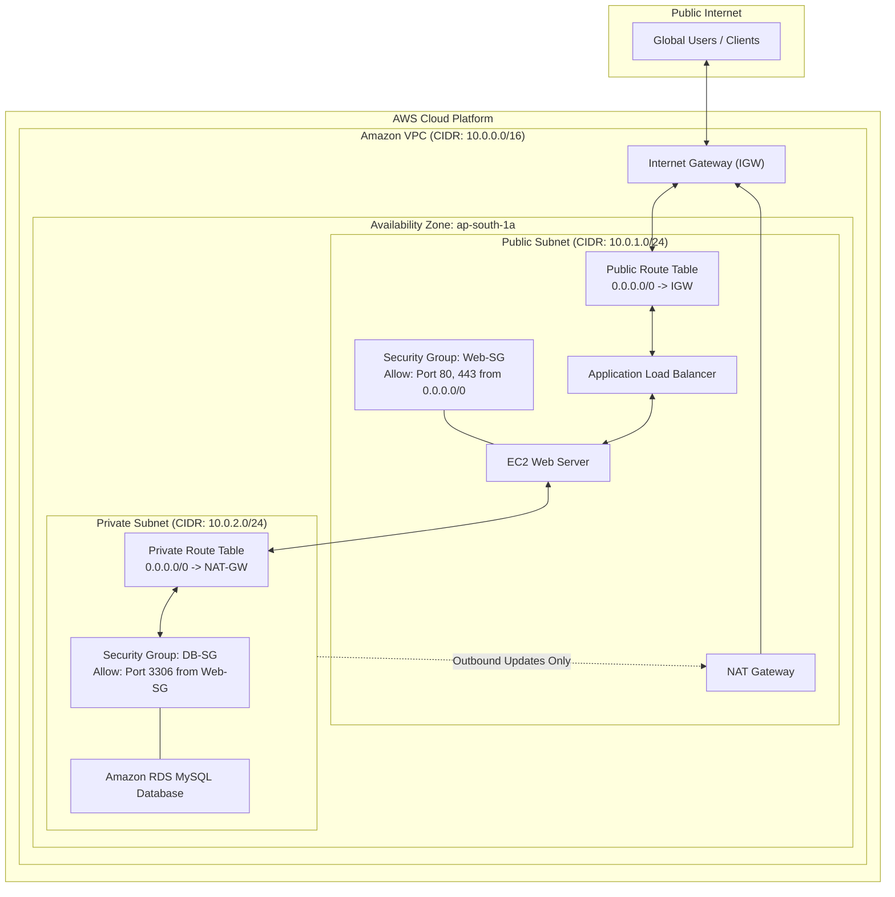
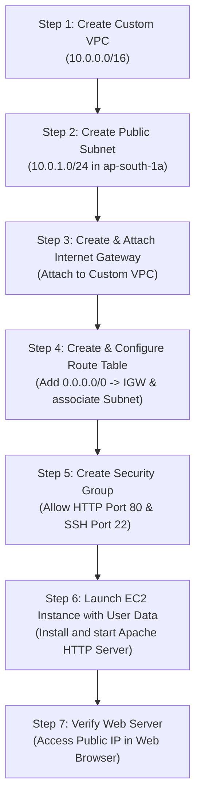
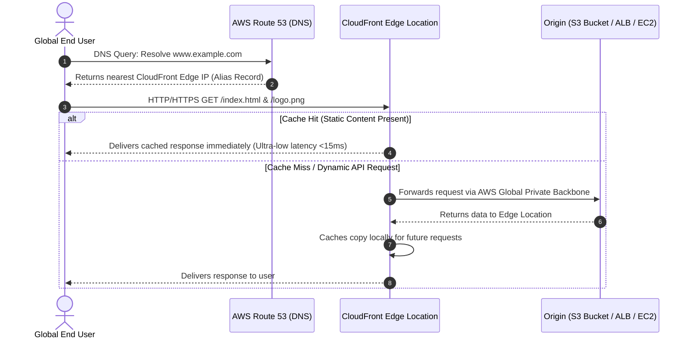

# Unit 2: Networking Services

---

# SECTION A – Very Short Answer Questions

---

## Q9. Define Amazon Virtual Private Cloud (VPC).

**Definition:**

Amazon Virtual Private Cloud (Amazon VPC) is a networking service that allows users to create a logically isolated virtual network within the AWS cloud dedicated to their AWS account.

It gives users complete control over their virtual networking environment, including the selection of IP address ranges, creation of subnets, and configuration of route tables and network gateways.

**Example:**

A developer creates an Amazon VPC with the CIDR block `10.0.0.0/16` to launch EC2 web servers and database instances in an isolated, private network environment.

**Key Points:**
1. Provides a logically isolated virtual network within AWS.
2. Gives full control over IP address ranges (IPv4 and IPv6 CIDR blocks).
3. Enables creation of both public and private subnets.
4. Secures cloud resources using Security Groups and Network Access Control Lists (NACLs).
5. Enables secure connections to the internet, other VPCs, or corporate on-premises data centres.

---

## Q10. What is a subnet in AWS?

**Definition:**

A subnet (sub-network) is a segmented partition or range of logical IP addresses within an Amazon VPC. Subnets allow organizations to group cloud resources based on security, operational, and architectural requirements.

Each subnet must reside entirely within a single AWS Availability Zone (AZ) and cannot span across multiple AZs.

**Example:**

Inside a VPC with CIDR `10.0.0.0/16`, a developer creates a subnet with CIDR `10.0.1.0/24` located in Availability Zone `ap-south-1a` (Mumbai).

**Key Points:**
1. Subnets span exactly one Availability Zone.
2. Created using a subset of the VPC's primary CIDR block.
3. Classified into Public Subnets and Private Subnets.
4. AWS reserves the first 4 IP addresses and the last 1 IP address (total 5 IP addresses) in each subnet for internal networking purposes.
5. Provides network isolation and traffic boundary control for deployed resources.

---

## Q11. Differentiate between public and private subnets.

**Definition:**

A public subnet is a subnet whose traffic is routed directly to an Internet Gateway, allowing resources within it to be accessed from the internet. A private subnet does not have a direct route to an Internet Gateway, protecting its resources from direct public exposure.

| Feature | Public Subnet | Private Subnet |
| :--- | :--- | :--- |
| **Internet Gateway Route** | Yes (has a route `0.0.0.0/0` targeted to an IGW) | No direct route to an Internet Gateway |
| **IP Addressing** | Assigns both private and public/Elastic IPv4 addresses | Assigns only private IPv4 addresses |
| **Internet Access** | Inbound and outbound access to/from the internet | Outbound internet access only via NAT Gateway / NAT instance |
| **Security Exposure** | Directly exposed to incoming internet traffic | Isolated and protected from inbound internet traffic |
| **Typical Resources** | Web servers, Load Balancers, Bastion hosts | Database servers, backend API servers, application workers |
| **Example** | Subnet hosting a public Nginx web server | Subnet hosting an Amazon RDS database instance |

**Easy way to remember:**
- **Public Subnet** = Connected to the outside internet.
- **Private Subnet** = Shielded inside the private network.

---

## Q12. What is a route table in AWS?

**Definition:**

A route table is a set of rules (called routes) that determine where network traffic from your subnet or gateway is directed within an Amazon VPC.

Each route specifies a destination CIDR block and a target (the next hop gateway, network interface, or connection).

**Example:**

A route rule with destination `0.0.0.0/0` and target `igw-0123456789abcdef0` directs all external internet-bound traffic to the attached Internet Gateway.

**Key Points:**
1. Every VPC comes with an automatic Main Route Table.
2. Custom route tables can be created and explicitly associated with specific subnets.
3. Each subnet must be associated with exactly one route table at a time.
4. By default, every route table contains a local route allowing communication among all resources within the VPC.
5. Routes prioritize the most specific prefix match (longest prefix match rule).

---

## Q13. Define a Security Group.

**Definition:**

A Security Group is a virtual firewall that operates at the instance level to control inbound (incoming) and outbound (outgoing) network traffic for Amazon EC2 instances and other elastic network interfaces.

Security Groups are stateful; if you send an outbound request from your instance, the response traffic is automatically allowed regardless of inbound rules.

**Example:**

A security group attached to a web server instance configured to allow inbound HTTP traffic on port 80 and HTTPS on port 443 from anywhere (`0.0.0.0/0`), and SSH on port 22 only from the administrator's static IP.

**Key Points:**
1. Operates at the instance / ENI level (not the subnet level).
2. Stateful virtual firewall (responses are automatically permitted).
3. Supports allow rules only (cannot create deny rules).
4. By default, denies all inbound traffic and allows all outbound traffic.
5. Multiple security groups can be attached to a single EC2 instance.

---

## Q14. What is AWS Route 53?

**Definition:**

Amazon Route 53 is a highly available and scalable cloud Domain Name System (DNS) web service provided by AWS.

It is designed to translate human-friendly domain names (such as `www.example.com`) into numeric IP addresses (such as `192.0.2.1`) that computers use to connect to each other.

**Example:**

A user enters `www.myonlineshop.com` in their web browser, and Route 53 routes the request to an Elastic Load Balancer or CloudFront distribution hosted in AWS.

**Key Points:**
1. Global DNS management service operating on port 53.
2. Provides domain name registration services.
3. Offers continuous resource health checking and automatic DNS failover.
4. Supports advanced routing policies (Simple, Weighted, Latency, Geolocation, Failover, Multi-Value).
5. Delivers 100% service level agreement (SLA) availability.

---

## Q15. What is Amazon CloudFront?

**Definition:**

Amazon CloudFront is a fast, highly secure Content Delivery Network (CDN) service that securely delivers data, videos, applications, and APIs to users worldwide with low latency and high transfer speeds.

CloudFront caches content at a worldwide network of data centres called Edge Locations.

**Example:**

An e-commerce website hosts product images in an Amazon S3 bucket in the US. When a customer in Mumbai requests an image, CloudFront delivers it from a local Mumbai Edge Location.

**Key Points:**
1. Uses a global network of Edge Locations and Regional Edge Caches.
2. Caches both static content (images, videos, stylesheets) and accelerates dynamic content.
3. Integrates seamlessly with AWS origins (Amazon S3, EC2, Application Load Balancers) and external servers.
4. Integrates natively with AWS Shield and AWS WAF for built-in DDoS and web security.
5. Reduces latency for end users and lowers origin server bandwidth load and costs.

---

## Q16. What is the purpose of an Internet Gateway?

**Definition:**

An Internet Gateway (IGW) is a horizontally scaled, redundant, and highly available VPC component that enables communication between resources in a VPC and the public internet.

It performs two primary roles: providing a target in your VPC route tables for internet-routable traffic, and performing Network Address Translation (NAT) for instances assigned public IPv4 addresses.

**Example:**

Attaching an Internet Gateway (`igw-1a2b3c4d`) to a VPC so that a web server launched in a public subnet can receive web traffic from users worldwide.

**Key Points:**
1. Enables bidirectional communication between the VPC and the public internet.
2. Manages Network Address Translation (NAT) between public and private IPv4 addresses.
3. Highly available and scalable with no availability risks or bandwidth constraints.
4. Exactly one Internet Gateway can be attached to a VPC at a time.
5. Essential component required to make any subnet a public subnet.

---

# SECTION B – Short and Medium Answer Questions

---

## Q47. Explain the architecture and components of Amazon VPC.

**Definition:**

Amazon Virtual Private Cloud (Amazon VPC) is a foundational networking service that provides a dedicated, logically isolated virtual network within the AWS cloud where developers can launch AWS resources according to custom networking rules.

### Major Components of Amazon VPC:

1. **Virtual Private Cloud (VPC) & CIDR Block**
   - The boundary of your virtual network.
   - Defined using Classless Inter-Domain Routing (CIDR) notation (e.g., `10.0.0.0/16` providing 65,536 private IP addresses).

2. **Subnets**
   - Segments of the VPC IP address range bound to a single Availability Zone.
   - **Public Subnet:** Direct route to the internet via an Internet Gateway.
   - **Private Subnet:** Isolated from direct internet access; accesses outbound internet via NAT Gateway.

3. **Internet Gateway (IGW)**
   - A managed VPC component that provides two-way internet communication for public subnets.
   - Performs 1:1 NAT between private and public IP addresses.

4. **NAT Gateway**
   - A managed Network Address Translation service placed in a public subnet.
   - Allows instances in private subnets to initiate outbound traffic to the internet (for software updates) while blocking inbound traffic initiated from the internet.

5. **Route Tables**
   - A collection of routing rules that determine where network packets are directed within the VPC and to external destinations.

6. **Security Groups and Network ACLs (NACLs)**
   - **Security Group:** Virtual firewall operating at the instance level (stateful, allow rules only).
   - **Network ACL:** Virtual firewall operating at the subnet level (stateless, allow and deny rules).

7. **VPC Endpoints & VPC Peering**
   - **VPC Endpoints:** Private connections between your VPC and supported AWS services (like Amazon S3 and DynamoDB) without using an Internet Gateway.
   - **VPC Peering:** Direct networking connection between two VPCs allowing them to communicate using private IP addresses.

### VPC Component Summary:

| Component | Scope / Layer | Primary Role |
| :--- | :--- | :--- |
| **VPC** | Regional | Top-level private virtual network container |
| **Subnet** | Availability Zone | Logical subdivision of IP space within an AZ |
| **Route Table** | Subnet / VPC | Controls routing and packet forwarding decisions |
| **Internet Gateway** | VPC-level | Bidirectional internet access for public subnets |
| **NAT Gateway** | Public Subnet | One-way outbound internet access for private subnets |
| **Security Group** | Instance / ENI | Stateful virtual firewall for instances |
| **Network ACL** | Subnet-level | Stateless subnet-level traffic filter |

**Real-World Example:**

A standard production application uses a VPC spanning two Availability Zones. Public subnets host Application Load Balancers, while private subnets host EC2 application servers and an Amazon RDS database cluster, ensuring high availability and robust network security.

**Conclusion:**

Amazon VPC provides the core networking foundation in AWS, offering full control over IP addressing, routing, access boundaries, and security policies.

---

## Q48. Differentiate between public and private subnets. Explain their use cases.

**Definition:**

Subnets in an Amazon VPC are categorized as public or private based on how they route traffic to the outside internet. Public subnets route traffic directly through an Internet Gateway, while private subnets remain isolated from direct external internet access.

### Difference Between Public and Private Subnets

| Feature | Public Subnet | Private Subnet |
| :--- | :--- | :--- |
| **Route Table Target** | Contains route `0.0.0.0/0` targeting an Internet Gateway (`igw-xxxx`) | Contains route `0.0.0.0/0` targeting a NAT Gateway (`nat-xxxx`) or no internet route |
| **Public IP Address** | Instances usually receive public IPv4 addresses or Elastic IPs | Instances have only private IP addresses (`10.x.x.x` / `172.x.x.x`) |
| **Inbound Internet Access** | Directly accessible from the internet over open ports | Inaccessible directly from the public internet |
| **Outbound Internet Access** | Direct access via Internet Gateway | Outbound-only access through a NAT Gateway or NAT instance |
| **Security Risk Profile** | Higher exposure; requires strict Security Group rules | Low exposure; protected from direct internet scanning and attacks |
| **Key Use Cases** | Web servers, public ALBs, NAT gateways, Bastion jump hosts | Database engines, backend APIs, internal microservices |
| **Example Component** | Nginx Reverse Proxy / Public Web Tier | Amazon RDS MySQL Database instance |

### Detailed Use Cases:

#### 1. Public Subnet Use Cases:
- **Public-Facing Web Servers:** Hosting web servers (Apache, Nginx, IIS) that directly serve static or dynamic content to internet users.
- **Application Load Balancers (ALB):** Public load balancers that receive incoming client traffic and distribute it across private application servers.
- **NAT Gateways:** Hosted in public subnets to translate and forward outbound internet requests initiated by private subnets.
- **Bastion Hosts (Jump Boxes):** Hardened instances accessed via SSH or RDP by system administrators to securely manage instances in private subnets.

#### 2. Private Subnet Use Cases:
- **Database Management Systems:** Hosting sensitive database instances (Amazon RDS, DynamoDB, MongoDB) that must never be directly reached from the internet.
- **Backend Application Logic:** Hosting core application servers (Spring Boot, Node.js, Django microservices) that process business logic and communicate only with frontend proxies.
- **Internal Processing & Analytics:** Hosting batch processing jobs, analytics clusters, and payment processing engines that require strict data security compliance.

**Conclusion:**

Separating infrastructure into public and private subnets implements the security principle of least privilege and defense-in-depth, protecting critical databases and backend systems from public internet exposure.

---

## Q49. Explain the working of route tables in AWS with a suitable example.

**Definition:**

A route table contains a set of rules (known as routes) that direct where network packets from subnets or gateways should be forwarded. It functions as a virtual router inside an Amazon VPC.

### Key Working Principles:

1. **Destination and Target:**
   - **Destination:** The IP address range (CIDR) where you want traffic to go.
   - **Target:** The gateway, network interface, or connection through which to send the traffic.
2. **The Local Route:**
   - Every route table automatically includes a default local route matching the VPC CIDR block.
   - This route allows all subnets inside the VPC to communicate with each other over private IP addresses and cannot be modified or deleted.
3. **Longest Prefix Match Rule:**
   - If multiple routes match a packet's destination IP, AWS routes the packet using the most specific route (the route with the longest subnet mask).
4. **Subnet Association:**
   - Each subnet must be explicitly associated with a custom route table or it implicitly inherits the VPC's Main Route Table.

### Practical Example:

Consider a VPC configured with CIDR block `10.0.0.0/16`:
- **Public Subnet (`10.0.1.0/24`)**: Associated with `Public-Route-Table`.
- **Private Subnet (`10.0.2.0/24`)**: Associated with `Private-Route-Table`.
- An **Internet Gateway (`igw-12345`)** is attached to the VPC.
- A **NAT Gateway (`nat-67890`)** is deployed in the Public Subnet.

#### 1. Public Route Table Configuration:

| Destination | Target | Explanation |
| :--- | :--- | :--- |
| `10.0.0.0/16` | `local` | Internal VPC traffic stays within the VPC |
| `0.0.0.0/0` | `igw-12345` | All other traffic (internet-bound) is routed to the Internet Gateway |

#### 2. Private Route Table Configuration:

| Destination | Target | Explanation |
| :--- | :--- | :--- |
| `10.0.0.0/16` | `local` | Internal VPC traffic stays within the VPC |
| `0.0.0.0/0` | `nat-67890` | All other traffic is routed to the NAT Gateway in the Public Subnet |

### How Packets Flow:

1. **Internal Traffic:** If an EC2 instance in the Public Subnet (`10.0.1.10`) sends a request to a database in the Private Subnet (`10.0.2.20`), the destination matches `10.0.0.0/16`. Traffic is routed locally within the VPC.
2. **Internet Request from Public Subnet:** If the web server connects to `54.239.28.85` (external internet), it matches `0.0.0.0/0`. The traffic is forwarded to `igw-12345` for public routing.
3. **Software Update from Private Subnet:** If the database instance needs to download an operating system patch, it sends traffic to `0.0.0.0/0`. The private route table routes the packet to `nat-67890` in the public subnet, which forwards it to the Internet Gateway.

**Conclusion:**

Route tables serve as the traffic controllers of an AWS VPC, dictating both internal inter-subnet routing and external connectivity boundaries.

---

## Q50. Explain Security Groups and their role in securing AWS resources.

**Definition:**

A Security Group acts as a virtual firewall for your Amazon EC2 instances and network interfaces to control inbound (incoming) and outbound (outgoing) traffic at the instance level.

Security Groups represent the first line of host-level defense in AWS cloud networking.

### Key Characteristics & Working Mechanism:

1. **Stateful Filtering:**
   - Security groups are stateful. When an inbound packet is permitted by an inbound rule, the return/response packet is automatically allowed out, regardless of outbound rules.
   - Similarly, if an outbound request is permitted, response traffic is automatically allowed back in.
2. **Allow-Only Rules (Whitelist Model):**
   - You can specify **Allow** rules, but you cannot create **Deny** rules.
   - By default, all inbound traffic is blocked until an explicit rule is added.
   - By default, all outbound traffic is allowed.
3. **Instance-Level Protection:**
   - Security groups protect individual network interfaces (ENIs) attached to instances, not the whole subnet.
4. **Security Group Referencing:**
   - A security group rule can reference another security group as its source or destination instead of static IP addresses, enabling dynamic, scalable multi-tier security.

### Typical Security Group Rule Structure:

| Rule Type | Protocol | Port Range | Source / Destination | Purpose |
| :--- | :--- | :--- | :--- | :--- |
| **Inbound** | TCP | 80 (HTTP) | `0.0.0.0/0` | Allows public web traffic to web server |
| **Inbound** | TCP | 443 (HTTPS) | `0.0.0.0/0` | Allows secure encrypted web traffic |
| **Inbound** | TCP | 22 (SSH) | `203.0.113.25/32` | Restricts SSH management to admin's static IP |
| **Inbound** | TCP | 3306 (MySQL) | `sg-webserver-id` | Allows database access only from web servers |
| **Outbound** | All Traffic | All Ports | `0.0.0.0/0` | Allows instances to access any outbound destination |

### Difference Between Security Groups and Network ACLs:

| Feature | Security Group | Network ACL |
| :--- | :--- | :--- |
| **Level of Operation** | Instance / ENI level | Subnet level |
| **State** | **Stateful** (return traffic automatically allowed) | **Stateless** (return traffic must be explicitly allowed) |
| **Rule Types** | Allow rules only | Allow and Deny rules |
| **Rule Evaluation** | All rules evaluated before decision is made | Rules processed in strict numerical order |
| **Default Setting** | Inbound denied, outbound allowed | Default NACL allows all inbound & outbound |

### Role in Multi-Tier Security Architecture:

In a 3-tier architecture:
- **Tier 1 (Load Balancer SG):** Allows inbound port 80/443 from `0.0.0.0/0`.
- **Tier 2 (Web Server SG):** Allows inbound port 80/443 **only** from the Load Balancer Security Group.
- **Tier 3 (Database SG):** Allows inbound port 3306 **only** from the Web Server Security Group.

This ensures the database instance is never accessible directly from the internet or even from unauthorized internal instances.

**Conclusion:**

Security Groups provide flexible, instance-level host protection through stateful traffic inspection and inter-group referencing.

---

## Q51. Explain AWS Route 53 and its major features.

**Definition:**

Amazon Route 53 is a highly available and scalable cloud Domain Name System (DNS) web service. It connects user requests to infrastructure running in AWS (such as EC2 instances, Elastic Load Balancers, or Amazon S3 buckets) as well as infrastructure outside AWS.

The name "Route 53" refers to TCP/UDP Port 53, the standard port used for DNS traffic.

### Major Features of AWS Route 53:

1. **Domain Name Registration:**
   - Allows users to search for, purchase, register, and manage top-level domain names (e.g., `.com`, `.org`, `.net`) directly from the AWS Management Console.
2. **Reliable DNS Resolution:**
   - Translates domain names into IP addresses using a globally distributed Anycast network of DNS servers, guaranteeing 100% DNS availability.
3. **Health Checking & DNS Failover:**
   - Continuously monitors the operational health of endpoints (web servers, IP addresses).
   - If an endpoint fails, Route 53 automatically updates DNS records to route traffic to healthy standby resources.
4. **Alias Records:**
   - A proprietary AWS DNS extension that maps domain apex records (e.g., `example.com` without `www`) directly to AWS resources (like CloudFront distributions, S3 website buckets, or ELB load balancers) without extra DNS query fees.
5. **Private DNS for VPCs:**
   - Manages internal domain names within private Amazon VPCs without exposing DNS data to the public internet.

### Route 53 Routing Policies:

Route 53 offers multiple routing policies to control how DNS queries are answered:

| Routing Policy | Working Mechanism | Primary Use Case |
| :--- | :--- | :--- |
| **Simple Routing** | Standard DNS record mapping a domain to one or more static IP addresses | Single resource with no health checks |
| **Weighted Routing** | Distributes traffic across multiple resources according to assigned percentages (e.g., 80% to v1, 20% to v2) | A/B testing and gradual software rollouts |
| **Latency-Based Routing** | Routes user requests to the AWS Region that provides the lowest network latency for that user | Global applications serving users across multiple continents |
| **Failover Routing** | Routes traffic to a primary resource when healthy and automatically fails over to a secondary standby resource | Active-Passive disaster recovery configurations |
| **Geolocation Routing** | Routes traffic based on the geographic location of the user (by continent, country, or US state) | Localized content, currency presentation, and regulatory compliance |
| **Multi-Value Answer** | Returns multiple healthy IP addresses in response to DNS queries and performs health checks | Simple DNS-based load balancing |

**Example:**

A global streaming company uses **Latency-Based Routing** to direct European users to AWS Frankfurt (`eu-central-1`) and Indian users to AWS Mumbai (`ap-south-1`), providing optimal video playback speed.

**Conclusion:**

AWS Route 53 is a mission-critical global DNS service that combines domain registration, flexible traffic routing policies, and automatic health-checked failover.

---

## Q52. Describe Amazon CloudFront and explain how it improves website performance.

**Definition:**

Amazon CloudFront is a globally distributed Content Delivery Network (CDN) service that securely delivers data, videos, applications, and APIs to users worldwide with low latency and high transfer speeds.

It acts as an intermediary caching proxy between the origin server (such as Amazon S3, an Application Load Balancer, or custom HTTP servers) and end users.

### Architecture of Amazon CloudFront:

- **Origins:** The source location of original content (Amazon S3 bucket, EC2 instance, Elastic Load Balancer, or custom on-premises web server).
- **Distribution:** A configuration unit identified by a domain name (`d1234.cloudfront.net`) that tells CloudFront where to fetch content and how to deliver it.
- **Edge Locations:** A worldwide network of points of presence (PoPs) that cache copies of content closer to end users.
- **Regional Edge Caches:** Larger caching tiers situated between Edge Locations and origin servers to hold less frequently accessed content.

### How CloudFront Improves Website Performance:

1. **Drastically Reduces Latency:**
   - Caches static assets (HTML, CSS, JavaScript, images, video files) at local Edge Locations.
   - Users download content from nearby servers rather than making long-distance round-trips to the origin server.
2. **Offloads Origin Servers:**
   - Up to 90%+ of incoming requests can be served directly from CloudFront's cache (cache hits), significantly reducing CPU, RAM, and bandwidth consumption on the origin servers.
3. **Optimized Network Transport:**
   - When fetching dynamic content (cache misses or API calls), CloudFront routes traffic across the private, congestion-free **AWS Global Private Backbone Network** rather than the unpredictable public internet.
4. **SSL/TLS Termination at the Edge:**
   - Secure cryptographic handshakes occur closer to the user at the Edge Location, reducing SSL negotiation latency.
5. **Automatic Compression:**
   - Automatically compresses files using Gzip and Brotli compression algorithms before transmitting them, reducing file transfer size and load times.
6. **HTTP/2 and HTTP/3 Support:**
   - Supports modern multiplexed web protocols, allowing multiple assets to download simultaneously over a single connection.

### Performance Comparison Table:

| Performance Factor | Without Amazon CloudFront | With Amazon CloudFront |
| :--- | :--- | :--- |
| **Data Travel Distance** | Traverses multiple public hops across oceans/continents | Traverses only local hops to the nearest Edge Location |
| **Origin Server Load** | High; every user request directly hits the origin | Low; origin receives only occasional cache-miss requests |
| **Page Load Time** | High and highly variable depending on geographic distance | Consistently low regardless of user location |
| **DDoS Resilience** | Origin server vulnerable to direct network flooding | Absorb attacks at the edge with AWS Shield and AWS WAF |

**Example:**

A user in Sydney visits a website hosted on an S3 bucket in North Virginia. Without CloudFront, each request travels over 15,000 km with latencies exceeding 250 ms. With CloudFront, the user fetches cached assets from the Sydney Edge Location in under 15 ms.

**Conclusion:**

Amazon CloudFront boosts web performance through global edge caching, optimized network routing, SSL termination, and substantial origin server offloading.

---

# SECTION C – Long Answer Questions

---

## Q83. Explain the complete architecture of Amazon VPC with a neat diagram. Describe subnets, route tables, Internet Gateway, and Security Groups.

### 1. Introduction to Amazon VPC

Amazon Virtual Private Cloud (Amazon VPC) is the cornerstone of AWS networking. It enables customers to provision a private, isolated virtual network space within the AWS cloud where they can deploy AWS resources with complete autonomy over network topology.

Users have complete control over:
- Selection of IP address spaces using Classless Inter-Domain Routing (CIDR) blocks (e.g., `10.0.0.0/16`).
- Division of the network into public and private subnets across multiple Availability Zones.
- Definition of routing rules via Route Tables.
- Edge connectivity using an Internet Gateway, NAT Gateway, or Virtual Private Gateway.
- Multi-layered security using Security Groups (instance firewall) and Network ACLs (subnet firewall).

---

### 2. Architecture Diagram of Amazon VPC



**Text Representation:**
```text
+---------------------------------------------------------------------------------------+
|                                    AWS CLOUD PLATFORM                                 |
|                                                                                       |
|  +---------------------------------------------------------------------------------+  |
|  |                   Amazon VPC (CIDR: 10.0.0.0/16)                                |  |
|  |                                                                                 |  |
|  |   [ Internet Gateway (IGW) ] <====== (Public Internet Traffic)                  |  |
|  |               ^                                                                 |  |
|  |               |                                                                 |  |
|  |   +-----------v--------------------------------------------------------------+  |  |
|  |   | Availability Zone: ap-south-1a                                           |  |  |
|  |   |                                                                          |  |  |
|  |   |  +--------------------------------------------------------------------+  |  |  |
|  |   |  | PUBLIC SUBNET (10.0.1.0/24)                                        |  |  |  |
|  |   |  | Route Table: 0.0.0.0/0 -> IGW                                      |  |  |  |
|  |   |  |                                                                    |  |  |  |
|  |   |  |  [ NAT Gateway ]           [ Application Load Balancer / Web EC2 ] |  |  |  |
|  |   |  |                                    | (Security Group: Web-SG)      |  |  |  |
|  |   |  +------------------------------------|-------------------------------+  |  |  |
|  |   |                                       | (Internal Private Requests)      |  |  |
|  |   |  +------------------------------------v-------------------------------+  |  |  |
|  |   |  | PRIVATE SUBNET (10.0.2.0/24)                                       |  |  |  |
|  |   |  | Route Table: 0.0.0.0/0 -> NAT Gateway                              |  |  |  |
|  |   |  |                                                                    |  |  |  |
|  |   |  |  [ Amazon RDS Database Instance ]                                  |  |  |  |
|  |   |  |  (Security Group: DB-SG - Allow Port 3306 ONLY from Web-SG)        |  |  |  |
|  |   |  +--------------------------------------------------------------------+  |  |  |
|  |   +--------------------------------------------------------------------------+  |  |
|  +---------------------------------------------------------------------------------+  |
+---------------------------------------------------------------------------------------+
```

---

### 3. In-Depth Explanation of Core VPC Components

#### A. Subnets (Public and Private)
- **Subnet Fundamentals:** A subnet is a contiguous segment of the VPC's IP CIDR block allocated to a specific Availability Zone.
- **Public Subnet:** A subnet whose associated route table has an active default route (`0.0.0.0/0`) pointing to an Internet Gateway. Instances launched here can be assigned public IP addresses and communicate directly with the internet. Used for public-facing components like Load Balancers, Nginx Web Proxies, and Bastion Hosts.
- **Private Subnet:** A subnet without a direct route to an Internet Gateway. Instances receive only private IP addresses and are protected from incoming internet connections. Outbound internet connectivity (for OS updates) is provided through a NAT Gateway. Used for databases, core application logic, and confidential data storage.
- **Reserved IP Addresses:** In every AWS subnet, 5 IP addresses are automatically reserved by AWS:
  1. `x.x.x.0`: Network address.
  2. `x.x.x.1`: Reserved by AWS for VPC router.
  3. `x.x.x.2`: Reserved by AWS for DNS server.
  4. `x.x.x.3`: Reserved by AWS for future use.
  5. `x.x.x.255`: Network broadcast address (broadcast is not supported in VPC).

#### B. Route Tables
- A route table contains routing rules that govern where network traffic leaving any instance inside a subnet should be directed.
- **The Local Route:** Every route table has a non-deletable local route (e.g., `10.0.0.0/16 -> local`) allowing direct private communication between all instances across all subnets in the VPC.
- **The Default Route (`0.0.0.0/0`):** Used to route external internet-bound traffic:
  - In a Public Subnet, `0.0.0.0/0` points to the **Internet Gateway** (`igw-xxxx`).
  - In a Private Subnet, `0.0.0.0/0` points to a **NAT Gateway** (`nat-xxxx`).
- **Subnet Association:** Subnets must be explicitly associated with a route table. If not explicitly assigned, they default to the VPC's Main Route Table.

#### C. Internet Gateway (IGW)
- An Internet Gateway is a managed, horizontally scalable, redundant software component that attaches to the VPC.
- **Dual Functionality:**
  1. Serves as a target in route tables for internet-bound network traffic.
  2. Performs 1:1 Network Address Translation (NAT) between the private IP address of an EC2 instance and its assigned public/Elastic IPv4 address.
- It imposes no bandwidth constraints and is fully maintained by AWS with zero single points of failure.

#### D. Security Groups
- A Security Group functions as a stateful virtual firewall at the individual instance / Elastic Network Interface (ENI) level.
- **Stateful Behavior:** If an inbound connection is allowed (e.g., HTTP on port 80), the return response traffic is automatically allowed out, regardless of outbound rules.
- **Rule Construction:** Only **Allow** rules are supported (no deny rules). All unlisted traffic is denied by default.
- **Security Group Chaining:** Security groups can reference other security groups. For example, the Database Security Group can permit MySQL port 3306 traffic only if the source is `sg-webserver`, ensuring tight internal isolation.

---

### 4. Component Comparison & Summary

| Component | Scope | Placement | Primary Role | State / Filter Type |
| :--- | :--- | :--- | :--- | :--- |
| **VPC** | Regional | AWS Cloud | Top-level isolated virtual network | Boundary isolation |
| **Subnet** | Availability Zone | Inside VPC | Segmented IP space for workloads | Logical partitioning |
| **Route Table** | Subnet / VPC | Inside VPC | Determines packet forwarding paths | Routing lookup |
| **Internet Gateway** | VPC-level | Edge of VPC | Bidirectional internet access | 1:1 NAT translation |
| **NAT Gateway** | Subnet-level | Public Subnet | Unidirectional outbound internet access | Many:1 NAT translation |
| **Security Group** | Instance / ENI | Attached to instance | Controls incoming & outgoing traffic | Stateful packet filter |
| **Network ACL** | Subnet-level | Subnet boundary | Secondary security layer for subnets | Stateless packet filter |

---

### 5. Step-by-Step Traffic Flow in this Architecture

1. **Inbound Client Request:** An internet user sends an HTTP request to the public IP of the Application Load Balancer. The packet passes through the Internet Gateway and enters the Public Subnet via the Public Route Table.
2. **Web Tier Processing:** The Web Server Security Group permits port 80/443 traffic. The web server processes the request.
3. **Database Query:** The web server sends an internal SQL query to the database in the Private Subnet. The packet is routed internally via the `local` route (`10.0.0.0/16`).
4. **Database Security Verification:** The Database Security Group inspects the packet. Because the request originates from `Web-SG`, it allows port 3306 traffic.
5. **Outbound Patch Download:** If the database requires a security update, it forwards packets to `0.0.0.0/0` targeted to the NAT Gateway in the Public Subnet, which proxies the request out through the Internet Gateway while preventing any direct incoming connection from the internet.

### Conclusion

The Amazon VPC architecture provides enterprise-grade isolation, high availability across Availability Zones, granular routing control, and multi-layered defense mechanisms, making it the bedrock for hosting secure production workloads.

---

## Q84. Explain the step-by-step procedure for creating and configuring a VPC in AWS and launching a web server inside it.

### 1. Introduction & Objective

This procedure outlines the end-to-end process of building a custom Amazon VPC from scratch, configuring its public networking infrastructure, and launching an Apache HTTP web server on an Amazon EC2 instance within the public subnet.

#### Configuration Blueprint:
- **VPC Name:** `Custom-Production-VPC` (CIDR: `10.0.0.0/16`)
- **Public Subnet:** `Public-Subnet-1` (CIDR: `10.0.1.0/24`, AZ: `ap-south-1a`)
- **Internet Gateway:** `Custom-IGW`
- **Route Table:** `Public-Route-Table` (Route: `0.0.0.0/0 -> Custom-IGW`)
- **Security Group:** `WebServer-SG` (Inbound: HTTP port 80 from `0.0.0.0/0`, SSH port 22 from admin IP)
- **EC2 Instance:** Amazon Linux 2023 `t2.micro` running Apache HTTP Server

---

### 2. Step-by-Step Procedure



---

### Step 1: Create the Custom Virtual Private Cloud (VPC)
1. Sign in to the **AWS Management Console** and navigate to the **VPC Console**.
2. In the navigation pane, click **Your VPCs**, then click **Create VPC**.
3. Under **VPC settings**, choose **VPC only**.
4. Configure the parameters:
   - **Name tag:** `Custom-Production-VPC`
   - **IPv4 CIDR block:** Enter `10.0.0.0/16`
   - **IPv6 CIDR block:** Select *No IPv6 CIDR block*
   - **Tenancy:** Select *Default*
5. Click **Create VPC**.

---

### Step 2: Create a Public Subnet
1. In the VPC Console navigation pane, click **Subnets**, then click **Create subnet**.
2. Under **VPC ID**, select `Custom-Production-VPC`.
3. Configure the subnet settings:
   - **Subnet name:** `Public-Subnet-1`
   - **Availability Zone:** Select `ap-south-1a` (or your preferred local AZ)
   - **IPv4 subnet CIDR block:** Enter `10.0.1.0/24`
4. Click **Create subnet**.
5. Select `Public-Subnet-1`, click **Actions** -> **Edit subnet settings**.
6. Check **Enable auto-assign public IPv4 address**, then click **Save**. *(This ensures all instances launched in this subnet automatically receive a public IP).*

---

### Step 3: Create and Attach an Internet Gateway
1. In the VPC Console navigation pane, click **Internet gateways**, then click **Create internet gateway**.
2. Enter **Name tag:** `Custom-IGW`.
3. Click **Create internet gateway**.
4. After creation, click **Actions** -> **Attach to VPC**.
5. Select `Custom-Production-VPC` from the dropdown list and click **Attach internet gateway**.

---

### Step 4: Create and Configure a Public Route Table
1. In the VPC Console navigation pane, click **Route tables**, then click **Create route table**.
2. Configure the route table:
   - **Name:** `Public-Route-Table`
   - **VPC:** Select `Custom-Production-VPC`
3. Click **Create route table**.
4. Select `Public-Route-Table`, navigate to the **Routes** tab, and click **Edit routes**.
5. Click **Add route**:
   - **Destination:** Enter `0.0.0.0/0`
   - **Target:** Select **Internet Gateway**, then choose `Custom-IGW`
6. Click **Save changes**.
7. Navigate to the **Subnet associations** tab, click **Edit subnet associations**.
8. Select `Public-Subnet-1` and click **Save associations**.

---

### Step 5: Create a Security Group for the Web Server
1. Navigate to the **EC2 Console**, and under **Network & Security**, click **Security Groups**.
2. Click **Create security group**.
3. Configure details:
   - **Security group name:** `WebServer-SG`
   - **Description:** `Security group for public web server`
   - **VPC:** Select `Custom-Production-VPC`
4. Under **Inbound rules**, add the following rules:
   - **Rule 1 (HTTP):** Type: `HTTP`, Protocol: `TCP`, Port: `80`, Source: `0.0.0.0/0` (Anywhere-IPv4).
   - **Rule 2 (SSH):** Type: `SSH`, Protocol: `TCP`, Port: `22`, Source: `My IP` (Restricts terminal access to your current IP).
5. Under **Outbound rules**, leave the default rule intact:
   - Type: `All traffic`, Destination: `0.0.0.0/0`.
6. Click **Create security group**.

---

### Step 6: Launch an EC2 Web Server Instance
1. In the EC2 Console, click **Instances**, then click **Launch instances**.
2. Configure instance details:
   - **Name:** `Public-Web-Server`
   - **Application and OS Images (AMI):** Select **Amazon Linux 2023 AMI**.
   - **Instance type:** Select `t2.micro` (Free tier eligible).
   - **Key pair (login):** Select an existing key pair or choose *Proceed without a key pair*.
3. Under **Network settings**, click **Edit**:
   - **VPC:** Select `Custom-Production-VPC`.
   - **Subnet:** Select `Public-Subnet-1`.
   - **Auto-assign public IP:** Select **Enable**.
   - **Firewall (security groups):** Choose **Select existing security group**, then select `WebServer-SG`.
4. Scroll down, expand **Advanced details**, and scroll to the **User data** field.
5. Paste the following bootstrap script to automate Apache web server installation:
   ```bash
   #!/bin/bash
   # Update system packages
   dnf update -y
   # Install Apache HTTP Server
   dnf install -y httpd
   # Start and enable Apache service
   systemctl start httpd
   systemctl enable httpd
   # Create a sample index webpage
   echo "<h1>Hello from AWS Custom VPC Web Server!</h1><p>Hosted successfully in Public Subnet 1.</p>" > /var/www/html/index.html
   ```
6. Click **Launch instance**.

---

### Step 7: Verification and Testing
1. Once the instance state changes from *Pending* to **Running** and status checks pass (**2/2 checks passed**), select the instance.
2. In the **Details** tab, copy the **Public IPv4 address** (e.g., `13.233.150.45`).
3. Open a web browser, enter `http://<Public-IPv4-Address>`, and press Enter.
4. **Result:** The webpage displays:
   > **Hello from AWS Custom VPC Web Server!**  
   > *Hosted successfully in Public Subnet 1.*

---

### Summary of Configured Resources

| Resource | Identifier | Configured Value | Function |
| :--- | :--- | :--- | :--- |
| **VPC** | `Custom-Production-VPC` | `10.0.0.0/16` | Isolated network container |
| **Subnet** | `Public-Subnet-1` | `10.0.1.0/24` (AZ: `ap-south-1a`) | Houses public web instances |
| **Internet Gateway** | `Custom-IGW` | Attached to VPC | Gateway to public internet |
| **Route Table** | `Public-Route-Table` | `0.0.0.0/0 -> Custom-IGW` | Directs external traffic to IGW |
| **Security Group** | `WebServer-SG` | Inbound Ports 80 and 22 | Virtual firewall for instance |
| **EC2 Instance** | `Public-Web-Server` | `t2.micro` (Amazon Linux 2023) | Executes web server workloads |

### Conclusion

Following this standardized procedure establishes a fully functional, internet-accessible web server inside a custom, secure AWS VPC architecture.

---

## Q85. Explain AWS Route 53 and Amazon CloudFront in detail. Discuss their architecture, working, features, and role in delivering web applications efficiently.

### 1. Introduction

Delivering modern web applications globally requires two fundamental capabilities:
1. **Intelligent DNS Resolution (AWS Route 53):** Ensuring users' domain queries are translated quickly, accurately, and with continuous health monitoring.
2. **Global Content Caching & Edge Acceleration (Amazon CloudFront):** Ensuring heavy static assets and dynamic content reach users with minimal network latency and bandwidth costs.

When integrated, Route 53 and CloudFront provide a resilient, globally distributed application delivery network.

---

### 2. AWS Route 53 In-Depth

#### A. Architecture and How It Works:
- Route 53 is an Anycast-routed Domain Name System service running across a worldwide network of authoritative DNS servers.
- **Hosted Zones:** A container for DNS records:
  - **Public Hosted Zone:** Controls internet-facing DNS records for public domains.
  - **Private Hosted Zone:** Resolves internal DNS records inside one or more specified Amazon VPCs.
- **Alias Records:** Unlike standard DNS CNAME records, Route 53 Alias records can map the zone apex (`example.com`) directly to AWS resources (CloudFront distributions, ALBs, S3 buckets) with automatic IP change tracking and zero query fees.

#### B. Key Features:
- **100% SLA Availability:** Backed by an Anycast DNS network with geographic redundancy.
- **DNS Health Checks:** Periodically pings application endpoints over HTTP, HTTPS, or TCP. Automatically redirects traffic away from unhealthy endpoints.
- **Comprehensive Routing Policies:**
  - *Simple:* Single-resource record mapping.
  - *Weighted:* Proportional traffic splitting (e.g., 90/10 canary deployments).
  - *Latency-Based:* Routes to the AWS Region offering lowest latency.
  - *Failover:* Automatic active-passive disaster recovery.
  - *Geolocation:* Routes based on user country or continent.
  - *Geoproximity:* Routes based on geographic distance with bias shifting.
  - *Multi-Value:* Returns multiple healthy IPs with DNS-level load balancing.

---

### 3. Amazon CloudFront In-Depth

#### A. Architecture and Infrastructure:
- **Edge Locations:** Over 600+ globally distributed points of presence located in major metropolitan cities that cache content close to end users.
- **Regional Edge Caches (REC):** Mid-tier caching layers placed between Edge Locations and origin servers to hold larger asset libraries and prevent origin cache misses.
- **Origin Servers:** The authoritative storage source (Amazon S3 bucket, EC2 instance, Elastic Load Balancer, or custom HTTP server).

#### B. Key Features:
- **Global Edge Caching:** Caches static files (images, videos, JS, CSS, HTML) with configurable Time-to-Live (TTL).
- **Dynamic Content Acceleration:** Optimizes TCP handshakes, SSL termination, and keep-alive connections over AWS's private high-speed global fiber backbone.
- **Security & DDoS Mitigation:** Seamless native integration with **AWS Shield** (DDoS mitigation) and **AWS WAF** (Web Application Firewall for SQLi, XSS, and bot protection).
- **Custom SSL/TLS via ACM:** Integrates with AWS Certificate Manager to provide free SSL certificates for custom domains.
- **Edge Computing:** Executes lightweight serverless functions at the edge using **CloudFront Functions** and **Lambda@Edge** for header manipulation, URL rewrites, and authentication.

---

### 4. Combined Architecture Diagram



**Text Representation:**
```text
[ Global End User ]
         |
         | 1. DNS Query: www.example.com
         v
[ AWS Route 53 ] ====> Returns IP of nearest CloudFront Edge Location
         |
         | 2. HTTPS Request (GET /image.png)
         v
+-------------------------------------------------------------+
| Amazon CloudFront Edge Location (Local Metropolitan City)   |
|                                                             |
|   Check Cache:                                              |
|   - CACHE HIT  --> Return cached file directly to User (<15ms)|
|   - CACHE MISS --> Fetch over AWS Private Backbone Network:  |
+-------------------------------------------------------------+
         |
         | 3. Fetch from Origin
         v
+-------------------------------------------------------------+
| AWS Origin Infrastructure                                   |
|   - Amazon S3 (Static assets)                               |
|   - Application Load Balancer / EC2 (Dynamic API Backend)   |
+-------------------------------------------------------------+
```

---

### 5. Step-by-Step Delivery Lifecycle

1. **DNS Resolution Phase:**
   - The user opens `https://www.example.com`.
   - The browser queries Route 53.
   - Route 53 uses Latency-Based routing or Alias evaluation to return the IP address of the optimal CloudFront Edge Location.
2. **Connection Establishment:**
   - The user negotiates an SSL/TLS session directly with the CloudFront Edge server.
   - Because the edge server is geographically close, the cryptographic handshake completes in a fraction of the time required to contact the origin.
3. **Serving Cached Content (Cache Hit):**
   - For static assets (images, stylesheets, JavaScript bundles), CloudFront checks its local cache.
   - If present and within its TTL, the edge server immediately returns the content to the user.
4. **Fetching from Origin (Cache Miss or Dynamic API):**
   - If the asset is missing or expired, CloudFront forwards the request over the dedicated, private AWS global network backbone to the origin (Amazon S3 bucket or ALB).
   - CloudFront caches the response locally and delivers it to the user.

---

### 6. Comparative Analysis Table

| Parameter | AWS Route 53 | Amazon CloudFront |
| :--- | :--- | :--- |
| **Primary Purpose** | Domain Name System (DNS) Management | Content Delivery Network (CDN) & Caching |
| **Operational OSI Layer** | Application Layer (DNS - Port 53) | Application Layer (HTTP/HTTPS - Ports 80/443) |
| **Core Function** | Maps domain names to IP addresses or AWS resources | Caches and delivers web content via global Edge Locations |
| **Routing Intelligence** | Evaluates latency, health, geolocation, and failover | Directs user requests to the nearest caching Point of Presence |
| **Health Checking** | Monitors endpoint availability; triggers DNS failover | Monitors origin health; automatically fails over to backup origin |
| **Security Capabilities** | Anycast DDoS mitigation, DNSSEC support | AWS WAF integration, AWS Shield DDoS mitigation, SSL at edge |
| **Primary Benefit** | Guarantees 100% DNS uptime and optimal entry point | Dramatically lowers latency, bandwidth costs, and server load |

---

### 7. Strategic Importance in Modern Web Architecture

1. **Global High Availability & Disaster Recovery:**
   - Route 53 monitors the primary CloudFront distribution or origin. If an outage occurs, it switches traffic to a standby backup site within seconds.
2. **Maximized Latency Reduction:**
   - Route 53 sends users to the nearest CloudFront Edge Location, and CloudFront serves cached content locally, eliminating intercontinental latency hops.
3. **Severe Origin Offloading:**
   - CloudFront caches static content, absorbing up to 95% of incoming requests. This allows backend EC2 instances and RDS databases to scale efficiently without over-provisioning hardware.
4. **Defense-in-Depth Security:**
   - Public traffic terminates at CloudFront's edge, hiding the actual origin IP addresses.
   - Combined with AWS WAF and AWS Shield, malicious attacks (SQL injections, SYN floods, HTTP floods) are neutralized before reaching the backend application.

### Conclusion

AWS Route 53 and Amazon CloudFront form a synergistic pair for cloud-native web delivery. Route 53 provides ultra-reliable DNS routing and automated failover, while CloudFront provides global edge caching and acceleration, delivering an ultra-fast, highly resilient, and secure user experience.
