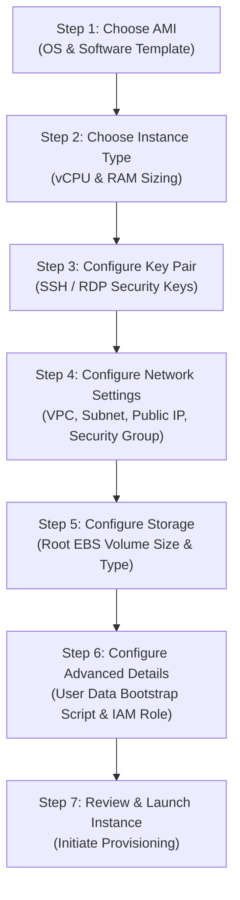
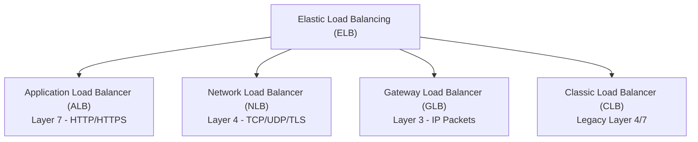
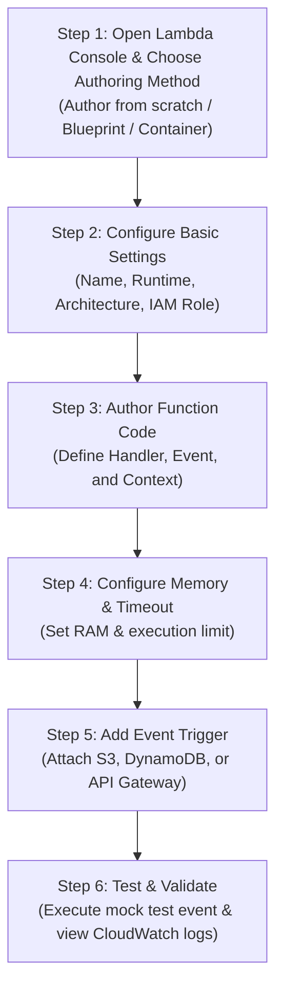
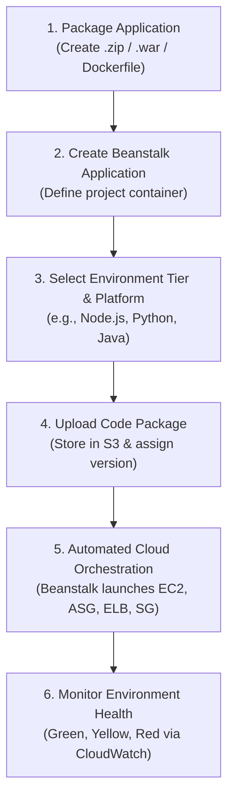
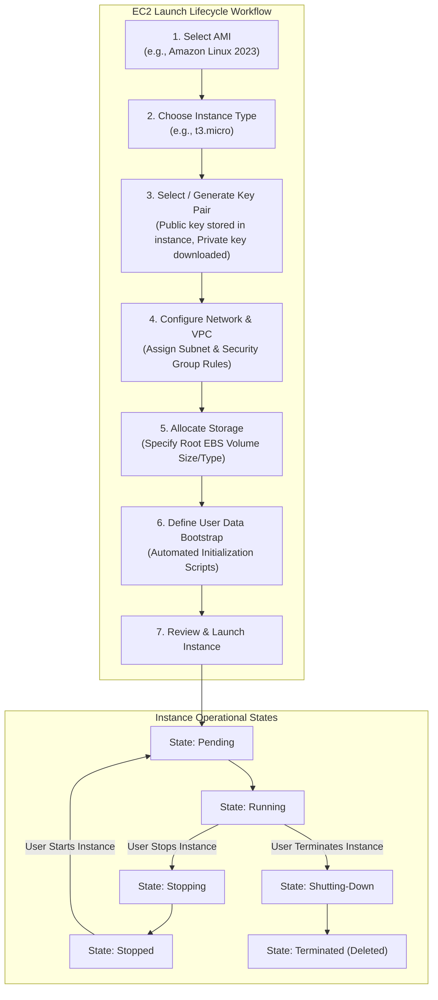
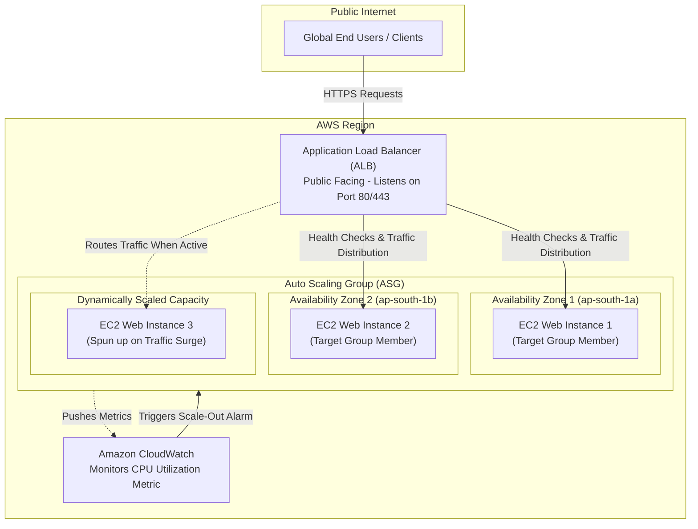
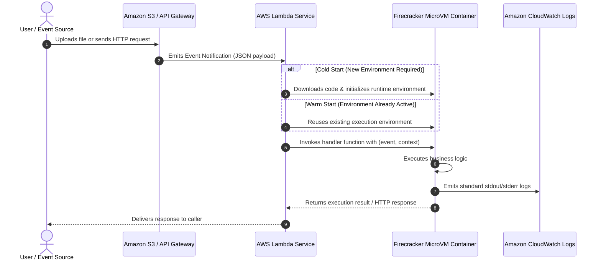
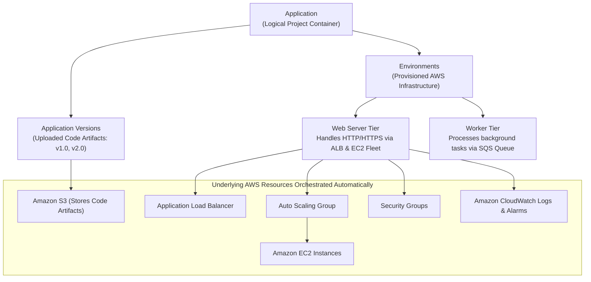

# Unit 3: Compute Services

---

# SECTION A – Very Short Answer Questions

---

## Q17. Define Infrastructure as a Service (IaaS).

**Definition:**

Infrastructure as a Service (IaaS) is a cloud computing service model that provides virtualized computing resources—such as virtual servers, network connections, bandwidth, and storage—over the internet on a pay-as-you-go basis.

In this model, the cloud provider manages the physical data centres, servers, virtualization hypervisors, and physical networking, while the customer retains full control over the operating system, installed applications, middleware, runtime environments, and data.

**Example:**

**Amazon Elastic Compute Cloud (Amazon EC2)** is an IaaS offering where users can choose their preferred operating system (Linux or Windows), install custom software stacks, and configure virtual networking.

**Key Points:**
1. Provides on-demand virtualized hardware, networking, and storage resources.
2. Gives users root-level or administrative control over operating systems.
3. Users are responsible for OS configuration, security patching, and application maintenance.
4. Highly scalable with pay-as-you-go consumption pricing.
5. Eliminates capital expenditure (CapEx) associated with purchasing physical on-premises servers.

---

## Q18. What is Amazon EC2?

**Definition:**

Amazon Elastic Compute Cloud (Amazon EC2) is a central compute web service provided by Amazon Web Services that offers resizable, on-demand virtual computing capacity in the cloud.

It allows developers and organizations to launch and manage virtual servers within minutes, dynamically scaling capacity up or down as computing requirements change.

**Example:**

A developer launches an EC2 instance running Ubuntu Linux to host a Java Spring Boot web application and configures it to automatically handle web traffic.

**Key Points:**
1. Provides resizable virtual compute servers called instances.
2. Offers full administrative control (root access on Linux, Administrator access on Windows).
3. Provides diverse instance families optimized for compute, memory, storage, or general workloads.
4. Supports multiple operating systems via Amazon Machine Images (AMIs).
5. Provides multiple pricing models including On-Demand, Savings Plans, Reserved Instances, and Spot Instances.

---

## Q19. What is an EC2 instance?

**Definition:**

An EC2 instance is an isolated virtual server in the AWS Cloud provisioned from an Amazon Machine Image (AMI) with a specific allocation of virtual Central Processing Units (vCPUs), memory (RAM), storage, and networking capability.

Each instance operates as an independent server with its own operating system and software environment.

**Example:**

A `t3.micro` instance equipped with 2 vCPUs and 1 GiB of RAM running Amazon Linux 2023.

**Key Points:**
1. Created and launched from an Amazon Machine Image (AMI).
2. Categorized into distinct instance families (General Purpose, Compute Optimized, Memory Optimized, Storage Optimized, Accelerated Computing).
3. Accompanied by either ephemeral Instance Store storage or persistent Amazon EBS block storage.
4. Operates through clear lifecycle states: *Pending*, *Running*, *Stopping*, *Stopped*, and *Terminated*.
5. Bound to a specific Availability Zone within an AWS Region.

---

## Q20. Define Elastic Load Balancing.

**Definition:**

Elastic Load Balancing (ELB) is a fully managed AWS service that automatically distributes incoming application or network traffic across multiple targets—such as Amazon EC2 instances, containers, and IP addresses—across one or more Availability Zones.

It maximizes application responsiveness, enhances fault tolerance, and ensures that no single server becomes overwhelmed with traffic.

**Example:**

An Application Load Balancer (ALB) receiving incoming HTTPS web traffic and distributing requests evenly across four EC2 web server instances located across two Availability Zones.

**Key Points:**
1. Automatically distributes incoming traffic across multiple healthy backend targets.
2. Monitors target health using periodic health checks and stops sending traffic to unhealthy targets.
3. Automatically scales its own capacity to handle traffic fluctuations.
4. Provides integrated SSL/TLS certificate termination and decryption.
5. Available in multiple specialized types: Application Load Balancer (ALB), Network Load Balancer (NLB), and Gateway Load Balancer (GLB).

---

## Q21. What is Auto Scaling in AWS?

**Definition:**

AWS Auto Scaling (specifically Amazon EC2 Auto Scaling) is a service that automatically monitors applications and dynamically adjusts the number of active EC2 instances in an Auto Scaling Group (ASG) based on demand metrics or defined conditions.

It ensures that the correct number of EC2 instances are running to handle current traffic while minimizing unnecessary infrastructure costs.

**Example:**

An e-commerce website runs 2 EC2 instances during normal hours, automatically scales out to 10 instances during a festival sale when CPU utilization exceeds 75%, and scales back in to 2 instances when traffic subsides.

**Key Points:**
1. Maintains application availability by automatically replacing unhealthy instances.
2. Dynamically scales compute capacity up (scale-out) and down (scale-in).
3. Controlled by defined boundaries: Minimum, Desired, and Maximum capacity.
4. Supports multiple scaling policies: Target Tracking, Step Scaling, Simple Scaling, Scheduled Scaling, and Predictive Scaling.
5. Optimizes costs by ensuring you only pay for compute capacity when needed.

---

## Q22. Define Serverless Computing.

**Definition:**

Serverless Computing is a cloud execution model that allows developers to build and run applications and services without having to provision, manage, scale, or maintain physical or virtual servers.

In a serverless model, the cloud provider automatically manages server provisioning, operating system patching, capacity scaling, and high availability, and charges users strictly for the exact compute execution time consumed.

**Example:**

Running a backend function on AWS Lambda that triggers only when an image is uploaded to an S3 bucket, resizes the image, and terminates immediately after execution without running a continuous server.

**Key Points:**
1. Zero server management, provisioning, or operating system administration.
2. Automatic and instantaneous horizontal scaling from zero to thousands of concurrent requests.
3. Pay-for-value pricing model (zero cost when code is idle; billed down to the millisecond).
4. Highly available and fault-tolerant by design across multiple Availability Zones.
5. Event-driven architecture responding to changes in data, state, or user requests.

---

## Q23. What is AWS Lambda?

**Definition:**

AWS Lambda is a serverless, event-driven compute service provided by AWS that executes application code in response to events and automatically provisions, scales, and manages the underlying compute infrastructure.

Developers simply upload their code (organized as Lambda functions), configure the trigger event source, and Lambda executes the function on demand.

**Example:**

A Python-based Lambda function triggered whenever a new user registers via an API Gateway endpoint, which formats the user data and writes it directly to Amazon DynamoDB.

**Key Points:**
1. Fully serverless compute service driven by events.
2. Supports popular programming runtimes (Python, Node.js, Java, Go, Ruby, C#, and custom runtimes via Docker containers).
3. Scales automatically by executing code in response to each incoming trigger event.
4. Granular billing calculated based on the number of requests and duration of execution in milliseconds.
5. Maximum execution time limit of 15 minutes (900 seconds) per invocation.

---

## Q24. What is AWS Elastic Beanstalk?

**Definition:**

AWS Elastic Beanstalk is an easy-to-use Platform as a Service (PaaS) offering that allows developers to quickly deploy, manage, and scale web applications and services without worrying about the underlying cloud infrastructure.

Developers upload their application source code, and Elastic Beanstalk automatically handles the deployment details—including provisioning EC2 instances, configuring load balancers, setting up Auto Scaling, and monitoring application health.

**Example:**

A developer uploads a packaged `.zip` file of a Node.js web application to Elastic Beanstalk; AWS automatically provisions the VPC subnets, EC2 instances, Application Load Balancer, and SSL settings to bring the site live.

**Key Points:**
1. Platform as a Service (PaaS) for rapid web application deployment.
2. Supports platforms such as Java, PHP, Node.js, Python, Ruby, Go, .NET, and Docker containers.
3. Automatically orchestrates EC2, Elastic Load Balancing, Auto Scaling, and CloudWatch.
4. Retains full administrative control over the underlying AWS resources.
5. Free service with no additional charge; users pay only for the AWS resources created.

---

# SECTION B – Short and Medium Answer Questions

---

## Q53. Explain Amazon EC2 and its major features and use cases.

**Definition:**

Amazon Elastic Compute Cloud (Amazon EC2) is an Infrastructure as a Service (IaaS) offering that provides secure, resizable compute capacity in the cloud. It eliminates the need to invest in on-premises hardware, enabling organizations to deploy scalable applications with speed and flexibility.

### Major Features of Amazon EC2:

1. **Amazon Machine Images (AMIs):**
   - Pre-configured operating system and software templates used to launch instances (e.g., Amazon Linux, Ubuntu, Red Hat, Windows Server).
   - Allows users to create custom AMIs containing their specific application configurations.

2. **Diverse Instance Types and Families:**
   - Tailored combinations of CPU, memory, storage, and networking capacity optimized for different workload characteristics:
     - **General Purpose (T, M families):** Balanced compute, memory, and networking for web servers and dev environments.
     - **Compute Optimized (C family):** High-performance processors for batch workloads, gaming servers, and media transcoding.
     - **Memory Optimized (R, X families):** Fast performance for memory-intensive workloads like in-memory caches and relational databases.
     - **Storage Optimized (I, D families):** High sequential read/write access for data warehouses and distributed file systems.
     - **Accelerated Computing (P, G families):** GPU-powered hardware for machine learning and graphic rendering.

3. **Flexible Storage Options:**
   - **Amazon Elastic Block Store (EBS):** Persistent, network-attached block storage volumes.
   - **EC2 Instance Store:** High-speed temporary (ephemeral) block storage physically attached to the host server.

4. **Multiple Purchasing / Pricing Models:**

| Purchasing Option | Key Characteristics | Best Use Case |
| :--- | :--- | :--- |
| **On-Demand** | Pay by the second/hour with no long-term commitment | Short-term, unpredictable workloads; development/testing |
| **Savings Plans** | Significant discounts (up to 72%) in exchange for a 1 or 3-year consistent compute commitment | Steady-state usage across multiple instance types |
| **Reserved Instances (RI)** | Up to 72% discount for 1 or 3-year commitment with capacity reservations | Predictable, long-term production workloads |
| **Spot Instances** | Up to 90% discount by utilizing spare AWS compute capacity; subject to 2-minute interruption notice | Fault-tolerant, stateless, or batch processing jobs |
| **Dedicated Hosts** | Physical EC2 server dedicated entirely to a single customer | Compliance requirements and server-bound software licenses |

5. **Security and Networking:**
   - Deployed inside an Amazon VPC with private/public subnets.
   - Controlled by stateful Security Groups and accessed securely using cryptographic Key Pairs.

### Common Use Cases:
- **Web and Application Hosting:** Running web portals, REST APIs, and microservices.
- **Enterprise Software:** Hosting ERP, CRM, and internal business tools.
- **Big Data & High-Performance Computing (HPC):** Distributed compute clusters running Apache Spark or Hadoop.
- **Continuous Integration / Continuous Deployment (CI/CD):** Automated build and testing worker nodes.

**Conclusion:**

Amazon EC2 offers unmatched infrastructure flexibility, allowing developers to provision virtually any operating system and hardware configuration to power modern enterprise workloads.

---

## Q54. Describe the steps involved in launching and configuring an EC2 instance.

**Definition:**

Launching an EC2 instance involves selecting an operating system template, provisioning compute hardware, configuring networking and security perimeters, attaching storage volumes, and initiating instance execution.

### Step-by-Step Procedure:



#### Step 1: Choose an Amazon Machine Image (AMI)
- Select the base operating system and software template from the AWS Marketplace, Quick Start, or Community AMIs (e.g., *Amazon Linux 2023 AMI*, *Ubuntu Server 22.04 LTS*, or *Windows Server 2022*).

#### Step 2: Choose an Instance Type
- Select the hardware profile that matches the compute and memory requirements of the workload (e.g., `t2.micro` or `t3.micro` for testing; `c6i.xlarge` for compute-heavy tasks).

#### Step 3: Configure Key Pair for Secure Authentication
- Create a new cryptographic key pair or select an existing one (`.pem` for OpenSSH or `.ppk` for PuTTY).
- The public key is stored by AWS in the instance, while the private key is retained securely by the administrator to authenticate via SSH (Linux) or decrypt the Administrator password (Windows).

#### Step 4: Configure Network and Firewall Settings
- **VPC & Subnet:** Select the destination Virtual Private Cloud and specific Subnet (Public for web-facing; Private for internal).
- **Auto-assign Public IP:** Enable to obtain a public IPv4 address if deploying in a public subnet.
- **Security Group:** Attach a security group with necessary inbound firewall rules:
  - SSH (port 22) restricted to the administrator's IP address.
  - HTTP (port 80) and HTTPS (port 443) opened to `0.0.0.0/0` for web servers.

#### Step 5: Configure Storage Volumes
- Specify the root volume size and volume type (e.g., General Purpose SSD `gp3` or `gp2`).
- Attach optional additional Amazon EBS block storage volumes if dedicated data storage is required.

#### Step 6: Configure Advanced Details and User Data
- Attach an **IAM Instance Profile (Role)** to grant the instance secure, credential-free access to other AWS services (like Amazon S3 or DynamoDB).
- Provide a shell **User Data** bootstrap script that executes automatically with root privileges during the initial boot sequence:
  ```bash
  #!/bin/bash
  dnf update -y
  dnf install -y httpd
  systemctl start httpd
  systemctl enable httpd
  ```

#### Step 7: Review and Launch
- Review all configured parameters, verify the summary, and click **Launch Instance**.
- The instance enters the `Pending` state and transitions to `Running` once status checks pass.

**Conclusion:**

This standardized launch procedure allows organizations to provision secured, configured, and automated virtual servers in minutes.

---

## Q55. Explain Elastic Load Balancing and describe its different types.

**Definition:**

Elastic Load Balancing (ELB) is an automated traffic distribution service that distributes incoming network or application traffic across a pool of backend targets (EC2 instances, containers, IP addresses, or Lambda functions) spread across multiple Availability Zones.

It prevents server overload, performs continuous health monitoring, and enhances application fault tolerance.

### Core Concepts of ELB:
- **Listeners:** Processes configured with a protocol and port to check for connection requests (e.g., HTTPS on port 443).
- **Target Groups:** Groups of backend resources that receive routed requests based on listener rules.
- **Health Checks:** Periodic ping requests sent to targets; ELB routes traffic only to targets that respond successfully.

---

### Different Types of Elastic Load Balancers:



#### 1. Application Load Balancer (ALB)
- **Layer:** Operates at Layer 7 (Application Layer) of the OSI model.
- **Protocol:** HTTP, HTTPS, HTTP/2, and gRPC.
- **Features:** Intelligent, content-based routing (path-based routing like `/api`, host-based routing like `api.example.com`, header-based routing, and query parameter routing). Supports redirecting HTTP to HTTPS and native WebSockets.
- **Target Types:** EC2 instances, ECS microservices containers, private IP addresses, and AWS Lambda functions.
- **Best Use Case:** Modern web applications, RESTful microservices architectures, and containerized workloads.

#### 2. Network Load Balancer (NLB)
- **Layer:** Operates at Layer 4 (Transport Layer).
- **Protocol:** TCP, UDP, and TLS.
- **Features:** Capable of handling millions of requests per second with ultra-low latency (sub-millisecond). Provides static IP addresses per Availability Zone and supports Elastic IP assignment.
- **Best Use Case:** High-throughput, latency-critical applications, gaming servers, VoIP, and financial trading platforms.

#### 3. Gateway Load Balancer (GLB)
- **Layer:** Operates at Layer 3 (Network Layer) and Layer 4.
- **Features:** Deploys, scales, and manages third-party virtual network appliances such as firewalls, Intrusion Detection and Prevention Systems (IDS/IPS), and deep packet inspection systems.
- **Best Use Case:** Transparent inline security traffic inspection and enterprise perimeter security.

#### 4. Classic Load Balancer (CLB)
- **Legacy:** Previous-generation load balancer operating across Layer 4 and Layer 7.
- **Status:** Largely superseded by ALB and NLB for modern applications.

---

### Comparison of Load Balancer Types:

| Feature | Application Load Balancer (ALB) | Network Load Balancer (NLB) | Gateway Load Balancer (GLB) |
| :--- | :--- | :--- | :--- |
| **OSI Layer** | Layer 7 (Application) | Layer 4 (Transport) | Layer 3 & Layer 4 (Network/IP) |
| **Supported Protocols** | HTTP, HTTPS, HTTP/2, gRPC | TCP, UDP, TLS | IP (GENEVE protocol) |
| **Routing Decisions** | URL path, host header, query strings | IP protocol, source/dest port | IP packet forwarding |
| **Latency** | Low (~millisecond) | Ultra-low (sub-millisecond) | Ultra-low |
| **Static / Elastic IP** | No (uses DNS name) | Yes (one static/Elastic IP per AZ) | No |
| **Primary Target** | Web applications & microservices | High-performance TCP/UDP apps | Virtual security appliances |

**Conclusion:**

Elastic Load Balancing provides the critical architectural layer for decoupling public traffic from backend servers, ensuring high availability, scalable throughput, and automatic failover.

---

## Q56. Explain Auto Scaling and its importance in managing cloud resources.

**Definition:**

Amazon EC2 Auto Scaling is a managed cloud orchestration service that automatically adds or removes Amazon EC2 instances from a compute cluster (called an Auto Scaling Group) in response to changing application demand, resource metrics, or predefined schedules.

### Core Components of Amazon EC2 Auto Scaling:

1. **Launch Template:**
   - Defines *what* to launch: the AMI, instance type, key pair, security groups, block device mapping, and user data bootstrap script.
2. **Auto Scaling Group (ASG):**
   - Defines *where* to launch: specifies the VPC, subnets across multiple Availability Zones, and capacity limits:
     - **Minimum Size:** The lowest number of instances that must run at all times.
     - **Desired Capacity:** The baseline number of instances running under normal conditions.
     - **Maximum Size:** The upper limit of instances allowed during peak traffic bursts to prevent unexpected billing.
3. **Scaling Policies:**
   - Defines *when* and *how* to scale:
     - **Target Tracking Scaling:** Adjusts capacity to keep a specific metric at a target value (e.g., keep average ASG CPU utilization at 60%).
     - **Step / Simple Scaling:** Scales capacity in steps based on CloudWatch alarm thresholds (e.g., if CPU > 80% add 2 instances; if CPU > 90% add 4 instances).
     - **Scheduled Scaling:** Scales based on predictable calendar events (e.g., add 5 instances every Monday at 8:00 AM).
     - **Predictive Scaling:** Uses machine learning models to forecast traffic patterns and provision capacity proactively.

---

### Importance of Auto Scaling in Cloud Resource Management:

1. **Cost Optimization:**
   - Eliminates over-provisioning. During low-traffic periods (such as overnight), unnecessary instances are automatically terminated, ensuring organizations pay only for capacity actively being used.
2. **High Availability and Self-Healing:**
   - Auto Scaling continuously checks the health of each instance. If an instance crashes or fails an ELB health check, the ASG automatically terminates the failed instance and launches a fresh replacement to maintain desired capacity.
3. **Consistent Performance During Spikes:**
   - Absorbs unpredictable traffic surges (flash sales, marketing campaigns, breaking news) by rapidly spinning up additional EC2 instances without manual intervention.
4. **Multi-AZ Geographic Redundancy:**
   - Automatically balances instance counts evenly across multiple Availability Zones, ensuring the application survives the physical failure of an entire data centre.

**Example:**

A streaming application uses a Target Tracking policy set to maintain 50% CPU utilization. When a live event begins and CPU utilization spikes to 85%, Auto Scaling triggers three additional instances. When the event ends, the instances are safely terminated.

**Conclusion:**

Auto Scaling transforms static compute capacity into an elastic, self-healing, and cost-efficient fleet that dynamically aligns with real-time business demands.

---

## Q57. Describe Serverless Computing and explain the characteristics of AWS Lambda.

**Definition:**

Serverless Computing is an execution model in cloud computing where the cloud provider completely abstracts server management, infrastructure provisioning, and maintenance. Developers write application code organized into independent functions or microservices, and the cloud provider executes the code in isolated, on-demand execution environments.

### Core Principles of Serverless:
- No server management or operating system maintenance.
- Flexible, automatic scaling that scales proportionally with request traffic.
- Pay strictly for execution value (zero idle costs).
- Built-in high availability and fault tolerance across multiple Availability Zones.

---

### Characteristics of AWS Lambda:

1. **Event-Driven Execution:**
   - Lambda functions do not run continuously. They are invoked in response to event triggers emitted by other AWS services, such as:
     - An object uploaded to an **Amazon S3** bucket.
     - A record added or modified in **Amazon DynamoDB**.
     - An incoming HTTP request via **Amazon API Gateway**.
     - A message placed on an **Amazon SQS** queue.

2. **Polyglot Runtime Support:**
   - Natively supports multiple programming languages: Python, Node.js, Java, Go, Ruby, and C# (.NET).
   - Allows packaging custom runtimes or container images up to 10 GB using the Lambda Runtime API.

3. **Sub-Second Millisecond Billing:**
   - Billed based on the number of invocations and the execution time measured in 1-millisecond increments. When code is idle, compute costs are exactly zero.

4. **Automated Horizontal Concurrency Scaling:**
   - Automatically handles concurrency by launching a separate, isolated execution environment for each incoming event. If 1,000 events arrive simultaneously, Lambda spins up 1,000 parallel instances.

5. **Stateless Nature:**
   - Lambda functions are completely stateless; any local ephemeral file system changes (`/tmp` directory) disappear when the execution environment terminates. Persistent data must be saved to external services like Amazon S3, DynamoDB, or RDS.

6. **Granular IAM Security:**
   - Every Lambda function runs under an assigned **IAM Execution Role** that grants explicit, least-privilege permissions to interact with specific AWS resources.

### AWS Lambda Limits & Configuration Summary:

| Parameter | Configuration Limit |
| :--- | :--- |
| **Maximum Execution Timeout** | 15 minutes (900 seconds) per invocation |
| **Configurable Memory (RAM)** | 128 MB to 10,240 MB (10 GB) |
| **CPU Allocation** | Proportional to allocated memory (1,769 MB = 1 full vCPU) |
| **Ephemeral Storage (`/tmp`)** | 512 MB up to 10,240 MB (10 GB) |
| **Deployment Package Size** | 50 MB (zipped direct upload), 250 MB (unzipped), 10 GB (Container Image) |
| **Default Concurrency Limit** | 1,000 concurrent executions per AWS Region |

**Conclusion:**

AWS Lambda embodies modern cloud-native computing, empowering developers to build scalable, event-driven architectures while eliminating operational server overhead.

---

## Q58. Explain the process of creating and configuring an AWS Lambda function.

**Definition:**

Creating an AWS Lambda function involves authoring business logic, configuring execution runtime parameters, setting IAM authorization permissions, defining event triggers, and validating execution through test events.

### Step-by-Step Walkthrough:



#### Step 1: Open Lambda Console and Choose Authoring Method
1. Sign in to the AWS Management Console and navigate to **AWS Lambda**.
2. Click **Create function**.
3. Choose an authoring option:
   - **Author from scratch:** Start with a fresh, empty function template.
   - **Use a blueprint:** Start with pre-configured sample code for common use cases.
   - **Container image:** Deploy code packaged as an OCI-compliant container image.

#### Step 2: Configure Basic Information
- **Function name:** Enter a descriptive identifier (e.g., `ProcessUserOrder`).
- **Runtime:** Choose the execution runtime (e.g., `Python 3.12` or `Node.js 20.x`).
- **Architecture:** Choose `x86_64` or `arm64` (AWS Graviton2 for lower cost).
- **Execution Role:** Select or create an **IAM Role** with the `AWSLambdaBasicExecutionRole` policy attached to allow Lambda to write logs to Amazon CloudWatch.

#### Step 3: Author and Edit Function Code
In the built-in code editor, define the entry-point handler function:
```python
import json

def lambda_handler(event, context):
    """
    Standard AWS Lambda Handler
    :param event: Contains incoming JSON payload data from the trigger
    :param context: Contains runtime metadata (time remaining, function name)
    """
    print("Received event: ", json.dumps(event))
    
    # Process event payload
    user_name = event.get('name', 'Guest')
    message = f"Hello, {user_name}! Your order was processed successfully."
    
    return {
        'statusCode': 200,
        'headers': {'Content-Type': 'application/json'},
        'body': json.dumps({'message': message})
    }
```

#### Step 4: Configure Memory and Timeout Parameters
- Navigate to the **Configuration** tab and select **General configuration**:
  - **Memory:** Adjust RAM allocation (default: 128 MB; increase for compute-heavy tasks).
  - **Timeout:** Adjust execution time limit (default: 3 seconds; increase up to a maximum of 15 minutes).
  - **Environment Variables:** Define key-value pairs (e.g., `DB_HOST`, `STAGE=production`) to externalize configurations.

#### Step 5: Add Event Triggers and Destinations
- In the Function Overview pane, click **Add trigger**.
- Select an event source (e.g., **Amazon S3** for bucket file uploads, **Amazon API Gateway** for REST endpoints, or **Amazon EventBridge** for cron schedules).
- Configure trigger rules and click **Add**.

#### Step 6: Test and Validate the Function
1. In the console, navigate to the **Test** tab.
2. Create a new test event using a JSON template (e.g., `{"name": "Alice"}`).
3. Click **Test**.
4. Review the **Execution results**:
   - Status: Succeeded
   - Duration and Billed Duration (e.g., 18 ms)
   - Max Memory Used (e.g., 62 MB)
   - View execution output logs automatically pushed to **Amazon CloudWatch Logs**.

**Conclusion:**

This end-to-end setup illustrates how easily an event-driven serverless workflow can be created, configured, and tested in AWS Lambda.

---

## Q59. Explain AWS Elastic Beanstalk and its deployment process.

**Definition:**

AWS Elastic Beanstalk is an application management Platform as a Service (PaaS) that enables developers to rapidly deploy and scale web applications and background workers without needing to manually provision or manage the underlying infrastructure.

### Key Architecture Components:
- **Application:** A logical container representing your overall software project.
- **Application Version:** A specific labeled iteration of deployable code (e.g., a `.zip` archive or Docker image).
- **Environment:** The provisioned AWS infrastructure running a specific application version:
  - **Web Server Environment:** Tier handling incoming HTTP/HTTPS requests from an Elastic Load Balancer.
  - **Worker Environment:** Tier running background tasks that read and process messages from an Amazon SQS queue.
- **Environment Configuration:** Defines parameters such as instance type, scaling thresholds, VPC subnets, and environment variables.

---

### Step-by-Step Deployment Process:



1. **Application Packaging:** The developer packages the application code along with any dependency manifests (e.g., `package.json`, `requirements.txt`, or `Dockerfile`) into a deployable `.zip` archive.
2. **Environment Initialization:** The developer creates an environment in Elastic Beanstalk, selecting the target language platform and web server (e.g., Python running on Amazon Linux 2023 with Gunicorn/Nginx).
3. **Automated Provisioning:** Elastic Beanstalk automatically makes API calls to orchestrate all necessary AWS infrastructure:
   - Provisions an **Amazon Virtual Private Cloud (VPC)** and Subnets.
   - Deploys an **Application Load Balancer (ALB)**.
   - Configures an **Auto Scaling Group (ASG)** and launches **Amazon EC2** instances.
   - Establishes **Security Groups** allowing port 80/443 traffic.
4. **Code Deployment:** Elastic Beanstalk installs the code onto the EC2 instances, executes initialization scripts, and configures reverse proxies.
5. **Continuous Health Monitoring:** Uses Enhanced Health Reporting to track HTTP response codes, latency, and system health status (*Green*, *Yellow*, or *Red*).

---

### Deployment Strategies Supported:

| Deployment Strategy | How It Works | Downtime | Cost Impact |
| :--- | :--- | :--- | :--- |
| **All at Once** | Deploys new version to all instances simultaneously | Brief outage | No extra cost |
| **Rolling** | Updates instances in batches (e.g., 2 at a time) | Zero downtime (reduced capacity) | No extra cost |
| **Rolling with Additional Batch** | Launches an extra batch of instances before rolling updates | Zero downtime (full capacity maintained) | Temporary minor cost |
| **Immutable** | Launches a completely new ASG with new instances; switches over once healthy | Zero downtime (safest rollback) | Temporary double cost |
| **Traffic Splitting (Canary)** | Splits a percentage of incoming traffic to the new version for testing | Zero downtime | Temporary minor cost |

**Conclusion:**

AWS Elastic Beanstalk abstracts infrastructure management complexities while preserving full customization control for developers.

---

## Q60. Differentiate between Amazon EC2, AWS Lambda, and AWS Elastic Beanstalk.

**Definition:**

Amazon EC2, AWS Elastic Beanstalk, and AWS Lambda represent the three primary tiers of AWS compute services, each offering a distinct trade-off between administrative control and automated operational management.

### Comprehensive Comparison:

| Feature / Criteria | Amazon EC2 | AWS Elastic Beanstalk | AWS Lambda |
| :--- | :--- | :--- | :--- |
| **Cloud Computing Model** | **IaaS** (Infrastructure as a Service) | **PaaS** (Platform as a Service) | **FaaS** (Function as a Service / Serverless) |
| **Primary Focus** | Managing virtual servers and OS | Managing and deploying applications | Writing code execution logic |
| **Server Administration** | **Full Responsibility:** OS setup, security patches, network routing | **Shared:** Handled automatically; OS access retained if needed | **Zero Responsibility:** Cloud provider manages all infrastructure |
| **Level of Control** | Highest: Root / Administrator OS access | High: Custom config via `.ebextensions` or direct SSH | Code-level only: No OS or server access |
| **Scaling Mechanism** | Auto Scaling Groups configured manually | Automatically managed Auto Scaling Group & ELB | Instant, automatic, request-driven horizontal scaling |
| **Pricing Model** | Pay per second/hour while instance is running | Free service; pay only for underlying EC2/ELB resources | Pay per request count and exact execution duration (ms) |
| **Execution Duration** | Runs 24/7 indefinitely | Runs 24/7 indefinitely | Maximum 15 minutes (900 seconds) per invocation |
| **Cold Start Latency** | None (always running) | None (always running) | Minor cold start possible for initial invocations |
| **Architecture Suitability** | Monolithic apps, legacy software, custom OS kernels | Web applications, standard REST APIs, microservices | Event-driven processing, asynchronous tasks, serverless APIs |
| **Deployment Mechanism** | Manual scripts, Ansible, or custom AMIs | Upload `.zip` package, Git commit, or AWS CLI | Upload function code, zip file, or container image |

### Easy Way to Remember:
- **Amazon EC2:** *You build and manage the house from the foundation up.*
- **AWS Elastic Beanstalk:** *A general contractor builds and manages the house, but gives you the master keys.*
- **AWS Lambda:** *You rent a furnished hotel room strictly for the few minutes you need it.*

**Conclusion:**

Choose **EC2** for full OS control and legacy architectures, **Elastic Beanstalk** for rapid deployment of standard web applications, and **Lambda** for cost-efficient, event-driven serverless architectures.

---

# SECTION C – Long Answer Questions

---

## Q86. Explain Amazon EC2 in detail. Describe its features, instance configuration, key pairs, security groups, and the complete process of launching an EC2 instance.

### 1. Introduction to Amazon EC2

Amazon Elastic Compute Cloud (Amazon EC2) is the fundamental Infrastructure as a Service (IaaS) offering within Amazon Web Services. It delivers resizable, reliable, and secure compute capacity in the cloud, allowing developers to provision virtual servers on demand.

By virtualizing physical servers using modern hypervisors (such as the AWS Nitro System), EC2 enables organizations to scale computing capacity up or down within minutes, eliminating the cost, complexity, and procurement delays associated with on-premises data centre hardware.

---

### 2. Core Architectural Features of Amazon EC2

1. **Virtual Computing Environments (Instances):**
   - Independent virtual guest machines provisioned with specific virtual CPUs (vCPUs), system memory (RAM), storage, and networking interfaces.
2. **Amazon Machine Images (AMIs):**
   - Pre-packaged templates containing the operating system, server configurations, and pre-installed application software required to launch an instance.
3. **Storage Architectures:**
   - **Amazon Elastic Block Store (EBS):** High-availability, network-attached block storage volumes that persist independently from instance termination.
   - **EC2 Instance Store:** Directly attached, physically local NVMe or SSD drives delivering ultra-high IOPS, but ephemeral in nature (data is lost upon instance stop or termination).
4. **Elastic IP Addresses (EIP):**
   - Static, public IPv4 addresses allocated to your AWS account that can be rapidly remapped to any healthy instance in the event of hardware failure.
5. **AWS Nitro System:**
   - The underlying platform for modern EC2 instances that offloads virtualization, networking, and security functions to dedicated hardware, delivering near-bare-metal performance.

---

### 3. Instance Families and Purchasing Models

#### Instance Families:

| Family | Focus Area | Common Instances | Typical Workload |
| :--- | :--- | :--- | :--- |
| **General Purpose** | Balanced compute, memory, and networking | `t3`, `t4g`, `m6i`, `m7g` | Web servers, dev/test environments, small databases |
| **Compute Optimized** | High compute-to-memory ratio | `c6i`, `c7g` | Batch processing, scientific modeling, gaming servers |
| **Memory Optimized** | High memory-to-CPU ratio | `r6i`, `r7g`, `x2idn` | High-performance relational DBs, in-memory caches (Redis) |
| **Storage Optimized** | Direct high-throughput NVMe storage | `i3en`, `d3`, `i4i` | Data warehousing, Elasticsearch, Apache Kafka, NoSQL |
| **Accelerated Computing** | Hardware GPU / FPGA accelerators | `p4d`, `g5` | Deep learning training, AI inference, 3D graphics |

#### Purchasing Models:
- **On-Demand:** Maximum flexibility, billed by the second without long-term commitment.
- **Savings Plans:** Up to 72% discount for a 1- or 3-year commitment to a consistent compute spend ($/hour).
- **Reserved Instances (RIs):** Up to 72% discount for 1- or 3-year commitments to specific instance configurations.
- **Spot Instances:** Up to 90% discount utilizing unused AWS capacity; subject to a 2-minute interruption notice.
- **Dedicated Hosts:** Physical servers dedicated to a single customer to meet strict software licensing or compliance needs.

---

### 4. Security Mechanisms: Key Pairs and Security Groups

#### A. Key Pairs (Cryptographic Authentication)
- Amazon EC2 relies on **asymmetric public-key cryptography** to authenticate administrative access rather than traditional passwords:
  - **Public Key:** Injected by AWS directly into the instance's `~/.ssh/authorized_keys` file during the initial boot.
  - **Private Key (`.pem` / `.ppk`):** Downloaded and retained securely by the administrator.
- **Linux Access:** Administrators connect via OpenSSH:
  ```bash
  ssh -i my-key.pem ec2-user@<public-ip>
  ```
- **Windows Access:** The private key is used to decrypt the randomly generated local Administrator password, which is then used to connect via Remote Desktop Protocol (RDP).

#### B. Security Groups (Instance-Level Virtual Firewall)
- Functions as a **stateful** host-level packet filter attached to the Elastic Network Interface (ENI) of the instance.
- **Key Properties:**
  - Evaluates traffic before it enters or leaves the instance.
  - Supports **Allow** rules only (traffic not explicitly permitted is implicitly blocked).
  - Automatically permits return traffic due to its stateful nature.

---

### 5. Instance Launch Lifecycle Architecture



**Text Representation:**
```text
[ Step 1: AMI Selection ] ===> [ Step 2: Instance Type ] ===> [ Step 3: Key Pair Setup ]
                                                                        |
[ Step 6: User Data Script ] <=== [ Step 5: EBS Storage ] <=== [ Step 4: VPC & Security Group ]
            |
            v
[ Step 7: Review & Launch ]
            |
            v
[ Instance State: Pending ] ===> [ Instance State: Running ]
                                      |             |
                         (Stop Action)|             |(Terminate Action)
                                      v             v
                             [ State: Stopped ]   [ State: Terminated ]
```

---

### 6. Complete Process of Launching an EC2 Web Server

1. **Navigate to EC2 Console:** Open the AWS Management Console and select **EC2** -> **Launch Instance**.
2. **Name and Tags:** Enter a name tag: `Production-Web-Server`.
3. **Choose AMI:** Select `Amazon Linux 2023 AMI` (HVM, SSD Volume Type).
4. **Choose Instance Type:** Select `t2.micro` or `t3.micro`.
5. **Configure Key Pair:** Choose an existing key pair or click *Create new key pair* named `web-key.pem`.
6. **Network Settings:**
   - Click **Edit**.
   - Choose your **VPC** and select a **Public Subnet**.
   - Enable **Auto-assign public IP**.
   - Create a Security Group named `web-server-sg` with rules:
     - Inbound Rule 1: Type `HTTP`, Port `80`, Source `0.0.0.0/0`.
     - Inbound Rule 2: Type `SSH`, Port `22`, Source `My IP`.
7. **Configure Storage:** Select 8 GiB or 20 GiB General Purpose SSD (`gp3`).
8. **Advanced Details (Bootstrap User Data):** Scroll down to the User Data input area and paste:
   ```bash
   #!/bin/bash
   dnf update -y
   dnf install -y httpd
   systemctl start httpd
   systemctl enable httpd
   echo "<h1>Enterprise EC2 Web Server Running Successfully</h1>" > /var/www/html/index.html
   ```
9. **Launch:** Click **Launch Instance**. Once the instance state shows **Running** and status checks show **2/2 passed**, copy the Public IPv4 address into a web browser to verify web server operation.

### Conclusion

Amazon EC2 combines flexible compute hardware profiles, automated AMI templating, robust public-key cryptography, and instance-level stateful firewalls to provide a secure, scalable compute platform for enterprise cloud applications.

---

## Q87. Explain Elastic Load Balancing and Auto Scaling in detail. Describe how they work together to achieve high availability, fault tolerance, and scalability.

### 1. Introduction

Individually, compute instances are susceptible to hardware failures, traffic spikes, and resource exhaustion. To achieve true cloud-scale reliability, modern cloud architectures pair **Elastic Load Balancing (ELB)** with **Amazon EC2 Auto Scaling**.

- **Elastic Load Balancing:** Directs incoming user traffic evenly across a dynamic pool of instances.
- **Auto Scaling:** Automatically expands or contracts the compute instance pool based on real-time traffic demand and replaces failed instances.

Together, they form the cornerstone of **High Availability**, **Fault Tolerance**, and **Elastic Scalability** in AWS.

---

### 2. Architecture Diagram: ELB + Auto Scaling Integration



**Text Representation:**
```text
               [ Global Internet Users ]
                          |
                          v
         +----------------------------------+
         | Application Load Balancer (ALB)  |
         +----------------------------------+
              /           |            \
             /            |             \  (Dynamic Traffic Routing)
            v             v              v
+-----------------------------------------------------------+
|               Auto Scaling Group (ASG)                    |
|                                                           |
|  [ Availability Zone 1 ]        [ Availability Zone 2 ]   |
|   +-------------------+          +-------------------+    |
|   |   EC2 Instance 1  |          |   EC2 Instance 2  |    |
|   |  (Target Group)   |          |  (Target Group)   |    |
|   +-------------------+          +-------------------+    |
|             \                              /              |
|              \                            /               |
|    +-----------------------------------------------+      |
|    | Dynamically Added Instance 3 (Traffic Surge)  |      |
|    +-----------------------------------------------+      |
+-----------------------------------------------------------+
                              ^
                              | (Scale Out / Scale In Signals)
               [ Amazon CloudWatch Alarms ]
```

---

### 3. Detailed Breakdown of Components

#### A. Elastic Load Balancer (ALB)
- **Listeners:** Configured to accept incoming connections on HTTP (port 80) and HTTPS (port 443).
- **Target Groups:** Logical groupings of targets. The Auto Scaling Group registers new instances directly into the ALB Target Group.
- **Continuous Health Checks:** The load balancer sends periodic HTTP GET requests (e.g., to `/health`) to every registered instance. If an instance fails consecutive checks, the load balancer marks it **Unhealthy** and immediately stops routing traffic to it.

#### B. Auto Scaling Group (ASG)
- **Capacity Controls:**
  - *Minimum Capacity:* Prevents the fleet from shrinking below a baseline (e.g., 2 instances for Multi-AZ redundancy).
  - *Desired Capacity:* The target number of instances the fleet actively maintains under standard operating conditions.
  - *Maximum Capacity:* An upper safeguard limit to control maximum cloud expenditures.
- **Scaling Mechanisms:**
  - *Target Tracking:* Automatically adjusts capacity to maintain target metrics (e.g., Average CPU Utilization = 60%, or ALB Request Count Per Target = 1,000).

---

### 4. How ELB and Auto Scaling Work Together

#### 1. Automated Target Registration & Deregistration (Connection Draining):
- When Auto Scaling launches a new instance, it automatically registers the new instance with the ELB Target Group. Once the instance passes initial health checks, ELB begins sending it traffic.
- When scaling in, ELB initiates **Connection Draining (Deregistration Delay)**: it stops sending new connections to the instance while allowing in-flight requests to complete gracefully before the ASG terminates the instance.

#### 2. Coordinated Self-Healing and Fault Tolerance:
- If an EC2 instance suffers an operating system kernel panic or application crash, the ELB health check fails.
- The ASG detects the failed health check, terminates the unhealthy instance, and provisions an identical replacement instance from the launch template automatically.

#### 3. Dynamic Elasticity (Handling Traffic Surges):
- When traffic increases, instance CPU utilization rises.
- When average CPU exceeds the CloudWatch alarm threshold (e.g., 75% for 3 consecutive minutes), CloudWatch triggers the ASG.
- The ASG launches additional EC2 instances across multiple Availability Zones, automatically registers them with the ELB Target Group, and traffic is distributed across the enlarged fleet.
- Once traffic subsides, the ASG terminates excess instances to minimize billing costs.

#### 4. Multi-AZ High Availability:
- The ASG distributes instances evenly across multiple Availability Zones. If an entire AWS data centre experiences an outage, the ELB routes traffic away from the affected zone while the ASG provisions replacement instances in the surviving healthy zones.

---

### 5. Architectural Comparison: ELB vs Auto Scaling

| Dimension | Elastic Load Balancing (ELB) | Amazon EC2 Auto Scaling |
| :--- | :--- | :--- |
| **Primary Function** | Distributes incoming traffic across existing servers | Dynamically adjusts the number of servers |
| **Operational Focus** | Traffic routing, SSL offloading, and health monitoring | Resource sizing, capacity management, and self-healing |
| **Trigger Mechanism** | Continuous packet flow from clients | Performance metrics, CloudWatch alarms, or schedules |
| **Failure Response** | Bypasses failed servers to prevent dropped requests | Destroys failed servers and launches fresh replacements |
| **Combined Value** | Ensures no server is overloaded | Ensures enough servers exist to handle the load |

### Conclusion

The tight integration of Elastic Load Balancing and Auto Scaling establishes a self-healing, highly resilient, and cost-efficient cloud architecture that ensures high availability and uninterrupted performance under any traffic load.

---

## Q88. What is Serverless Computing? Explain AWS Lambda, its characteristics, architecture, working, and the procedure for creating and configuring a Lambda function.

### 1. Introduction to Serverless Computing

Serverless Computing represents a modern paradigm in cloud computing that eliminates the need for developers to manage physical or virtual infrastructure.

The core tenets of Serverless Computing are:
1. **Zero Server Management:** Developers never provision, patch, or configure virtual machines or operating systems.
2. **Automatic, Effortless Scaling:** Infrastructure scales horizontally in direct response to incoming request volume.
3. **Pay-for-Value Billing:** Customers pay strictly for execution time and memory consumed; idle time costs $0.00.
4. **Built-in Fault Tolerance:** Built-in multi-Availability Zone redundancy without manual configuration.

---

### 2. What is AWS Lambda?

AWS Lambda is a serverless, event-driven compute service that executes code in response to events emitted by AWS services or direct HTTP requests.

Lambda executes application code inside lightweight, secure, and isolated microVM execution environments (powered by **AWS Firecracker** technology), abstracting all underlying compute infrastructure.

---

### 3. Architecture and Internal Working of AWS Lambda



**Text Representation:**
```text
[ Event Source: Amazon S3 / API Gateway / DynamoDB ]
                        |
                        | 1. Emits JSON Event Payload
                        v
         [ AWS Lambda Management Service ]
                        |
         +--------------+--------------+
         | (Cold Start: Spin up)       | (Warm Start: Reuse)
         v                             v
+-------------------------------------------------------------+
| Firecracker MicroVM Container                               |
|   - Initializes Runtime (Python, Node.js, Java)             |
|   - Executes: lambda_handler(event, context)                |
|   - Enforces IAM Execution Role Permissions                 |
+-------------------------------------------------------------+
         |                             |
         | 2. Standard Logs            | 3. Execution Result
         v                             v
[ Amazon CloudWatch Logs ]      [ Caller / Return Response ]
```

#### Cold Start vs. Warm Start Explained:
- **Cold Start:** When a function is invoked for the first time or after scaling up, Lambda spins up a new Firecracker microVM, downloads the code package, and initializes the runtime. This introduces a slight one-time initialization latency (typically 50–200 ms).
- **Warm Start:** Subsequent invocations reuse the already-initialized microVM container, executing instantly with sub-millisecond overhead.

---

### 4. Key Characteristics of AWS Lambda

1. **Event-Driven Invocation Models:**
   - *Synchronous:* Caller waits for response (e.g., Amazon API Gateway, Application Load Balancer).
   - *Asynchronous:* Event is queued; Lambda retries automatically on errors (e.g., Amazon S3, Amazon SNS).
   - *Poll-Based / Stream-Based:* Lambda polls stream and processes batches (e.g., Amazon Kinesis, DynamoDB Streams, Amazon SQS).
2. **Ephemeral and Stateless:**
   - Any local state stored in the `/tmp` directory is temporary. Permanent state must be stored in external data stores like Amazon S3 or DynamoDB.
3. **Integrated Security via IAM Roles:**
   - Every Lambda function executes using an **IAM Execution Role** that governs what other AWS resources the function is permitted to read or write.
4. **Comprehensive Monitoring:**
   - Automatically streams invocation counts, execution durations, error rates, and memory usage metrics directly to **Amazon CloudWatch**.

---

### 5. Step-by-Step Procedure for Creating and Configuring a Lambda Function

#### Objective:
Create an automated serverless Lambda function in Python that is triggered whenever an image file is uploaded to an Amazon S3 bucket, logging the file metadata.

#### Step 1: Open Console and Create Function
1. In the AWS Management Console, navigate to **AWS Lambda** and click **Create function**.
2. Select **Author from scratch**.
3. **Function name:** Enter `ProcessS3ImageUpload`.
4. **Runtime:** Select `Python 3.12`.
5. **Architecture:** Choose `arm64` (for optimized cost and performance).
6. Under **Permissions**, choose *Create a new role with basic Lambda permissions*.
7. Click **Create function**.

#### Step 2: Author the Lambda Code
In the built-in code editor, replace the default code with:
```python
import json
import urllib.parse

def lambda_handler(event, context):
    """
    Triggered on S3 Object Creation
    """
    print("Received S3 Event: ", json.dumps(event))
    
    # Extract Bucket Name and Object Key from S3 Event payload
    for record in event.get('Records', []):
        bucket_name = record['s3']['bucket']['name']
        object_key = urllib.parse.unquote_plus(record['s3']['object']['key'])
        object_size = record['s3']['object']['size']
        
        print(f"New object uploaded: {object_key} ({object_size} bytes) in bucket {bucket_name}")
    
    return {
        'statusCode': 200,
        'body': json.dumps('File metadata logged successfully!')
    }
```
Click **Deploy** to save changes.

#### Step 3: Configure Function Settings
- Navigate to **Configuration** -> **General configuration** -> **Edit**:
  - Set **Memory:** `256 MB`.
  - Set **Timeout:** `10 seconds`.
  - Click **Save**.

#### Step 4: Add S3 Trigger
1. In the **Function overview** pane, click **Add trigger**.
2. Under **Trigger configuration**, select **S3**.
3. Select your pre-created S3 bucket.
4. Set **Event type:** *All object create events (`s3:ObjectCreated:*`)*.
5. Acknowledge recursive invocation risks and click **Add**.

#### Step 5: Test and Verify
1. Navigate to the **Test** tab.
2. Select the **s3-put** template from the event template dropdown.
3. Click **Test**.
4. The output shows **Execution result: succeeded**.
5. Click **View CloudWatch logs** to review detailed timestamps, request IDs, and memory metrics.

### Conclusion

AWS Lambda represents the pinnacle of serverless compute, enabling developers to build enterprise-scale, event-driven backends with zero server maintenance and high cost efficiency.

---

## Q89. Explain AWS Elastic Beanstalk in detail. Describe its architecture, features, deployment process, and advantages over manually managing EC2 infrastructure.

### 1. Introduction to AWS Elastic Beanstalk

AWS Elastic Beanstalk is an application management Platform as a Service (PaaS) designed to help developers deploy, manage, and scale web applications and services rapidly.

With Elastic Beanstalk, developers simply upload their application code, and the service automatically orchestrates the provisioning of underlying infrastructure—including virtual servers (EC2), load balancers (ELB), scaling policies (Auto Scaling), and database connections (RDS).

Crucially, unlike many proprietary PaaS offerings, Elastic Beanstalk does not hide or restrict access to the underlying infrastructure; developers retain complete administrative access to every provisioned AWS resource.

---

### 2. Core Architecture of AWS Elastic Beanstalk

Elastic Beanstalk organizes infrastructure into a clean, hierarchical operational model:



**Text Representation:**
```text
+-------------------------------------------------------------+
|                Elastic Beanstalk Application                |
|                                                             |
|   +---------------------+        +-----------------------+  |
|   | Application Version |        | Configuration Profile |  |
|   | (v1.0, v2.0 in S3)  |        | (.ebextensions)       |  |
|   +---------------------+        +-----------------------+  |
|              \                              /               |
|               v                            v                |
|   +-----------------------------------------------------+   |
|   |                  Environment                        |   |
|   |                                                     |   |
|   |  [ Web Server Tier ]         [ Worker Tier ]        |   |
|   |  - Handles HTTP/HTTPS        - Polls SQS Queue      |   |
|   |  - Application Load Balancer - Batch Processing     |   |
|   |  - Auto Scaling Group        - Background Tasks     |   |
|   |  - EC2 Fleet                                        |   |
|   +-----------------------------------------------------+   |
+-------------------------------------------------------------+
```

#### Core Components:
- **Application:** A high-level logical container for the software project.
- **Application Version:** A distinct, labeled code package stored as an archive in Amazon S3 (e.g., `v1.0.zip`).
- **Environment:** A collection of provisioned AWS resources running an application version.
- **Environment Tiers:**
  - **Web Server Environment Tier:** Serves web pages and REST API requests over HTTP/HTTPS routed via an Application Load Balancer.
  - **Worker Environment Tier:** Pulls and processes long-running asynchronous background jobs from an **Amazon Simple Queue Service (SQS)** queue.

---

### 3. Key Features of AWS Elastic Beanstalk

1. **Broad Language and Platform Support:**
   - Pre-configured platforms for Java, Python, Node.js, PHP, Ruby, Go, .NET, and Docker container environments running on Amazon Linux 2023 with Apache, Nginx, or IIS web servers.
2. **Customizable Infrastructure via `.ebextensions`:**
   - Allows fine-grained configuration of underlying AWS resources using YAML or JSON configuration files stored in an `.ebextensions/` folder within the project code.
3. **Automated Application Health Monitoring:**
   - Uses **Enhanced Health Reporting** to monitor OS metrics, HTTP status code distributions (2xx, 4xx, 5xx), and application latency, reporting unified health colors (*Green*, *Yellow*, *Red*, *Grey*).
4. **Database Integration:**
   - Seamlessly integrates an Amazon RDS database instance directly into the environment lifecycle (ideal for development/testing).
5. **Multiple Deployment Strategies:**
   - Supports safe, zero-downtime deployment patterns including Rolling, Immutable, and Blue/Green deployments.

---

### 4. End-to-End Deployment Process

1. **Package Code:** Developer packages code and dependency files (`requirements.txt`, `package.json`, or `Dockerfile`) into a `.zip` archive.
2. **Create Application & Environment:** In the Elastic Beanstalk console or via the `eb init` CLI command, create a new application and select the runtime platform.
3. **Upload Code:** Upload the packaged code archive. Elastic Beanstalk places the artifact into a dedicated Amazon S3 bucket.
4. **Automated Resource Provisioning:** Elastic Beanstalk generates an AWS CloudFormation template behind the scenes to provision:
   - VPC subnets and security groups.
   - An Application Load Balancer.
   - An Auto Scaling Group with EC2 instances.
5. **Code Execution:** The code is pulled onto each EC2 instance, dependencies are installed, reverse proxies are configured, and the application process starts.
6. **Continuous Management:** Elastic Beanstalk monitors health and automates OS platform updates without service interruption.

---

### 5. Elastic Beanstalk vs. Manually Managing EC2 Infrastructure

| Evaluation Dimension | AWS Elastic Beanstalk (PaaS) | Manually Managed EC2 Infrastructure (IaaS) |
| :--- | :--- | :--- |
| **Setup Speed** | **Fast:** Launch a complete production environment in under 5 minutes | **Slow:** Requires manual setup of VPC, subnets, IGW, ELB, ASG, and security rules |
| **Operational Overhead** | **Low:** Automated patching, provisioning, and scaling management | **High:** Ongoing manual patching, scaling rule maintenance, and health scripting |
| **Infrastructure Control** | **Full Control:** Users retain root access to EC2 and can customize all resources | **Full Control:** Direct, unconstrained access to all layers |
| **Scaling & Load Balancing** | **Automated:** Integrated ELB and Auto Scaling configured out of the box | **Manual:** Must configure Target Groups, listeners, alarms, and ASG policies by hand |
| **Software Updates & Deployments**| **Automated:** Built-in rolling, immutable, and canary deployment pipelines | **Manual:** Requires custom CI/CD pipelines, CodeDeploy, or manual server redeployment |
| **Monitoring & Health** | **Integrated:** Unified health dashboard tracking HTTP status codes and CPU | **Manual:** Requires manual setup of CloudWatch agents, dashboards, and custom alarms |
| **Cost** | **No Additional Cost:** Pay only for underlying AWS resources consumed | Pay only for underlying AWS resources consumed |

### Conclusion

AWS Elastic Beanstalk provides the ideal balance between operational simplicity and architectural control. It enables software teams to focus entirely on writing business code while AWS automatically orchestrates, scales, and maintains a production-grade infrastructure fleet.
