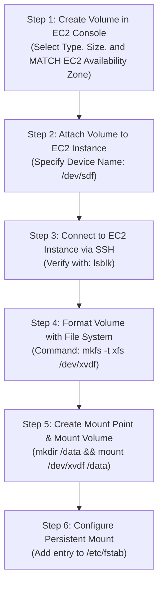
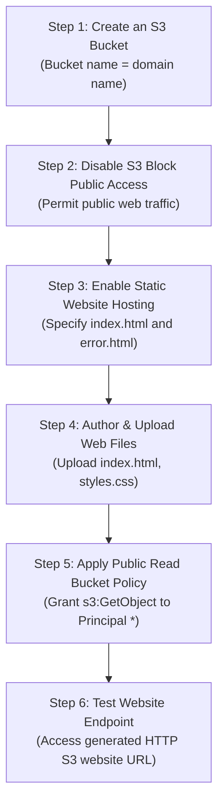
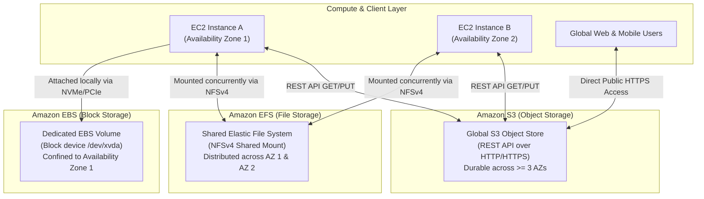
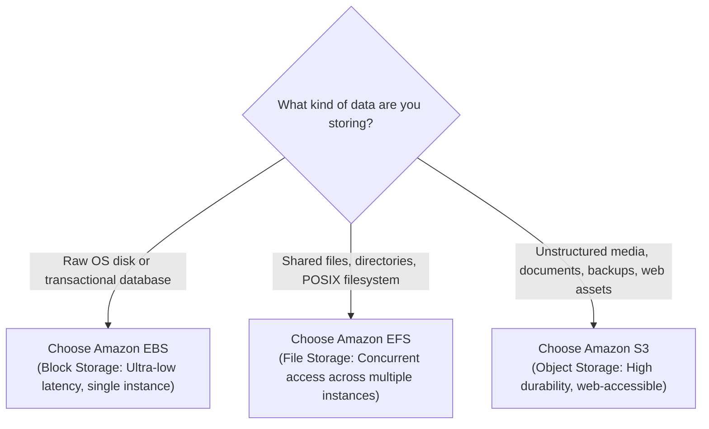
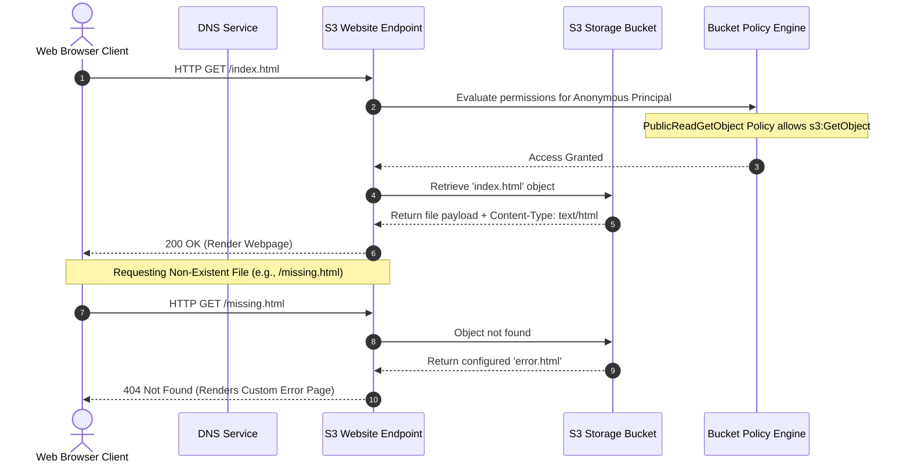

# Unit 4: Storage Services

---

# SECTION A – Very Short Answer Questions

---

## Q25. Define Object Storage.

**Definition:**

Object Storage is a data storage architecture that manages data as distinct, independent units called **objects**, rather than organizing data into a hierarchical directory tree (file storage) or raw disk sectors (block storage).

Each object consists of three components:
1. **The Data (Payload):** The raw file contents (e.g., image, video, document, or backup archive).
2. **Customizable Metadata:** Descriptive key-value pairs providing context (e.g., content-type, creation date, author, or resolution).
3. **Globally Unique Identifier (Key):** A unique key that allows the object to be retrieved directly across a flat address space via HTTP/HTTPS REST APIs.

**Example:**

**Amazon Simple Storage Service (Amazon S3)** is an object storage system where a file `invoice.pdf` is stored in a bucket and accessed directly via a unique URL: `https://my-bucket.s3.amazonaws.com/invoice.pdf`.

**Key Points:**
1. Flat storage structure without traditional nested folders.
2. Unlimited scalability capable of storing petabytes of data.
3. Accessible from anywhere over standard internet protocols (HTTP/HTTPS REST APIs).
4. Highly optimized for unstructured data (images, videos, backups, logs, and data lakes).
5. Provides high durability and availability through automatic geographic distribution.

---

## Q26. Differentiate between Block Storage and File Storage.

**Definition:**

Block Storage divides raw data into fixed-size chunks (blocks) accessed directly by an operating system as a raw drive, whereas File Storage organizes data hierarchically in files and folders accessible over a local network protocol.

| Feature | Block Storage | File Storage |
| :--- | :--- | :--- |
| **Storage Structure** | Raw, unformatted blocks of fixed size | Hierarchical file system (directories, subfolders, files) |
| **Access Protocol** | Fibre Channel, iSCSI, or PCIe/NVMe protocols | Network protocols: NFS (Linux) or SMB/CIFS (Windows) |
| **Server Attachment** | Attached directly to a **single** compute instance | Mounted concurrently across **hundreds or thousands** of instances |
| **Latency & Performance** | Ultra-low latency with high random read/write IOPS | Moderate latency with high shared throughput |
| **Operating System View** | Appears as a raw, blank physical hard drive | Appears as a shared network drive / mounted folder |
| **AWS Implementation** | **Amazon Elastic Block Store (Amazon EBS)** | **Amazon Elastic File System (Amazon EFS)** |
| **Typical Use Cases** | OS boot volumes, transactional databases (MySQL, Oracle) | Shared application storage, CMS media pools, dev repositories |

**Easy way to remember:**
- **Block Storage (EBS):** A dedicated internal hard drive plugged into one server.
- **File Storage (EFS):** A shared office network folder accessed by everyone simultaneously.

---

## Q27. What is Amazon S3?

**Definition:**

Amazon Simple Storage Service (Amazon S3) is an industry-leading, highly scalable, reliable, and secure cloud object storage service provided by AWS.

It is designed to store and retrieve any amount of data from anywhere on the internet, providing enterprise customers with high durability, comprehensive compliance features, and flexible data management.

**Example:**

A streaming application uses Amazon S3 to store millions of user profile pictures and video clips, providing instant public access via secure web URLs.

**Key Points:**
1. Delivers **99.999999999% (11 9s)** of data durability by automatically replicating data across at least three Availability Zones.
2. Virtually limitless storage capacity; individual objects can range from 0 bytes up to 5 TB.
3. Accessible over standard HTTP/HTTPS REST APIs.
4. Provides built-in features including Versioning, Lifecycle Policies, Server-Side Encryption, and Cross-Region Replication.
5. Offers multiple specialized storage classes optimized for different access patterns and cost budgets.

---

## Q28. What is an S3 bucket?

**Definition:**

An S3 bucket is a fundamental, top-level logical container used to store objects (files and metadata) within Amazon Simple Storage Service.

Every object stored in Amazon S3 resides inside a bucket. Buckets represent the root level of the S3 namespace and serve as the administrative unit for access control, geographic placement, billing, and lifecycle management.

**Example:**

A bucket named `company-financial-backups-2026` created in the `ap-south-1` (Mumbai) AWS Region.

**Key Points:**
1. Bucket names must be **globally unique** across all AWS accounts worldwide.
2. Naming convention follows strict DNS standards (3 to 63 lowercase characters, numbers, and hyphens).
3. Created in a specific AWS Region selected by the user; data never leaves that Region unless explicitly replicated.
4. Holds an unlimited number of objects.
5. Manages access control via Bucket Policies, Access Control Lists (ACLs), and IAM policies.

---

## Q29. Name any four Amazon S3 Storage Classes.

**Definition:**

Amazon S3 offers a range of storage classes designed to deliver the lowest-cost storage for different access patterns, performance requirements, and data retention durations.

**Four Major Amazon S3 Storage Classes:**

1. **Amazon S3 Standard:**
   - Designed for frequently accessed data requiring high throughput and low-latency access.
   - *Example:* Active website assets, streaming video files, and application data.

2. **Amazon S3 Standard-Infrequent Access (S3 Standard-IA):**
   - Designed for data accessed less frequently but requiring rapid, millisecond retrieval when needed. Offers lower storage costs than S3 Standard with a small per-GB retrieval fee.
   - *Example:* Disaster recovery backups and long-term document archives.

3. **Amazon S3 One Zone-Infrequent Access (S3 One Zone-IA):**
   - Designed for infrequently accessed data that does not require multi-AZ redundancy. Stored in a single Availability Zone at a 20% lower cost than Standard-IA.
   - *Example:* Secondary on-premises backup copies and easily reproducible image thumbnails.

4. **Amazon S3 Glacier Flexible Retrieval (formerly S3 Glacier):**
   - Low-cost archival storage class designed for data accessed once or twice a year, with retrieval times ranging from minutes (Expedited) to 3–5 hours (Standard).
   - *Example:* Annual tax compliance records and healthcare patient history archives.

*(Additional classes include **S3 Intelligent-Tiering** and **S3 Glacier Deep Archive**).*

---

## Q30. What is Amazon EBS?

**Definition:**

Amazon Elastic Block Store (Amazon EBS) is a high-performance, persistent block storage service designed for use with Amazon Elastic Compute Cloud (Amazon EC2) instances.

EBS provides block-level storage volumes that behave like raw, unformatted physical hard drives that can be formatted with any operating system file system (ext4, XFS, NTFS) and attached to running EC2 instances.

**Example:**

An 80 GB General Purpose SSD (`gp3`) EBS volume attached to an Amazon Linux EC2 instance as the primary root volume (`/dev/xvda`) hosting the OS and web application.

**Key Points:**
1. Provides block-level storage attached over a dedicated storage network to an EC2 instance.
2. Automatically replicates within its specific Availability Zone to prevent component failure.
3. Persists independently from the running instance (data remains intact when the EC2 instance is stopped).
4. Supports point-in-time automated snapshots backed up incrementally to Amazon S3.
5. Offers diverse volume types: General Purpose SSD (`gp3`, `gp2`), Provisioned IOPS SSD (`io2`, `io1`), Throughput Optimized HDD (`st1`), and Cold HDD (`sc1`).

---

## Q31. What is Amazon EFS?

**Definition:**

Amazon Elastic File System (Amazon EFS) is a serverless, fully managed, highly elastic shared file system service that provides simple, scalable network storage using the Network File System (NFSv4) protocol for AWS compute resources and on-premises servers.

It automatically grows and shrinks dynamically as files are added or removed without requiring manual storage provisioning or capacity management.

**Example:**

Mounting a single shared EFS file system concurrently across a cluster of 20 EC2 web instances running a WordPress Content Management System (CMS), ensuring all servers share the same uploaded media files.

**Key Points:**
1. Fully managed, serverless shared file system supporting the standard NFSv4.1/4.0 protocol.
2. Multi-Attach capability: Can be mounted simultaneously by thousands of EC2 instances, containers (ECS/EKS), or Lambda functions.
3. Automatically elastic: Scales capacity up to petabytes without provisioning or disruption.
4. Multi-AZ resilience: Stores data redundantly across multiple Availability Zones within a Region.
5. Fully POSIX-compliant file system supporting standard file-level read/write/execute permissions.

---

## Q32. What is static website hosting in Amazon S3?

**Definition:**

Static website hosting is an Amazon S3 feature that allows users to configure an S3 bucket to serve static client-side web content (HTML, CSS, client-side JavaScript, images, and fonts) directly to web browsers over HTTP without needing a web server or backend EC2 instance.

**Example:**

Hosting a modern React, Angular, or Vue.js Single Page Application (SPA) directly from an S3 bucket with an index document configured as `index.html` and an error document configured as `error.html`.

**Key Points:**
1. Serverless website hosting eliminating the cost and maintenance of web servers.
2. Only serves static assets; does not execute server-side scripts (e.g., PHP, Python, Java, or ASP.NET).
3. Provides a dedicated regional website endpoint URL (e.g., `http://mybucket.s3-website.ap-south-1.amazonaws.com`).
4. Highly scalable, capable of serving millions of concurrent web visitors automatically.
5. Can be paired with **Amazon CloudFront** to provide custom domain names, SSL/TLS encryption (HTTPS), and global caching.

---

# SECTION B – Short and Medium Answer Questions

---

## Q61. Explain the different types of cloud storage: Object Storage, Block Storage, and File Storage.

**Definition:**

Cloud storage enables organizations to store, access, and manage digital data over the internet. AWS categorizes storage into three foundational paradigms based on data structure, access protocols, and workload characteristics: **Object Storage**, **Block Storage**, and **File Storage**.

---

### 1. Object Storage (Amazon S3)
- **Architecture:** Organizes data into a flat address space without hierarchical folders. Each unit of data is stored as an **object** containing the file payload, customizable metadata, and a globally unique key.
- **Access Protocol:** Accessed via internet-standard HTTP/HTTPS REST API operations (`GET`, `PUT`, `DELETE`).
- **Characteristics:** Highly durable, virtually limitless capacity, write-once/read-many access pattern.
- **Best Suited For:** Unstructured data, media distribution, system backups, big data analytics lakes, and static website assets.

### 2. Block Storage (Amazon EBS)
- **Architecture:** Splits data into raw, fixed-size chunks called **blocks**. Each block has its own address but contains no metadata. The operating system formats these blocks with a filesystem (ext4, XFS, NTFS) and manages file placement directly.
- **Access Protocol:** Low-level storage protocols (NVMe, iSCSI) operating across a dedicated storage network.
- **Characteristics:** Ultra-low, sub-millisecond latency and high random Input/Output Operations Per Second (IOPS). Typically attached to a single virtual server.
- **Best Suited For:** Operating system boot volumes, transactional relational database management systems (RDBMS like MySQL, PostgreSQL, Oracle), and high-performance transactional engines.

### 3. File Storage (Amazon EFS)
- **Architecture:** Stores data in a traditional hierarchical file tree of directories, subdirectories, and files. Supports POSIX file system permissions and file locking.
- **Access Protocol:** Network File System protocols (NFSv4 for Linux or SMB for Windows via Amazon FSx).
- **Characteristics:** Allows hundreds or thousands of compute instances to mount and concurrently access the same shared storage repository.
- **Best Suited For:** Enterprise content management systems (WordPress, Drupal), shared home directories, big data processing, and container shared storage (ECS, EKS).

---

### Comprehensive 3-Way Storage Comparison Table:

| Feature | Object Storage (Amazon S3) | Block Storage (Amazon EBS) | File Storage (Amazon EFS) |
| :--- | :--- | :--- | :--- |
| **Data Hierarchy** | Flat namespace (Key-Value) | Raw unformatted blocks | Hierarchical directory tree |
| **Access Method** | HTTP/HTTPS REST APIs | Block-level storage protocol (NVMe) | Network File System (NFSv4) |
| **Server Concurrency** | Accessible by millions of web clients | Dedicated to 1 instance (limited Multi-Attach) | Mounted simultaneously by thousands of servers |
| **Latency** | Milliseconds (100–200 ms) | Ultra-low Sub-millisecond (< 1 ms) | Low single-digit milliseconds (1–3 ms) |
| **Scalability** | Virtually unlimited (automatic) | Up to 64 TB per individual volume | Elastic (petabytes; grows/shrinks automatically) |
| **Durability Model** | Multi-AZ (99.999999999% - 11 9s) | Single Availability Zone replication | Multi-AZ redundancy across Region |
| **Cost Model** | Pay per GB stored + requests | Pay for provisioned GB capacity | Pay only for actual GB consumed |

**Conclusion:**

Selecting the appropriate cloud storage model depends on performance requirements: use **EBS** for dedicated low-latency server disks, **EFS** for multi-server shared file systems, and **S3** for scalable, durable unstructured object data.

---

## Q62. Explain Amazon S3 architecture and its major features.

**Definition:**

Amazon Simple Storage Service (Amazon S3) is an object storage service designed to provide 99.999999999% (11 9s) durability, high scalability, and fine-grained access control for unstructured cloud data.

---

### Architectural Foundations of Amazon S3:

1. **Buckets:**
   - Top-level containers that hold objects.
   - Names must be globally unique across all AWS accounts worldwide.
   - Assigned to a specific AWS Region to ensure data residency compliance.
2. **Objects:**
   - The fundamental entities stored in Amazon S3.
   - An object consists of:
     - **Key:** The name/path of the object (e.g., `images/products/item1.png`).
     - **Value:** The data payload (bytes ranging from 0 bytes up to 5 TB).
     - **Version ID:** Unique identifier used when versioning is enabled.
     - **Metadata:** System metadata (file size, MD5 hash) and user-defined key-value tags.
     - **Access Control Information:** Object-level permissions and ownership metadata.
3. **Flat Hierarchy with Key Prefixes:**
   - S3 does not use physical folders. Forward slashes (`/`) in object keys act as **prefixes**, allowing management consoles and APIs to simulate a folder structure logically.

---

### Major Features of Amazon S3:

1. **Extreme Data Durability (11 9s):**
   - Automatically stores redundant copies of objects across a minimum of three geographically separated Availability Zones within an AWS Region, delivering 99.999999999% annual durability.

2. **S3 Versioning:**
   - Keeps multiple historical variants of an object in the same bucket.
   - Protects against accidental user deletion and unintended overwrites by preserving previous versions with unique Version IDs.
   - Deleting an object creates a **Delete Marker**, allowing easy file restoration.

3. **Lifecycle Management:**
   - Automated rules that manage objects throughout their lifetime:
     - **Transition Actions:** Moves older objects to lower-cost storage classes (e.g., move to S3 Standard-IA after 30 days, and to S3 Glacier after 90 days).
     - **Expiration Actions:** Permanently deletes expired objects after a specified period (e.g., delete log files after 365 days).

4. **Robust Security & Encryption:**
   - **Encryption at Rest:**
     - *SSE-S3:* Server-side encryption managed with S3 keys.
     - *SSE-KMS:* Encryption managed with AWS Key Management Service keys.
     - *SSE-C:* Server-side encryption using customer-provided keys.
   - **Access Control:** Managed via IAM policies, S3 Bucket Policies, and S3 Block Public Access (which prevents accidental public data exposure).

5. **Static Website Hosting:**
   - Serves static HTML, CSS, JavaScript, and client-side web assets directly over HTTP without requiring web servers.

6. **Cross-Region Replication (CRR) & Same-Region Replication (SRR):**
   - Automatically copies objects asynchronously between different AWS Regions or within the same Region for disaster recovery and compliance.

7. **S3 Event Notifications:**
   - Emits automated event messages when objects are created, removed, or restored, triggering serverless compute services such as AWS Lambda, Amazon SQS, or Amazon SNS.

**Conclusion:**

Amazon S3's combination of high durability, comprehensive lifecycle automation, fine-grained security, and native cloud integrations makes it the primary storage foundation for modern cloud architectures.

---

## Q63. Describe different Amazon S3 Storage Classes and their use cases.

**Definition:**

Amazon S3 offers a tiered portfolio of storage classes engineered to match data storage costs with varying access frequencies, retrieval speeds, and redundancy requirements.

---

### Detailed Analysis of S3 Storage Classes:

#### 1. S3 Standard
- **Access Pattern:** Frequently accessed data requiring high throughput and low-latency access.
- **Redundancy:** Multi-AZ (>= 3 AZs).
- **Use Cases:** Active websites, dynamic cloud applications, media streaming libraries, and gaming assets.

#### 2. S3 Intelligent-Tiering
- **Access Pattern:** Unknown, unpredictable, or changing data access patterns.
- **Mechanism:** Automatically monitors access patterns and moves data between two access tiers (Frequent Access and Infrequent Access) without performance impact or retrieval fees.
- **Use Cases:** New applications, data lakes, and user-generated content with unpredictable usage.

#### 3. S3 Standard-Infrequent Access (S3 Standard-IA)
- **Access Pattern:** Data accessed less frequently but requiring millisecond retrieval when needed.
- **Cost Structure:** Lower storage price per GB than S3 Standard, but incurs a small per-GB data retrieval charge.
- **Use Cases:** Long-term backups, disaster recovery environments, and older application files.

#### 4. S3 One Zone-Infrequent Access (S3 One Zone-IA)
- **Access Pattern:** Infrequently accessed data that does not require multi-AZ resilience.
- **Redundancy:** Stored in a single Availability Zone (data is lost if that specific AZ fails).
- **Cost Structure:** 20% cheaper than S3 Standard-IA.
- **Use Cases:** Inexpensive secondary backups, reproducible image thumbnails, and non-critical data.

#### 5. S3 Glacier Instant Retrieval
- **Access Pattern:** Archival data accessed once or twice a quarter requiring immediate, millisecond retrieval.
- **Use Cases:** Medical imaging, news media archives, and financial transaction records.

#### 6. S3 Glacier Flexible Retrieval (formerly S3 Glacier)
- **Access Pattern:** Long-term archival data accessed a few times a year.
- **Retrieval Times:** Expedited (1–5 minutes), Standard (3–5 hours), Bulk (5–12 hours).
- **Use Cases:** Regulatory audit archives, legal records, and end-of-year financial reporting.

#### 7. S3 Glacier Deep Archive
- **Access Pattern:** Lowest-cost cloud storage designed for long-term data retention (7–10+ years), accessed rarely (once every few years).
- **Retrieval Times:** Standard (12 hours), Bulk (48 hours).
- **Use Cases:** Government compliance, oil and gas exploration logs, and scientific research data.

---

### S3 Storage Classes Comparison Matrix:

| Storage Class | Durability | Availability | Availability Zones | Min Storage Duration | Retrieval Time | Cost Profile |
| :--- | :--- | :--- | :--- | :--- | :--- | :--- |
| **S3 Standard** | 99.999999999% | 99.99% | >= 3 AZs | None | Milliseconds | Highest storage cost, free retrieval |
| **S3 Intelligent-Tiering**| 99.999999999% | 99.9% | >= 3 AZs | None | Milliseconds | Automated optimization fee |
| **S3 Standard-IA** | 99.999999999% | 99.9% | >= 3 AZs | 30 days | Milliseconds | Lower storage cost + retrieval fee |
| **S3 One Zone-IA** | 99.999999999% | 99.5% | **1 AZ** | 30 days | Milliseconds | 20% cheaper than Standard-IA |
| **S3 Glacier Instant** | 99.999999999% | 99.9% | >= 3 AZs | 90 days | Milliseconds | Very low storage + retrieval fee |
| **S3 Glacier Flexible** | 99.999999999% | 99.9% | >= 3 AZs | 90 days | Minutes to hours | Extremely low storage cost |
| **S3 Glacier Deep Archive**| 99.999999999% | 99.9% | >= 3 AZs | 180 days | 12 to 48 hours | Lowest cost ($0.00099 / GB/mo) |

**Conclusion:**

By configuring automated S3 Lifecycle policies, organizations can automatically transition data from S3 Standard down to S3 Glacier Deep Archive over time, optimizing storage costs throughout the data lifecycle.

---

## Q64. Explain Amazon EBS and describe the process of creating and attaching an EBS volume to an EC2 instance.

**Definition:**

Amazon Elastic Block Store (Amazon EBS) provides persistent, high-performance block-level storage volumes designed for use with Amazon EC2 instances. EBS volumes operate like physical unformatted disk drives connected to an instance over a dedicated storage network.

---

### Major EBS Volume Types:

1. **General Purpose SSD (`gp3` / `gp2`):** Balanced price and performance for boot volumes, virtual desktops, and medium-sized databases. (`gp3` delivers a baseline 3,000 IOPS and 125 MB/s throughput independently of storage capacity).
2. **Provisioned IOPS SSD (`io2` / `io1`):** Sub-millisecond latency engineered for mission-critical I/O-intensive workloads and large relational databases.
3. **Throughput Optimized HDD (`st1`):** Low-cost magnetic storage optimized for frequently accessed, throughput-intensive sequential workloads (Big Data, MapReduce, log processing).
4. **Cold HDD (`sc1`):** Lowest-cost magnetic storage designed for infrequently accessed, large sequential datasets.

---

### Step-by-Step Procedure: Creating and Attaching an EBS Volume



#### Step 1: Create the EBS Volume in the AWS Console
1. Open the **Amazon EC2 Console** and click **Volumes** under **Elastic Block Store**.
2. Click **Create volume**.
3. Configure settings:
   - **Volume type:** Select *General Purpose SSD (`gp3`)*.
   - **Size (GiB):** Enter desired size (e.g., `50 GiB`).
   - **Availability Zone:** **CRITICAL:** You must select the **exact same Availability Zone** where your EC2 instance is running (e.g., `ap-south-1a`).
4. Click **Create volume**.

#### Step 2: Attach the Volume to the EC2 Instance
1. Select the newly created volume in the list.
2. Click **Actions** -> **Attach volume**.
3. Under **Instance**, choose your target EC2 instance.
4. Under **Device name**, keep the suggested device name (e.g., `/dev/sdf` or `/dev/xvdf`).
5. Click **Attach volume**.

#### Step 3: Format and Mount the Volume on the Linux Operating System
1. Connect to the EC2 instance via SSH:
   ```bash
   ssh -i my-key.pem ec2-user@<instance-public-ip>
   ```
2. Check available block devices to confirm the new disk is attached:
   ```bash
   lsblk
   ```
3. Check if the volume contains an existing filesystem:
   ```bash
   sudo file -s /dev/xvdf
   # If output shows 'data', the device is raw and unformatted.
   ```
4. Format the volume with an XFS or ext4 filesystem:
   ```bash
   sudo mkfs -t xfs /dev/xvdf
   ```
5. Create a target directory to serve as the mount point:
   ```bash
   sudo mkdir /data
   ```
6. Mount the formatted volume:
   ```bash
   sudo mount /dev/xvdf /data
   ```

#### Step 4: Configure Automatic Mounting on Reboot (`/etc/fstab`)
1. Find the unique Universally Unique Identifier (UUID) of the volume:
   ```bash
   sudo blkid
   ```
2. Open `/etc/fstab` and add the mount configuration entry:
   ```text
   UUID=1234-5678-abcd    /data    xfs    defaults,nofail    0    2
   ```
   *(The `nofail` flag ensures the server boots normally even if the storage volume is detached).*

**Conclusion:**

This process provides dedicated block storage to an EC2 instance, enabling high-performance local disk operations for databases and applications.

---

## Q65. Explain Amazon EFS and its major features.

**Definition:**

Amazon Elastic File System (Amazon EFS) is a serverless, fully managed, highly scalable shared file system service designed for use with AWS compute services (Amazon EC2, AWS Lambda, Amazon ECS, Amazon EKS) and on-premises environments.

EFS provides standard network file storage using the Network File System (NFSv4.1/4.0) protocol, supporting standard POSIX file permissions.

---

### Major Features of Amazon EFS:

1. **Elastic and Serverless Scalability:**
   - Automatically grows and shrinks dynamically as files are written and deleted.
   - Requires no capacity provisioning or volume resizing; you pay only for the storage space actually used.

2. **Multi-AZ Durability and High Availability:**
   - Automatically stores every file across multiple Availability Zones in an AWS Region, delivering 99.999999999% (11 9s) of data durability.

3. **Concurrent Shared Access:**
   - Can be mounted concurrently by **thousands of EC2 instances** across different Availability Zones, allowing distributed applications to share a unified storage repository.

4. **Performance Modes:**
   - **General Purpose Mode:** Optimized for latency-sensitive operations (ideal for web hosting environments, CMS platforms, and general file shares).
   - **Max I/O Mode:** Optimized for high-throughput, horizontally scaled workloads requiring aggregate throughput across hundreds of nodes (big data, media analysis).

5. **Throughput Modes:**
   - **Elastic Throughput (Default):** Automatically scales read and write throughput up or down to match unpredictable workload demands.
   - **Provisioned Throughput:** Guarantees a dedicated throughput level (MB/s) regardless of total stored data size.

6. **Automatic Cost Optimization (EFS Lifecycle Management):**
   - Automatically migrates files not accessed for a specified period (e.g., 30 days) to the **EFS Infrequent Access (EFS IA)** storage tier, reducing storage costs by up to 92%.

7. **POSIX Compliance:**
   - Supports traditional file system capabilities including user/group read-write permissions, symbolic links, file locking, and directory structures.

### Common Use Cases:
- **Web Serving & CMS Platforms:** Shared media pools and upload folders for clustered WordPress and Drupal sites.
- **Container Persistence:** Shared storage for microservices containers running on Amazon ECS and EKS.
- **Enterprise Shared Directories:** Centralized shared home directories and developer environments.

**Conclusion:**

Amazon EFS provides a serverless, POSIX-compliant shared file storage solution that eliminates storage capacity planning while enabling multi-instance concurrent access.

---

## Q66. Differentiate between Amazon S3, Amazon EBS, and Amazon EFS.

**Definition:**

Amazon S3, Amazon EBS, and Amazon EFS represent the three foundational storage pillars of AWS. Each service is tailored for distinct access patterns, protocols, performance needs, and architectural tiers.

### Comprehensive Comparison Matrix:

| Feature / Criteria | Amazon S3 | Amazon EBS | Amazon EFS |
| :--- | :--- | :--- | :--- |
| **Storage Paradigm** | **Object Storage** | **Block Storage** | **File Storage** |
| **Data Hierarchy** | Flat address space (Key, Value, Metadata) | Raw, unformatted data blocks | Hierarchical directory and folder tree |
| **Access Protocol** | HTTP / HTTPS (REST API) | Storage protocol (NVMe, iSCSI) | Network File System (NFSv4.1/4.0) |
| **Geographic Scope** | **Regional** (replicated across >= 3 AZs) | **Availability Zone specific** | **Regional** (replicated across >= 3 AZs) |
| **Compute Concurrency** | Millions of concurrent internet/cloud clients | Attached to **single** EC2 instance | Mounted concurrently by **thousands** of EC2 instances |
| **Latency Profile** | High (~100–200 ms) | Ultra-low Sub-millisecond (< 1 ms) | Low single-digit milliseconds (~1–3 ms) |
| **Capacity Sizing** | Virtually limitless; up to 5 TB per object | Fixed allocation (up to 64 TB per volume) | Elastic; scales automatically to petabytes |
| **File System Formats** | None (accessed via API) | Formatted by OS (ext4, XFS, NTFS) | POSIX-compliant shared file system |
| **Pricing Model** | Pay per GB stored + API request fees | Pay for provisioned GB capacity | Pay only for consumed GB storage |
| **Best Architectural Role** | Backups, static websites, data lakes | OS boot disks, relational databases | Shared application media, web CMS clusters |

### Memory Trick:
- **Amazon S3:** Think of a **cloud safety deposit box** for unlimited documents and media files.
- **Amazon EBS:** Think of a **high-speed internal SSD** plugged directly into your personal computer.
- **Amazon EFS:** Think of a **shared corporate network drive** that everyone in the building accesses at once.

**Conclusion:**

Use **EBS** for dedicated single-server performance and databases, **EFS** for scalable multi-server shared file systems, and **S3** for durable, internet-accessible object storage.

---

## Q67. Explain the procedure for hosting a static website using Amazon S3.

**Definition:**

Static website hosting using Amazon S3 is a serverless architecture where an S3 bucket is configured to serve static assets—such as HTML, CSS, client-side JavaScript, images, and audio—directly to web browsers over HTTP without running an EC2 web server.

---

### Step-by-Step Procedure:



#### Step 1: Create the S3 Bucket
1. Open the **Amazon S3 Console** and click **Create bucket**.
2. **Bucket name:** Enter a globally unique name (e.g., `my-student-exam-site-2026`).
3. **AWS Region:** Select your preferred AWS Region (e.g., `ap-south-1`).
4. Click **Create bucket**.

#### Step 2: Disable "Block Public Access" Settings
1. Select the newly created bucket and navigate to the **Permissions** tab.
2. Under **Block public access (bucket settings)**, click **Edit**.
3. Uncheck **Block all public access**.
4. Click **Save changes** and type `confirm` in the dialog box.

#### Step 3: Enable Static Website Hosting
1. Navigate to the **Properties** tab.
2. Scroll to the bottom to find the **Static website hosting** panel and click **Edit**.
3. Choose **Enable**.
4. Set **Hosting type:** *Host a static website*.
5. In **Index document**, enter `index.html`.
6. In **Error document**, enter `error.html`.
7. Click **Save changes**.
8. Note the generated **Bucket website endpoint URL** (e.g., `http://my-student-exam-site-2026.s3-website.ap-south-1.amazonaws.com`).

#### Step 4: Author and Upload Website Content
1. Create a simple `index.html` file on your computer:
   ```html
   <!DOCTYPE html>
   <html>
   <head><title>AWS S3 Static Website</title></head>
   <body>
       <h1>Welcome to My AWS S3 Hosted Website!</h1>
       <p>This page is hosted serverlessly on Amazon Simple Storage Service.</p>
   </body>
   </html>
   ```
2. Create an `error.html` fallback file:
   ```html
   <!DOCTYPE html>
   <html>
   <head><title>Error</title></head>
   <body><h1>404: Page Not Found</h1></body>
   </html>
   ```
3. In the S3 Console, go to the **Objects** tab, click **Upload**, and upload both files into the bucket.

#### Step 5: Configure a Public Read Bucket Policy
1. Navigate to the **Permissions** tab and scroll to **Bucket policy**, then click **Edit**.
2. Paste the following JSON policy to grant public read permissions for all objects in the bucket:
   ```json
   {
       "Version": "2012-10-17",
       "Statement": [
           {
               "Sid": "PublicReadGetObject",
               "Effect": "Allow",
               "Principal": "*",
               "Action": "s3:GetObject",
               "Resource": "arn:aws:s3:::my-student-exam-site-2026/*"
           }
       ]
   }
   ```
   *(Ensure you replace `my-student-exam-site-2026` with your actual bucket name).*
3. Click **Save changes**.

#### Step 6: Verify and Test the Website
1. Copy the **Bucket website endpoint URL** from the Properties tab.
2. Open a web browser, paste the URL, and press Enter.
3. The browser renders your `index.html` file successfully.

**Conclusion:**

Hosting static websites on Amazon S3 provides high scalability and availability at a fraction of the cost of running dedicated compute servers.

---

# SECTION C – Long Answer Questions

---

## Q90. Explain Amazon S3 in detail. Describe its architecture, buckets, objects, storage classes, features, and applications.

### 1. Introduction to Amazon S3

Amazon Simple Storage Service (Amazon S3) is an object storage service engineered for industry-leading scalability, data availability, security, and performance.

Introduced in 2006 as one of AWS's first public cloud services, S3 has grown to store tens of trillions of objects and exabytes of data. It addresses the limitations of traditional file and block systems by providing an internet-accessible, durable data store for unstructured content.

---

### 2. S3 Core Architecture: Buckets, Objects, and Keys

```mermaid
graph TB
    subgraph S3Global["Amazon S3 Global Namespace"]
        subgraph Bucket["S3 Bucket: 'enterprise-data-repo' (Region: ap-south-1)"]
            
            subgraph Obj1["Object 1"]
                Key1["Key: images/logo.png"]
                Val1["Payload: 150 KB Binary Data"]
                Meta1["Metadata: Content-Type: image/png"]
                Ver1["Version ID: v3.1"]
            end

            subgraph Obj2["Object 2"]
                Key2["Key: reports/2026-summary.pdf"]
                Val2["Payload: 2.4 MB Binary Data"]
                Meta2["Metadata: Department: Finance"]
                Ver2["Version ID: v1.0"]
            end

            subgraph Policies["Bucket Control Infrastructure"]
                BP["Bucket Policy & ACLs"]
                LC["Lifecycle Automation Engine"]
                ENC["Encryption (SSE-KMS / SSE-S3)"]
            end

        end
    end

    Clients["Web Clients / Mobile Apps / EC2"] <-->|HTTP/HTTPS REST API (GET / PUT / DELETE)| Bucket
```

**Text Representation:**
```text
+-------------------------------------------------------------------------+
|                  Amazon S3 Global Storage Infrastructure                |
|                                                                         |
|  +-------------------------------------------------------------------+  |
|  |  S3 Bucket: 'enterprise-data-repo' (Region: ap-south-1)           |  |
|  |                                                                   |  |
|  |   [ Object 1 ]                                                    |  |
|  |     - Key: images/logo.png                                        |  |
|  |     - Value: Binary Image Data (150 KB)                           |  |
|  |     - Metadata: Content-Type: image/png, Cache-Control: max-age   |  |
|  |     - Version ID: 11002233                                        |  |
|  |                                                                   |  |
|  |   [ Object 2 ]                                                    |  |
|  |     - Key: reports/2026-summary.pdf                               |  |
|  |     - Value: Binary Document Data (2.4 MB)                        |  |
|  |     - Metadata: Author: Finance Team, Classification: Internal    |  |
|  |     - Version ID: 44556677                                        |  |
|  |                                                                   |  |
|  |   [ Bucket Management Engine ]                                    |  |
|  |     - Bucket Policies & Public Access Block                       |  |
|  |     - Lifecycle Transition & Expiration Rules                     |  |
|  |     - Server-Side Encryption (SSE-S3 / SSE-KMS)                   |  |
|  +-------------------------------------------------------------------+  |
+-------------------------------------------------------------------------+
         ^
         | HTTP REST Operations (GET, PUT, POST, DELETE)
         v
[ Internet Clients / EC2 Applications / AWS Lambda / Analytics Clusters ]
```

#### Core Components Explained:
1. **Buckets:**
   - The fundamental logical containers for objects.
   - Names must be unique across the entire global AWS namespace.
   - Serve as the administrative boundary for access control policies, lifecycle rules, replication, and billing.
2. **Objects:**
   - Individual data files and associated metadata.
   - S3 objects range from **0 bytes to 5 TB** in size.
3. **Keys:**
   - The complete path string that identifies an object within a bucket (e.g., `development/logs/app.log`). Forward slashes create logical prefixes that simulate folders in the console.
4. **Metadata:**
   - Key-value pairs providing information about the object. System metadata includes file size, last modified date, and MD5 checksum. Custom metadata can be added by applications.

---

### 3. S3 Storage Classes

| Storage Class | Durability | Availability | AZ Redundancy | Minimum Duration | Retrieval Latency | Primary Use Case |
| :--- | :--- | :--- | :--- | :--- | :--- | :--- |
| **S3 Standard** | 99.999999999% | 99.99% | >= 3 AZs | None | Milliseconds | Active web assets, gaming media |
| **S3 Intelligent-Tiering** | 99.999999999% | 99.9% | >= 3 AZs | None | Milliseconds | Dynamic data with unknown access patterns |
| **S3 Standard-IA** | 99.999999999% | 99.9% | >= 3 AZs | 30 days | Milliseconds | Long-term backups, disaster recovery |
| **S3 One Zone-IA** | 99.999999999% | 99.5% | 1 AZ | 30 days | Milliseconds | Reproducible secondary backup copies |
| **S3 Glacier Instant** | 99.999999999% | 99.9% | >= 3 AZs | 90 days | Milliseconds | Medical imaging, news media archives |
| **S3 Glacier Flexible** | 99.999999999% | 99.9% | >= 3 AZs | 90 days | Minutes to hours | Annual compliance archives |
| **S3 Glacier Deep Archive**| 99.999999999% | 99.9% | >= 3 AZs | 180 days | 12 to 48 hours | Long-term digital preservation |

---

### 4. Advanced Features of Amazon S3

1. **S3 Versioning & MFA Delete:**
   - Tracks and preserves historical versions of every object.
   - Accidental deletion only places a **Delete Marker** on the object; historical versions remain intact and can be restored.
   - **MFA Delete** requires multi-factor authentication to permanently delete object versions or change bucket versioning configurations.

2. **Automated Lifecycle Management:**
   - Defines transition rules that automatically cascade objects into progressively lower-cost storage tiers over time (e.g., Standard -> Standard-IA after 30 days -> Glacier after 90 days -> Expire after 365 days).

3. **Multi-Layered Security & Encryption:**
   - **Encryption in Transit:** Enforced using HTTPS (TLS).
   - **Encryption at Rest:**
     - `SSE-S3`: Keys managed by Amazon S3.
     - `SSE-KMS`: Keys managed by AWS Key Management Service (supports audit logging).
     - `SSE-C`: Keys managed and supplied by the customer.
   - **S3 Block Public Access:** A centralized safeguard that overrides bucket policies to prevent public data leaks.

4. **Replication Capabilities:**
   - **Cross-Region Replication (CRR):** Automatically replicates objects to another AWS Region for geographic compliance and disaster recovery.
   - **Same-Region Replication (SRR):** Replicates objects within the same Region between different accounts for log aggregation.

5. **Multipart Upload & Transfer Acceleration:**
   - **Multipart Upload:** Breaks files larger than 100 MB into parallel parts, uploading them concurrently and reassembling them upon completion, improving upload speed and reliability.
   - **S3 Transfer Acceleration:** Routes uploads through the global network of AWS Edge Locations, accelerating transfers over long geographical distances.

---

### 5. Enterprise Applications of Amazon S3

1. **Data Lakes and Big Data Analytics:**
   - Serves as the central repository for unstructured and semi-structured big data, queried directly in place using services like **Amazon Athena** and **Amazon Redshift Spectrum**.
2. **Backup and Disaster Recovery:**
   - Provides a durable, off-site cloud repository for database dumps, filesystem snapshots, and system images.
3. **Media Hosting and Distribution:**
   - Stores master video, audio, and high-resolution photo libraries delivered globally through Amazon CloudFront.
4. **Serverless Application Storage:**
   - Decoupled object storage layer for AWS Lambda microservices and containerized backends.

### Conclusion

Amazon S3's 11 9s durability, flexible storage classes, automated lifecycle management, and strong security make it the foundational object storage platform for cloud applications.

---

## Q91. Explain the differences between Amazon S3, EBS, and EFS in detail. Discuss their architectures, use cases, advantages, and limitations.

### 1. Introduction

Storage architecture is a critical design decision in cloud computing. AWS provides three distinct storage services, each optimized for different performance profiles, access patterns, and architectural tiers:
- **Amazon EBS:** Dedicated block storage for high-performance single-server compute.
- **Amazon EFS:** Shared file storage for multi-server, concurrent POSIX-compliant operations.
- **Amazon S3:** Scalable, durable object storage for internet-accessible unstructured data.

---

### 2. Tri-Storage Comparative Architecture Diagram



**Text Representation:**
```text
+------------------------------------------------------------------------------------+
|                                    AWS REGION                                      |
|                                                                                    |
|  [ Availability Zone 1 ]                     [ Availability Zone 2 ]               |
|   +-------------------+                       +-------------------+                |
|   |  EC2 Instance A   |                       |  EC2 Instance B   |                |
|   +-------------------+                       +-------------------+                |
|       |           \                               /           |                    |
|       | (NVMe)     \ (NFSv4)             (NFSv4) /            |                    |
|       v             v                           v             |                    |
|  +---------+   +-------------------------------------+        |                    |
|  | Amazon  |   |            Amazon EFS               |        |                    |
|  | EBS     |   |   (Shared POSIX File System)        |        |                    |
|  | (Local) |   |   Concurrent read/write across AZs  |        |                    |
|  +---------+   +-------------------------------------+        |                    |
|                                                               |                    |
|         +-----------------------------------------------------+                    |
|         | REST API over HTTP/HTTPS (GET / PUT / DELETE)                            |
|         v                                                                          |
|  +------------------------------------------------------------------------------+  |
|  |                                  Amazon S3                                   |  |
|  |                        (Global Object Storage Store)                         |  |
|  |             Durability: 99.999999999% across 3+ Availability Zones           |  |
|  +------------------------------------------------------------------------------+  |
+------------------------------------------------------------------------------------+
                                           ^
                                           | Direct Internet Access (HTTPS)
                                [ Global Internet Clients ]
```

---

### 3. Detailed Technical Comparison Matrix

| Evaluation Dimension | Amazon EBS | Amazon EFS | Amazon S3 |
| :--- | :--- | :--- | :--- |
| **Storage Architecture** | Block-level storage | File-level storage (hierarchical) | Object-level storage (flat) |
| **Access Protocol** | Block device protocol (NVMe) | Network File System (NFSv4) | HTTP / HTTPS REST APIs |
| **Scope / Boundary** | Availability Zone specific | Regional (Multi-AZ) | Regional (Multi-AZ) |
| **Maximum Concurrency** | Single EC2 instance (limited Multi-Attach) | Thousands of EC2 instances / containers | Millions of internet / cloud callers |
| **Latency** | Sub-millisecond (< 1 ms) | Low single-digit ms (~1–3 ms) | High (100–200 ms) |
| **Throughput / IOPS** | Up to 256,000 IOPS & 4,000 MB/s | Up to 10+ GB/s aggregate throughput | High throughput via parallel requests |
| **Capacity Sizing** | Static allocation (up to 64 TB) | Elastic; scales dynamically (petabytes) | Virtually limitless (5 TB max per object) |
| **File System Formats** | Formatted by OS (ext4, XFS, NTFS) | Native POSIX compliant | None (accessed via REST API) |
| **Cost Basis** | Provisioned capacity (GB/month) | Consumed capacity (GB/month) | Stored capacity + API requests |

---

### 4. In-Depth Analysis: Advantages, Limitations, and Use Cases

#### A. Amazon Elastic Block Store (EBS)
- **Advantages:**
  - Ultra-low latency and dedicated throughput for I/O-intensive workloads.
  - Independent lifecycle from the compute instance (persists through instance reboots).
  - Snapshot integration with Amazon S3 for point-in-time recovery.
- **Limitations:**
  - Confined to a single Availability Zone (cannot attach across AZs).
  - You pay for provisioned capacity regardless of whether it is fully utilized.
- **Primary Use Cases:**
  - EC2 boot volumes, transactional relational databases (MySQL, Oracle, PostgreSQL), and NoSQL primary stores (MongoDB, Cassandra).

#### B. Amazon Elastic File System (EFS)
- **Advantages:**
  - True multi-instance concurrent read and write access across multiple AZs.
  - Serverless and elastic (no pre-provisioning required; grows and shrinks automatically).
  - POSIX compliance allows existing file-based software to run without modification.
- **Limitations:**
  - Higher latency than EBS (network-attached overhead).
  - More expensive per GB stored than EBS General Purpose SSD.
- **Primary Use Cases:**
  - Clustered web applications (WordPress, Drupal media pools), container persistent storage (Kubernetes / EKS), and shared developer home directories.

#### C. Amazon Simple Storage Service (S3)
- **Advantages:**
  - 99.999999999% (11 9s) durability across multiple Availability Zones.
  - Lowest cost per GB among the three services.
  - Directly accessible from anywhere on the internet over secure HTTP/HTTPS.
- **Limitations:**
  - High latency unsuitable for operating systems or transactional database engines.
  - Objects are immutable (cannot modify a byte in place; modifying an object requires rewriting the entire file).
- **Primary Use Cases:**
  - Cloud data lakes, static website hosting, digital media streaming libraries, system backups, and disaster recovery archives.

---

### 5. Architectural Decision Framework



### 6. Real-World Multi-Tier Cloud Architecture Example

In a production e-commerce application:
1. **Amazon EBS** powers the root boot volume and the high-transaction database engine, delivering sub-millisecond write speeds for customer orders.
2. **Amazon EFS** provides shared media and configuration storage across a fleet of auto-scaled EC2 application servers running in private subnets.
3. **Amazon S3** stores product images, invoice PDFs, system backups, and data lake logs, serving static assets to users globally via Amazon CloudFront.

### Conclusion

Modern cloud architectures rarely use a single storage type. Instead, they combine Amazon EBS for fast local disk access, Amazon EFS for multi-server shared file systems, and Amazon S3 for scalable, cost-effective object storage.

---

## Q92. Describe the complete procedure for hosting a static website using Amazon S3. Explain bucket creation, object uploading, static website configuration, permissions, and website access.

### 1. Introduction

Static website hosting using Amazon Simple Storage Service (Amazon S3) is a serverless hosting solution that eliminates the operational overhead of provisioning, patching, and managing traditional web servers like Apache or Nginx.

An Amazon S3 bucket can be configured to act as an HTTP web server, serving client-side assets (HTML5, CSS3, JavaScript, web fonts, images, and videos) directly to browsers.

---

### 2. Architecture and Request Flow Diagram



**Text Representation:**
```text
[ Web Browser Client ]
        |
        | 1. HTTP GET request (http://bucket-name.s3-website.region.amazonaws.com)
        v
+-----------------------------------------------------------------------------+
| Amazon S3 Static Website Hosting Engine                                     |
|                                                                             |
|   Step A: Check Bucket Policy (Is anonymous s3:GetObject allowed?)          |
|   Step B: Locate Document:                                                  |
|           - Root URL request  ==> Serves 'index.html' (200 OK)              |
|           - File Not Found    ==> Serves 'error.html' (404 Error Page)      |
+-----------------------------------------------------------------------------+
        |
        | 2. Fetches stored object payload from storage
        v
+-----------------------------------------------------------------------------+
| S3 Storage Bucket Repository                                                |
|   [ index.html ]   [ error.html ]   [ style.css ]   [ logo.png ]            |
+-----------------------------------------------------------------------------+
```

---

### 3. Comprehensive Step-by-Step Implementation Guide

#### Phase 1: Bucket Creation & Global Configuration
1. Sign in to the **AWS Management Console** and navigate to the **Amazon S3 Console**.
2. Click **Create bucket**.
3. **Bucket Name:**
   - Enter a globally unique name (e.g., `www.student-exam-cloud-2026.com`).
   - *Note:* If using a custom domain with Route 53, the bucket name should match your registered domain name.
4. **AWS Region:** Select an appropriate AWS Region (e.g., `ap-south-1` for Mumbai).
5. **Object Ownership:** Select *ACLs disabled (recommended)* to ensure all object access is controlled through modern Bucket Policies.
6. Click **Create bucket**.

---

#### Phase 2: Disabling "Block Public Access"
By default, AWS automatically applies a four-point safeguard that prevents any public access to S3 buckets. To host a public website, this safeguard must be relaxed for this bucket:
1. Click on your newly created bucket to open its details.
2. Navigate to the **Permissions** tab.
3. In the **Block public access (bucket settings)** section, click **Edit**.
4. **Uncheck** the box labeled **Block all public access**.
5. Leave all individual boxes unchecked.
6. Click **Save changes**.
7. In the confirmation pop-up modal, type `confirm` and click **Confirm**.

---

#### Phase 3: Enabling Static Website Hosting
1. In the bucket details, click the **Properties** tab.
2. Scroll to the bottom of the page to find the **Static website hosting** card and click **Edit**.
3. Under **Static website hosting**, select **Enable**.
4. Under **Hosting type**, choose **Host a static website**.
5. In the **Index document** field, enter: `index.html`.
   *(This is the default page served when requests are made to the root website URL).*
6. In the **Error document** field, enter: `error.html`.
   *(This custom page is returned when a requested object is missing, returning an HTTP 404).*
7. Click **Save changes**.
8. Scroll back to the **Static website hosting** card and note the auto-generated **Bucket website endpoint**:
   ```text
   http://www.student-exam-cloud-2026.com.s3-website.ap-south-1.amazonaws.com
   ```

---

#### Phase 4: Authoring and Uploading Web Content
1. On your local machine, create an `index.html` file:
   ```html
   <!DOCTYPE html>
   <html lang="en">
   <head>
       <meta charset="UTF-8">
       <title>AWS Cloud Computing Portal</title>
       <style>
           body { font-family: Arial, sans-serif; text-align: center; margin-top: 50px; background-color: #f4f6f8; }
           .card { background: white; padding: 30px; border-radius: 8px; display: inline-block; box-shadow: 0 4px 6px rgba(0,0,0,0.1); }
           h1 { color: #ff9900; }
       </style>
   </head>
   <body>
       <div class="card">
           <h1>Amazon S3 Static Website</h1>
           <p>This website is hosted serverlessly on Amazon Simple Storage Service (S3).</p>
           <p>High Durability • Zero Server Maintenance • Global Availability</p>
       </div>
   </body>
   </html>
   ```

2. Create a custom `error.html` page:
   ```html
   <!DOCTYPE html>
   <html lang="en">
   <head>
       <meta charset="UTF-8">
       <title>Page Not Found</title>
       <style>
           body { font-family: Arial, sans-serif; text-align: center; margin-top: 50px; color: #d9534f; }
       </style>
   </head>
   <body>
       <h1>404 - Page Not Found</h1>
       <p>The requested page does not exist on this S3 website.</p>
       <a href="index.html">Return to Home</a>
   </body>
   </html>
   ```

3. In the S3 Console, navigate to the **Objects** tab.
4. Click **Upload** -> **Add files**, select `index.html` and `error.html`, and click **Upload**.

---

#### Phase 5: Configuring the Public Read Bucket Policy
Uploading files and enabling website hosting is not enough; S3 objects remain private by default. You must apply an explicit JSON Bucket Policy granting anonymous public read access:
1. Navigate to the **Permissions** tab and scroll to the **Bucket policy** card.
2. Click **Edit**.
3. Paste the following policy in the JSON editor:
   ```json
   {
       "Version": "2012-10-17",
       "Statement": [
           {
               "Sid": "PublicReadGetObjectForWebsite",
               "Effect": "Allow",
               "Principal": "*",
               "Action": "s3:GetObject",
               "Resource": "arn:aws:s3:::www.student-exam-cloud-2026.com/*"
           }
       ]
   }
   ```
   *(Ensure you replace `www.student-exam-cloud-2026.com` with your exact bucket name).*
4. Click **Save changes**. The bucket now displays an indicator showing **Publicly accessible**.

---

#### Phase 6: Testing and Verification
1. Copy the **Bucket website endpoint** URL generated in Phase 3.
2. Open an incognito browser window and paste the URL.
3. **Success Result:** The formatted `index.html` webpage loads successfully.
4. **Error Page Test:** Append `/missing.html` to the URL in your browser.
5. **Error Result:** The custom `error.html` page displays with an HTTP 404 status code.

---

### 4. Important Differences: REST Endpoint vs. Website Endpoint

| Feature | S3 REST API Endpoint | S3 Website Endpoint |
| :--- | :--- | :--- |
| **URL Format** | `https://bucket.s3.region.amazonaws.com` | `http://bucket.s3-website.region.amazonaws.com` |
| **Protocol** | Supports **HTTPS** and HTTP | **HTTP only** (no native HTTPS support) |
| **Default Root Index** | Returns an XML list of bucket objects | Automatically serves the configured `index.html` |
| **Error Handling** | Returns raw XML error payloads | Returns your custom formatted `error.html` page |
| **Redirection** | Not supported | Supports HTTP 3xx URL redirect rules |

---

### 5. Production Best Practices: Integrating Amazon CloudFront

While S3 website hosting is powerful, production websites require:
- **HTTPS Encryption:** The native S3 website endpoint supports only unencrypted HTTP.
- **Custom Domain Mapping:** Using friendly domain names without complicated S3 URLs.
- **Global Edge Caching:** Caching website assets worldwide to reduce page load latency.

**Production Setup:**
1. Configure the S3 bucket with private permissions using **Origin Access Control (OAC)**.
2. Deploy an **Amazon CloudFront distribution** pointing to the S3 bucket.
3. Attach a free SSL/TLS certificate provisioned via **AWS Certificate Manager (ACM)**.
4. Route your domain name using **Amazon Route 53 Alias records** pointing to the CloudFront distribution.

### Conclusion

Amazon S3 static website hosting offers a cost-effective, serverless hosting solution for modern client-side web applications, providing high scalability and availability without the operational burden of managing traditional web servers.
