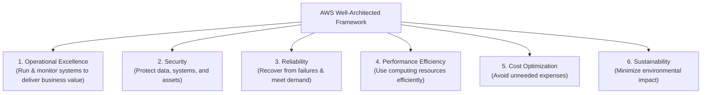
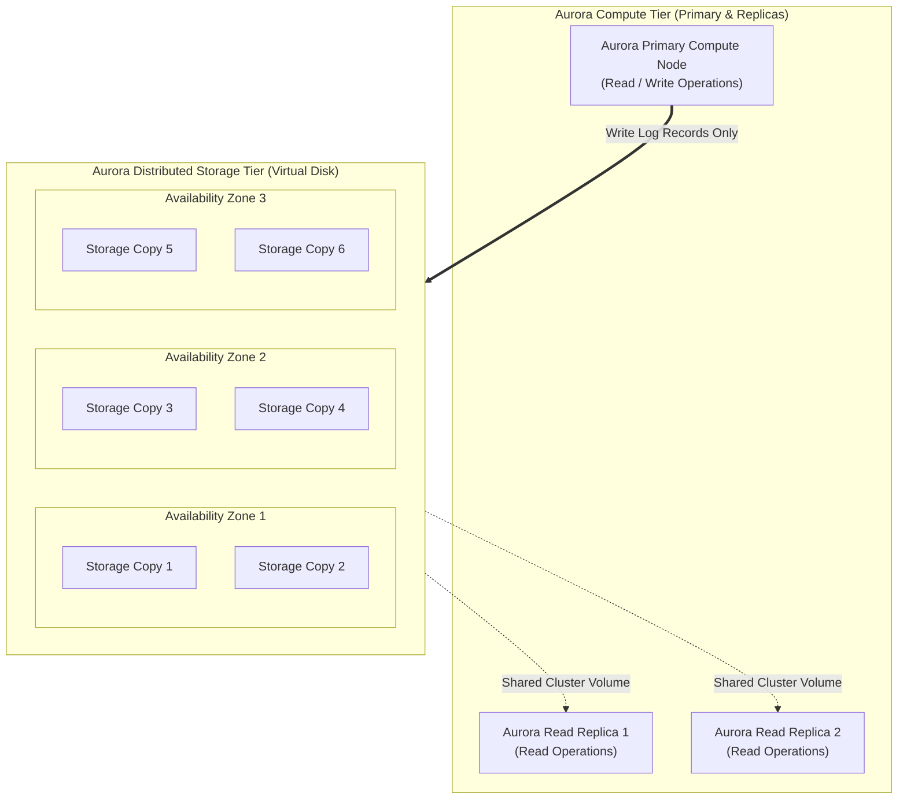
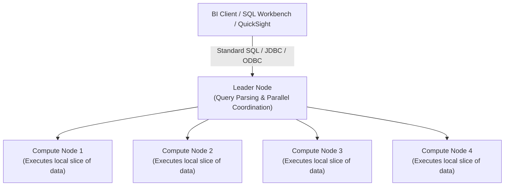
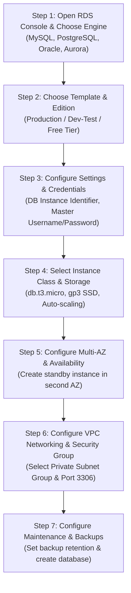
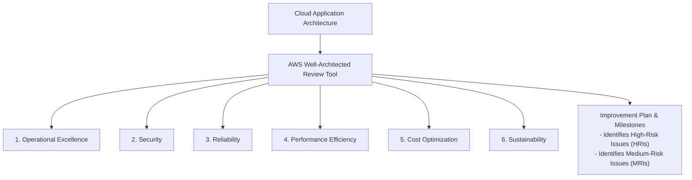
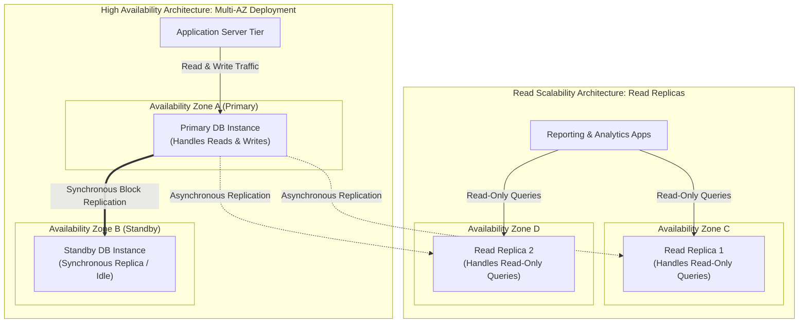
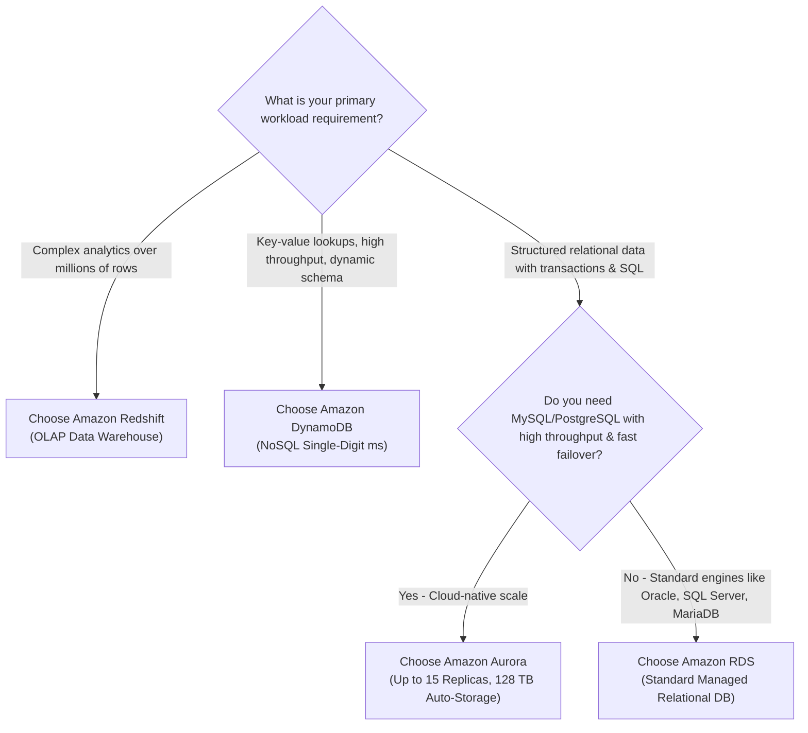

# Unit 5: AWS Architecture and Database Services

---

# SECTION A – Very Short Answer Questions

---

## Q33. What is the AWS Well-Architected Framework?

**Definition:**

The AWS Well-Architected Framework is a comprehensive set of architectural best practices, design principles, and guidelines developed by AWS to help cloud architects build secure, high-performing, resilient, and efficient cloud application architectures.

It provides a consistent approach for evaluating cloud architectures and implementing scalable designs aligned with proven industry practices.

**Example:**

A cloud engineering team conducts a Well-Architected Review on a banking portal to ensure customer data is encrypted at rest and in transit, and that database servers fail over automatically across multiple Availability Zones.

**Key Points:**
1. Structured around **Six Core Pillars**:
   - Operational Excellence
   - Security
   - Reliability
   - Performance Efficiency
   - Cost Optimization
   - Sustainability
2. Provides architectural design principles and evaluation questions.
3. Supported by the free **AWS Well-Architected Tool** in the AWS Console.
4. Identifies architectural high-risk issues (HRIs) and medium-risk issues (MRIs).
5. Helps organizations build scalable, modern cloud-native systems.

---

## Q34. Define Amazon RDS.

**Definition:**

Amazon Relational Database Service (Amazon RDS) is a fully managed cloud database web service that makes it easy to set up, operate, and scale a relational database in the AWS cloud.

It automates time-consuming administrative database management tasks—such as hardware provisioning, database setup, software patching, automated backups, and failure detection—while providing cost-efficient and resizable capacity.

**Example:**

A company launches an Amazon RDS MySQL instance to manage its user accounts, transactions, and order history without having to manually patch the underlying Linux operating system or configure database backup scripts.

**Key Points:**
1. Fully managed Relational Database Management Service (RDBMS).
2. Automates provisioning, OS patching, software updates, and backups.
3. Supports Multi-AZ deployments for high availability and automatic failover.
4. Supports Read Replicas to horizontally scale read-heavy workloads.
5. Preserves compatibility with existing database code, applications, and tools.

---

## Q35. Name any four database engines supported by Amazon RDS.

**Definition:**

Amazon RDS provides broad flexibility by supporting six industry-standard commercial and open-source relational database engines.

**Four Major Database Engines Supported by Amazon RDS:**

1. **Amazon Aurora:**
   - AWS's cloud-native, high-performance relational database engine compatible with MySQL and PostgreSQL.
2. **PostgreSQL:**
   - Popular open-source object-relational database known for standards compliance and extensible data types.
3. **MySQL:**
   - Widely adopted open-source relational database engine used for web applications.
4. **Oracle Database:**
   - Enterprise-grade commercial relational database supporting both Bring-Your-Own-License (BYOL) and License-Included models.

*(The remaining supported engines are **Microsoft SQL Server** and **MariaDB**).*

---

## Q36. What is Amazon Aurora?

**Definition:**

Amazon Aurora is a cloud-native, fully managed relational database engine built specifically for the AWS cloud that is fully compatible with MySQL and PostgreSQL.

It combines the speed, performance, and availability of high-end commercial databases with the simplicity and cost-effectiveness of open-source databases, delivering up to **5 times the throughput of standard MySQL** and **3 times the throughput of standard PostgreSQL** on the same hardware.

**Example:**

An enterprise migrates a high-traffic MySQL e-commerce database to Amazon Aurora MySQL to automatically scale database storage up to 128 TB while maintaining sub-10ms replication lag across 15 read replicas.

**Key Points:**
1. Up to 5x faster than standard MySQL; up to 3x faster than standard PostgreSQL.
2. Cloud-native architecture that separates the compute layer from the distributed storage layer.
3. Automatically replicates data **6 ways across 3 Availability Zones**.
4. Self-healing storage system that automatically scales up to 128 TB without performance degradation.
5. Supports up to 15 low-latency Aurora Read Replicas and offers **Aurora Serverless** for auto-scaling capacity.

---

## Q37. Define Amazon DynamoDB.

**Definition:**

Amazon DynamoDB is a fully managed, serverless, key-value and document NoSQL database service designed to deliver fast, predictable, single-digit millisecond latency performance at any scale.

It eliminates the operational burden of managing distributed hardware, clustering, software installation, patching, and data partitioning, automatically scaling throughput capacity up or down to meet demand.

**Example:**

A mobile gaming application uses Amazon DynamoDB to store millions of real-time player profiles, game state sessions, and global leaderboard rankings, processing over 100,000 read/write operations per second with sub-10ms response times.

**Key Points:**
1. Serverless NoSQL database supporting both Key-Value and Document data models.
2. Provides consistent, predictable single-digit millisecond latency at any scale.
3. Automatically partitions and distributes data across multiple servers and Availability Zones.
4. Offers flexible capacity modes: **On-Demand Capacity** (pay per request) and **Provisioned Capacity** (configured read/write units with auto-scaling).
5. Built-in enterprise features: DynamoDB Accelerator (DAX in-memory cache), Global Tables (multi-region active-active replication), and Point-in-Time Recovery (PITR).

---

## Q38. What is Amazon Redshift?

**Definition:**

Amazon Redshift is a fast, fully managed, petabyte-scale cloud data warehouse service that makes it simple and cost-effective to analyze large volumes of structured and semi-structured data using standard SQL and existing Business Intelligence (BI) tools.

It uses a Massively Parallel Processing (MPP) architecture and columnar data storage to execute complex analytical queries across millions of rows up to 10x faster than traditional relational databases.

**Example:**

A retail corporation aggregates daily sales records, inventory updates, and customer clickstream data from multiple stores into Amazon Redshift to generate real-time analytics reports and executive dashboards.

**Key Points:**
1. Petabyte-scale cloud data warehouse designed for Online Analytical Processing (OLAP).
2. Uses **Columnar Data Storage** to maximize I/O efficiency and compression.
3. Employs a **Massively Parallel Processing (MPP)** architecture that distributes query execution across multiple compute nodes.
4. Supports standard SQL and integrates with BI tools like Amazon QuickSight, Tableau, and PowerBI.
5. Features **Amazon Redshift Spectrum**, allowing queries directly against exabytes of data stored in Amazon S3 without loading it into the warehouse.

---

# SECTION B – Short and Medium Answer Questions

---

## Q68. Explain the AWS Well-Architected Framework and its design principles.

**Definition:**

The AWS Well-Architected Framework is a formal methodology created by AWS to help organizations design, build, and continuously optimize secure, high-performing, resilient, and cost-efficient cloud architectures.

It provides a systematic approach to evaluating architectures against proven cloud design principles.

---

### General Design Principles of Cloud Architecture:

1. **Stop guessing your capacity needs:** Eliminate arbitrary hardware provisioning; scale capacity dynamically using auto-scaling.
2. **Test systems at production scale:** Create production-scale cloud architectures on demand, test performance, and deprovision them to minimize testing costs.
3. **Automate to make architectural experimentation easier:** Use Infrastructure as Code (AWS CloudFormation / Terraform) to automate environment creation and updates.
4. **Allow for evolutionary architectures:** Design modular, decoupled systems (microservices) that evolve easily as business requirements change.
5. **Drive architectures using data:** Collect and analyze operational performance metrics to make data-driven architectural decisions.
6. **Improve through game days:** Regularly simulate production outages and security incidents to test system resilience and team preparedness.

---

### The Six Pillars of the AWS Well-Architected Framework:



#### 1. Operational Excellence Pillar
- **Focus:** Running and monitoring systems to deliver business value and continuously improving processes.
- **Key Principles:** Perform operations as code, make frequent and reversible changes, anticipate failure, and learn from operational incidents.
- **Key AWS Services:** AWS CloudFormation, AWS Systems Manager, Amazon CloudWatch.

#### 2. Security Pillar
- **Focus:** Protecting information, assets, and systems while delivering business value through risk assessments and mitigation strategies.
- **Key Principles:** Implement a strong identity foundation, maintain traceability, apply security at all layers (defense in depth), automate security best practices, and protect data in transit and at rest.
- **Key AWS Services:** AWS IAM, AWS KMS, AWS WAF, Amazon GuardDuty, AWS Shield.

#### 3. Reliability Pillar
- **Focus:** Ensuring workloads perform their intended functions correctly and consistently, and recover quickly from infrastructure or service disruptions.
- **Key Principles:** Automatically recover from failure, test recovery procedures, scale horizontally to increase workload availability, and stop guessing capacity.
- **Key AWS Services:** Amazon EC2 Auto Scaling, Elastic Load Balancing, Amazon Route 53, Multi-AZ RDS.

#### 4. Performance Efficiency Pillar
- **Focus:** Using computing resources efficiently to meet system requirements and maintaining that efficiency as demand changes and technologies evolve.
- **Key Principles:** Democratize advanced technologies, go global in minutes, use serverless architectures, and experiment more often.
- **Key AWS Services:** AWS Lambda, Amazon CloudFront, Amazon ElastiCache, Auto Scaling.

#### 5. Cost Optimization Pillar
- **Focus:** Running systems to deliver maximum business value at the lowest price point.
- **Key Principles:** Implement cloud financial management, adopt a consumption model, measure overall efficiency, and analyze and attribute expenditure.
- **Key AWS Services:** AWS Cost Explorer, AWS Budgets, Compute Optimizer, Savings Plans.

#### 6. Sustainability Pillar
- **Focus:** Minimizing the environmental impacts of running cloud workloads.
- **Key Principles:** Understand your impact, maximize utilization, adopt new and more efficient hardware and software offerings (e.g., AWS Graviton processors), and reduce the downstream impact of your cloud workloads.
- **Key AWS Services:** AWS Customer Carbon Footprint Tool, AWS Graviton.

**Conclusion:**

The Well-Architected Framework provides a structured blueprint that aligns engineering implementations with organizational goals, resilience, security, and cost governance.

---

## Q69. Explain Amazon RDS and describe its major features and advantages.

**Definition:**

Amazon Relational Database Service (Amazon RDS) is a managed cloud database service that simplifies the setup, operation, and scaling of relational databases. It handles repetitive administrative tasks, allowing database administrators and developers to focus on application development.

---

### Shared Responsibility in Amazon RDS:

| Responsibility Layer | Customer Responsibility (EC2 Self-Hosted DB) | Amazon RDS Managed Responsibility |
| :--- | :--- | :--- |
| **Application Optimization** | Customer | Customer |
| **Database Schema & Indexing** | Customer | Customer |
| **Database Software Updates & Patches** | Customer | **Amazon RDS (Automated)** |
| **Database Backup & Recovery** | Customer | **Amazon RDS (Automated)** |
| **Multi-AZ Replication & Failover** | Customer | **Amazon RDS (Automated)** |
| **OS Installation & Security Patches**| Customer | **Amazon RDS (Automated)** |
| **Physical Server & Hardware Maintenance** | AWS | **Amazon RDS (Automated)** |

---

### Major Features and Advantages of Amazon RDS:

1. **Automated Backups and Point-in-Time Recovery:**
   - Automatically performs a daily storage volume snapshot and captures transaction logs.
   - Allows users to restore their database to any specific second within a retention window (up to 35 days).

2. **Multi-AZ Deployments for High Availability:**
   - Synchronously replicates database writes to an idle standby instance in a physically separate Availability Zone.
   - If the primary instance experiences hardware failure, network outage, or AZ disruption, RDS automatically fails over to the standby instance within 60–120 seconds with zero manual intervention and no change to the application connection endpoint.

3. **Read Replicas for Read Scalability:**
   - Uses built-in asynchronous replication to offload read-heavy traffic (e.g., analytics reports, user queries) from the primary database instance to up to 5 read replicas.
   - Can be placed across different Availability Zones or across different AWS Regions.

4. **Automated Software Patching & Maintenance:**
   - Applies operating system and database engine security updates automatically during a configurable weekly maintenance window.

5. **Storage Auto-Scaling:**
   - Automatically increases allocated database storage when available free space drops below 10%, scaling up to 64 TB without application downtime.

6. **Security & Encryption:**
   - Integrated with **AWS KMS** for encryption at rest (encrypts tables, backups, and logs).
   - Enforces encryption in transit using SSL/TLS.
   - Deployed within private subnets in an Amazon VPC, isolated by Security Groups.

**Conclusion:**

Amazon RDS combines enterprise database capabilities with cloud automation, providing high availability, scalable read throughput, and operational simplicity.

---

## Q70. Differentiate between relational databases and NoSQL databases with suitable examples.

**Definition:**

Relational Databases (SQL) store structured data in fixed tables with rows and columns enforced by predefined schemas and relational integrity. NoSQL Databases (Not Only SQL) store unstructured or semi-structured data using flexible data models designed for horizontal scale and low latency.

---

### Comprehensive Comparison Matrix:

| Feature / Criteria | Relational Databases (SQL) | NoSQL Databases |
| :--- | :--- | :--- |
| **Data Model** | Tabular (tables, rows, columns, foreign keys) | Diverse: Key-Value, Document, Wide-Column, Graph |
| **Schema** | **Fixed / Rigid schema:** Predefined schema enforced strictly before insertion | **Dynamic / Flexible schema:** Fields can be added or omitted dynamically per record |
| **Scaling Architecture**| **Vertical Scaling (Scale-Up):** Adding more CPU, RAM, or faster SSDs to a single server | **Horizontal Scaling (Scale-Out):** Distributing partitions across thousands of commodity servers |
| **Query Language** | Structured Query Language (SQL) with complex joins and aggregations | Proprietary query APIs (e.g., JSON-based queries, partition lookups; no complex joins) |
| **Consistency Model** | **ACID Properties:** Atomicity, Consistency, Isolation, Durability (Strong Consistency) | **BASE Properties:** Basically Available, Soft state, Eventual consistency |
| **Transaction Focus** | **OLTP:** Complex transactional integrity, banking systems, accounting | High-throughput, distributed real-time writes, caching, streaming |
| **Join Operations** | Native support for multi-table relational `JOIN` operations | Denormalized data model; joins are avoided or handled at the application layer |
| **AWS Managed Service** | **Amazon RDS**, **Amazon Aurora** | **Amazon DynamoDB**, **Amazon DocumentDB** |
| **Real-World Examples** | PostgreSQL, MySQL, Oracle, Microsoft SQL Server | MongoDB, Apache Cassandra, Redis, DynamoDB |

---

### Practical Example Comparison:

#### Relational Approach (Amazon RDS / SQL):
Storing an e-commerce order requires multiple normalized tables linked by foreign keys:
- `Users` table (UserID, Name, Email)
- `Orders` table (OrderID, UserID, OrderDate, TotalAmount)
- `OrderItems` table (OrderItemID, OrderID, ProductID, Quantity, Price)
- *Query:* Requires a multi-table `JOIN` statement to assemble the complete order.

#### NoSQL Document Approach (Amazon DynamoDB):
The entire order is stored as a single, self-contained JSON document:
```json
{
  "OrderID": "ORD-10928",
  "CustomerID": "CUST-441",
  "OrderDate": "2026-11-21T18:30:00Z",
  "Items": [
    {"ProductID": "PROD-1", "Name": "Mechanical Keyboard", "Qty": 1, "Price": 85.00},
    {"ProductID": "PROD-2", "Name": "USB Cable", "Qty": 2, "Price": 12.00}
  ],
  "TotalAmount": 109.00
}
```
*Query:* A single Key-Value lookup by `OrderID` fetches the complete data structure in sub-10 milliseconds without any join operations.

**Conclusion:**

Choose **Relational (SQL)** when complex relationships, joins, and strict ACID transactions are required (e.g., core financial systems). Choose **NoSQL** for massive scale, dynamic data structures, high write speeds, and low latency (e.g., social feeds, IoT telemetry, shopping carts).

---

## Q71. Explain Amazon Aurora and discuss its important features.

**Definition:**

Amazon Aurora is a fully managed, cloud-native relational database engine developed by AWS that is fully compatible with open-source MySQL and PostgreSQL.

It reimagines database architecture by decoupling the compute layer from the underlying storage layer, delivering commercial-grade database speed, availability, and durability at one-tenth the cost of commercial alternatives.

---

### Aurora Architecture: Decoupled Compute and Storage



**Text Representation:**
```text
+---------------------------------------------------------------------------------+
|                       Aurora Compute Tier (EC2 Compute Nodes)                  |
|                                                                                 |
|   [ Primary DB Node (RW) ]       [ Read Replica 1 ]      [ Read Replica 2 ]    |
+---------------------------------------------------------------------------------+
          |                                  ^                      ^
          | (Writes Redo Logs Only)          |                      |
          v                                  +----------+-----------+
+---------------------------------------------------------------------------------+
|                 Aurora Shared Cluster Storage Engine (Virtual Disk)             |
|                                                                                 |
|    AZ 1: [ Data Copy 1 ] [ Data Copy 2 ]                                        |
|    AZ 2: [ Data Copy 3 ] [ Data Copy 4 ]  ===> Replicated 6 ways across 3 AZs   |
|    AZ 3: [ Data Copy 5 ] [ Data Copy 6 ]                                        |
|                                                                                 |
|   - Auto-scales up to 128 TB in 10 GB increments                                |
|   - Self-healing storage with automated continuous background repairs           |
+---------------------------------------------------------------------------------+
```

---

### Major Features of Amazon Aurora:

1. **High Performance Throughput:**
   - Delivers up to **5x the throughput of standard MySQL** and up to **3x the throughput of standard PostgreSQL**.
   - Achieves this by sending only database redo log records over the network to the storage tier, eliminating dirty page writes.

2. **Fault-Tolerant, Distributed Storage:**
   - Every database volume is divided into 10 GB blocks and replicated **6 ways across 3 Availability Zones**.
   - Can tolerate the loss of an entire Availability Zone plus an additional storage copy without losing write availability, and can lose two AZs without losing read availability.

3. **Elastic Storage Auto-Scaling:**
   - Automatically grows storage capacity in 10 GB increments up to **128 TB** based on actual database growth without provisioning or downtime.

4. **Low-Latency Read Replicas (Up to 15):**
   - Supports up to **15 Aurora Read Replicas** that share the same underlying storage volume, reducing replication lag to milliseconds (typically < 10 ms).
   - In standard RDS, each read replica maintains its own independent copy of storage, which increases replication lag.

5. **Rapid Automatic Failover:**
   - If the primary compute node fails, Aurora promotes one of the existing Read Replicas to the primary writer role in under **30 seconds** without data loss.

6. **Aurora Serverless:**
   - An on-demand, auto-scaling configuration where the database automatically starts up, scales compute capacity up or down based on application demand, and shuts down when inactive, saving costs for intermittent workloads.

7. **Global Database:**
   - Enables a single Aurora database to span multiple AWS Regions, providing fast local reads with sub-second cross-region replication for disaster recovery.

**Conclusion:**

Amazon Aurora delivers high performance, enterprise availability, and elastic storage for demanding relational database workloads.

---

## Q72. Explain Amazon DynamoDB and its use cases.

**Definition:**

Amazon DynamoDB is a fully managed, serverless NoSQL database service that provides fast, predictable, single-digit millisecond latency performance at any scale.

It is a non-relational database supporting key-value and document data models, designed to handle massive throughput across distributed applications.

---

### Core Architectural Features:

1. **Key-Value and Document Data Model:**
   - Stores data as **Items** (equivalent to rows) containing multiple **Attributes** (equivalent to columns).
   - Items can have different numbers and types of attributes; schemas are completely flexible.

2. **Primary Key Structure:**
   - **Partition Key (Simple Primary Key):** A single attribute used by DynamoDB's internal hash function to distribute items across physical partitions.
   - **Composite Primary Key (Partition Key + Sort Key):** The partition key determines physical data placement, while the sort key orders items within that partition (e.g., `UserID` [Partition Key] + `Timestamp` [Sort Key]).

3. **Secondary Indexes:**
   - **Global Secondary Index (GSI):** An index with a partition key and sort key that can be different from those on the base table.
   - **Local Secondary Index (LSI):** An index that shares the partition key of the base table, but has a different sort key.

4. **Capacity Modes:**
   - **On-Demand Capacity:** Automatically accommodates unpredictable workloads, scaling throughput up or down instantly. You pay strictly per read and write request.
   - **Provisioned Capacity:** You configure the expected Read Capacity Units (RCUs) and Write Capacity Units (WCUs), optimizing costs for predictable, steady-state workloads.

5. **DynamoDB Accelerator (DAX):**
   - A fully managed, in-memory cache dedicated to DynamoDB that accelerates read response times from milliseconds to **microseconds**.

6. **DynamoDB Streams:**
   - Captures an ordered, time-stamped sequence of item-level modifications (insert, update, delete) and triggers serverless **AWS Lambda** functions for real-time stream processing.

---

### Common Enterprise Use Cases:

1. **Gaming Applications:**
   - Storing user profile information, real-time session state data, game world configurations, and dynamic leaderboards with sub-10ms response times.
2. **E-Commerce Platforms:**
   - Managing millions of concurrent customer shopping carts, product catalog attributes, and checkout transaction workflows during major sale events.
3. **Mobile & Web User Sessions:**
   - Storing web session tokens, authentication cookies, user preferences, and access tracking history with automatic data expiration using **Time-To-Live (TTL)**.
4. **Internet of Things (IoT) Telemetry:**
   - Ingesting massive streams of sensor data, device telemetry readings, and smart meter records.

**Conclusion:**

Amazon DynamoDB provides a scalable, low-latency, and serverless data storage solution for modern applications with high-throughput read/write demands.

---

## Q73. Explain Amazon Redshift and its role in data warehousing.

**Definition:**

Amazon Redshift is a fast, petabyte-scale, fully managed cloud data warehouse service designed for Online Analytical Processing (OLAP) and complex business intelligence reporting.

While standard relational databases (Amazon RDS) are optimized for high-speed Online Transaction Processing (OLTP) involving individual row operations, Amazon Redshift is optimized for scanning and aggregating millions or billions of rows across multiple dimensions.

---

### Core Architectural Mechanics of Amazon Redshift:

#### 1. Columnar Data Storage vs. Traditional Row Storage:
- **Row Storage (OLTP - RDS):** Stores all column values for a single record consecutively on disk. Ideal for transactional operations:
  ```text
  Row 1: [101, 'Alice', 'Mumbai', 450.00]
  Row 2: [102, 'Bob',   'Delhi',  120.00]
  ```
- **Columnar Storage (OLAP - Redshift):** Stores each column's values consecutively on disk:
  ```text
  ID Column:       [101, 102, ...]
  Name Column:     ['Alice', 'Bob', ...]
  City Column:     ['Mumbai', 'Delhi', ...]
  Amount Column:   [450.00, 120.00, ...]
  ```
  *Benefit:* An analytical query such as `SELECT AVG(Amount) FROM Sales` only reads the `Amount` disk blocks, reducing disk I/O by up to 90%. Furthermore, because similar data types are stored together, columnar data compresses significantly better.

#### 2. Massively Parallel Processing (MPP) Architecture:
- Redshift operates as a coordinated compute cluster:
  - **Leader Node:** Receives client SQL connections, parses queries, builds optimized parallel execution plans, and coordinates worker nodes.
  - **Compute Nodes:** Dedicated worker servers that execute query execution steps in parallel, each processing its local partition of data.



---

### Key Features of Amazon Redshift:

1. **Amazon Redshift Spectrum:**
   - Allows analysts to run SQL queries directly against exabytes of unstructured or semi-structured data stored in **Amazon S3** data lakes without having to load the data into the Redshift cluster.
2. **Automated Data Compression:**
   - Multiple compression encodings (ZSTD, LZO, RunLength) are applied automatically to reduce required storage footprint and speed up I/O transfers.
3. **Redshift Serverless:**
   - An on-demand configuration that automatically provisions and scales data warehouse capacity, allowing analytics without manual cluster management.
4. **Integration with Machine Learning:**
   - **Amazon Redshift ML** enables data analysts to create, train, and deploy machine learning models directly using standard SQL queries.

### Summary Comparison: OLTP (RDS) vs. OLAP (Redshift):

| Feature | Online Transaction Processing (OLTP) - Amazon RDS | Online Analytical Processing (OLAP) - Amazon Redshift |
| :--- | :--- | :--- |
| **Primary Purpose** | Fast day-to-day transactional updates | Complex data analysis and BI reporting |
| **Data Organization** | Row-based storage | Columnar storage |
| **Query Nature** | High frequency of simple read/write statements | Complex queries aggregating millions of rows |
| **Database Size** | Gigabytes to Terabytes | Terabytes to Petabytes |
| **Architecture** | Single primary instance with read replicas | Massively Parallel Processing (MPP) multi-node cluster |

**Conclusion:**

Amazon Redshift serves as the central data warehouse in enterprise analytics, enabling fast SQL-based queries across petabytes of business data.

---

## Q74. Describe the steps involved in launching an Amazon RDS database instance.

**Definition:**

Launching an Amazon RDS instance involves selecting a relational database engine, defining compute sizing, setting administrative credentials, configuring VPC networking, enabling automated backups, and configuring Multi-AZ redundancy.

---

### Step-by-Step Procedure:



#### Step 1: Open RDS Console and Select Database Engine
1. Navigate to the **Amazon RDS Console** and click **Create database**.
2. Under **Choose a database creation method**, select **Standard create**.
3. Under **Engine options**, choose your database engine (e.g., **MySQL** or **PostgreSQL**).
4. Select the desired **Engine Version** (e.g., *MySQL 8.0*).

#### Step 2: Choose Deployment Template
- **Production:** High availability pre-configured with Multi-AZ deployment.
- **Dev/Test:** Development environments with single-AZ setup.
- **Free tier:** Constrained configuration within AWS Free Tier limits (e.g., `db.t3.micro`, 20 GB storage).

#### Step 3: Configure Instance Identifiers and Master Credentials
- **DB instance identifier:** Name of your database instance (e.g., `corporate-sales-db`).
- **Master username:** Admin username (e.g., `admin`).
- **Master password:** Set a secure master password (or select *Auto generate a password*).

#### Step 4: Configure Instance Class and Storage
- **DB instance class:** Select the hardware compute size:
  - *Standard classes (m-family)* for production.
  - *Burstable classes (`db.t3.micro` or `db.t4g.micro`)* for testing.
- **Storage type:** Select *General Purpose SSD (`gp3`)*.
- **Allocated storage:** Enter baseline capacity (e.g., `20 GiB`).
- **Storage auto-scaling:** Enable and set maximum storage threshold (e.g., `100 GiB`).

#### Step 5: Configure High Availability (Multi-AZ)
- Under **Availability and durability**, select:
  - **Create a standby instance** (Multi-AZ deployment) for production fault tolerance.
  - **Do not create a standby instance** for development cost savings.

#### Step 6: Configure VPC Connectivity and Security
- **Virtual Private Cloud (VPC):** Select your target custom VPC.
- **DB Subnet Group:** Select a private subnet group spanning at least two Availability Zones.
- **Public access:** Choose **No** to keep the database private.
- **VPC security group:** Choose **Select existing** and choose a database security group that allows inbound traffic on port 3306 only from your Web/App Server Security Group.

#### Step 7: Database Authentication and Automated Backups
- **Database authentication:** Choose *Password authentication* or *Password and IAM database authentication*.
- **Backup:** Enable automated backups and choose the retention period (e.g., 7 days).
- Click **Create database**.

---

### Summary of Configured Database Parameters:

| Parameter | Configuration Setting | Purpose |
| :--- | :--- | :--- |
| **Engine** | MySQL Community Edition | Relational SQL database engine |
| **Instance Class** | `db.t3.micro` (2 vCPUs, 1 GiB RAM) | Compute and memory sizing |
| **Storage** | 20 GiB General Purpose SSD (`gp3`) | High-speed block storage volume |
| **Multi-AZ** | Enabled | Synchronous standby replica in another AZ |
| **Public Access** | No | Protects database from direct internet exposure |
| **Inbound Security**| Port 3306 from Web-SG | Limits access strictly to authorized web servers |

**Conclusion:**

This standardized procedure provisions an enterprise-grade, highly available relational database in a private cloud network with automated backup protection.

---

# SECTION C – Long Answer Questions

---

## Q93. Explain the AWS Well-Architected Framework in detail. Discuss its design principles and importance in building reliable, secure, efficient, and cost-effective cloud applications.

### 1. Introduction

The AWS Well-Architected Framework represents a collection of architectural guidelines, design principles, and review questions compiled from thousands of enterprise cloud implementations.

It enables cloud architects to evaluate architectures against current industry standards and identify structural risks early in the development lifecycle.

---

### 2. High-Level Architecture of the Well-Architected Review



**Text Representation:**
```text
+-------------------------------------------------------------------------+
|                  AWS Well-Architected Review Lifecycle                  |
|                                                                         |
|        [ Workload Architecture: Compute, Network, Storage, Data ]       |
|                                    |                                    |
|                                    v                                    |
|         +-----------------------------------------------------+         |
|         |          AWS Well-Architected Tool & Pillars        |         |
|         |                                                     |         |
|         |  1. Operational Excellence   2. Security            |         |
|         |  3. Reliability              4. Performance         |         |
|         |  5. Cost Optimization        6. Sustainability      |         |
|         +-----------------------------------------------------+         |
|                                    |                                    |
|                                    v                                    |
|         +-----------------------------------------------------+         |
|         | Remediation Report & Risk Matrix                    |         |
|         | - Identifies High-Risk Issues (HRIs)                |         |
|         | - Identifies Medium-Risk Issues (MRIs)              |         |
|         | - Prescriptive Architecture Guidance                |         |
|         +-----------------------------------------------------+         |
+-------------------------------------------------------------------------+
```

---

### 3. In-Depth Analysis of the Six Pillars

#### Pillar 1: Operational Excellence
- **Core Concept:** The ability to run and monitor workloads to deliver business value and continuously refine operational processes.
- **Design Principles:**
  - *Perform operations as code:* Define your entire infrastructure as software using AWS CloudFormation or Terraform.
  - *Make frequent, small, reversible changes:* Design components to be updated in small increments so issues can be isolated and rolled back quickly.
  - *Refine operations procedures frequently:* Continuously evaluate operational runbooks with team walkthroughs.
  - *Anticipate failure:* Conduct "pre-mortem" exercises to identify potential failure modes before deployments.
  - *Learn from all operational failures:* Conduct blameless post-incident reviews to drive root-cause remediation.

#### Pillar 2: Security
- **Core Concept:** Protecting data, applications, and cloud assets while maintaining compliance through layered defense mechanisms.
- **Design Principles:**
  - *Implement a strong identity foundation:* Enforce least-privilege permissions, mandate Multi-Factor Authentication (MFA), and eliminate long-term credentials using AWS IAM Roles.
  - *Enable traceability:* Log, audit, and monitor all API actions and environment changes using **AWS CloudTrail** and **Amazon CloudWatch**.
  - *Apply security at all layers:* Implement defense-in-depth across edge networks, VPC subnets, OS instances, and application containers.
  - *Automate security best practices:* Automate security monitoring and remediation with services like **Amazon GuardDuty** and **AWS Config**.
  - *Protect data in transit and at rest:* Enforce TLS encryption for data in transit and AWS KMS customer-managed keys for data at rest.

#### Pillar 3: Reliability
- **Core Concept:** Ensuring a workload performs its intended function consistently and recovers quickly from failures or capacity constraints.
- **Design Principles:**
  - *Automatically recover from failure:* Monitor metrics and automate recovery actions using Auto Scaling and route health checks.
  - *Test recovery procedures:* Simulate realistic infrastructure failures (chaos engineering) to validate automated failover.
  - *Scale horizontally to increase aggregate system availability:* Replace single large instances with multiple smaller instances to reduce the blast radius of any single failure.
  - *Stop guessing capacity:* Use auto-scaling to match compute capacity to actual demand automatically.

#### Pillar 4: Performance Efficiency
- **Core Concept:** Using computing resources efficiently to meet system requirements and sustaining that efficiency as demand changes.
- **Design Principles:**
  - *Democratize advanced technologies:* Use managed cloud services (e.g., Amazon Aurora, AWS Lambda) instead of manually managing complex technology stacks.
  - *Go global in minutes:* Deploy applications across multiple AWS Regions to reduce latency for users worldwide.
  - *Use serverless architectures:* Deploy compute and storage architectures that operate on demand, removing server management overhead.
  - *Experiment more often:* Test different instance types, storage classes, and configurations using automation.

#### Pillar 5: Cost Optimization
- **Core Concept:** Delivering business value at the lowest possible price point while avoiding unnecessary expenditures.
- **Design Principles:**
  - *Implement cloud financial management:* Establish clear accountability and cost ownership across development teams.
  - *Adopt a consumption model:* Pay only for computing resources used; terminate idle dev/test resources when not in use.
  - *Measure overall efficiency:* Measure business output against cloud spend to evaluate efficiency improvements.
  - *Stop spending money on undifferentiated heavy lifting:* Leverage managed services to reduce operational staffing and maintenance costs.

#### Pillar 6: Sustainability
- **Core Concept:** Minimizing the environmental and carbon impacts of running cloud workloads.
- **Design Principles:**
  - *Understand your impact:* Quantify carbon emissions and energy consumption using the AWS Customer Carbon Footprint Tool.
  - *Maximize utilization:* Maximize baseline hardware utilization and consolidate workloads to eliminate idle capacity.
  - *Adopt efficient hardware and software:* Adopt high-efficiency hardware (e.g., ARM-based AWS Graviton processors) to reduce energy consumption.

---

### 4. Importance in Modern Cloud Application Development

1. **Elimination of Architectural Blind Spots:**
   - Provides a comprehensive checklist that prevents teams from focusing on features at the expense of security or operational monitoring.
2. **Reduced Downtime and Failure Blast Radii:**
   - Multi-AZ deployments, health checking, and horizontal scaling protect workloads against hardware failures and traffic surges.
3. **Continuous Cost Governance:**
   - Identifies idle resources, unattached EBS volumes, and oversized compute instances, reducing monthly AWS bills.
4. **Accelerated Compliance Audits:**
   - Adhering to the Security and Operational Excellence pillars helps meet compliance standards such as SOC 2, ISO 27001, and HIPAA.

### Conclusion

The AWS Well-Architected Framework provides a structured blueprint that guides cloud implementations toward resilience, security, efficiency, and cost governance.

---

## Q94. Explain Amazon RDS in detail. Discuss its architecture, supported database engines, features, advantages, and the procedure for launching an RDS database instance.

### 1. Introduction

Amazon Relational Database Service (Amazon RDS) is a managed cloud web service that simplifies the setup, operation, and scaling of relational databases in the cloud.

RDS manages low-level infrastructure tasks—including hardware provisioning, OS installation, security patching, storage allocation, network configuration, automated backups, and hardware failover—allowing database engineers to focus on schema design, query optimization, and application development.

---

### 2. Amazon RDS Architecture: Multi-AZ vs. Read Replicas

Amazon RDS provides two primary architectural patterns to address **High Availability** and **Read Scalability**:



**Text Representation:**
```text
+-----------------------------------------------------------------------------------+
|                        Amazon RDS Production Architecture                         |
|                                                                                   |
|  [ Availability Zone A - Primary ]              [ Availability Zone B - Standby ] |
|   +-----------------------------+                +-----------------------------+  |
|   |   Primary DB (Read/Write)   |                |   Standby DB (Hot Standby)  |  |
|   +-----------------------------+                +-----------------------------+  |
|                 |                                               ^                 |
|                 +======= Synchronous Physical Block Replication +                 |
|                 |                                                                 |
|                 v (Asynchronous Log Replication)                                  |
|  [ Availability Zone C ]                        [ Availability Zone D ]           |
|   +-----------------------------+                +-----------------------------+  |
|   |    Read Replica 1 (RO)      |                |    Read Replica 2 (RO)      |  |
|   +-----------------------------+                +-----------------------------+  |
+-----------------------------------------------------------------------------------+
        ^                                                 ^
        | (Read-Only Traffic)                             | (Reporting & Analytics)
[ Web Clients ]                                   [ BI Reporting Applications ]
```

#### Multi-AZ Deployment (High Availability):
- **Mechanism:** Synchronous block-level replication to a dedicated standby instance in a different Availability Zone.
- **Failover:** Automatic failover in 60–120 seconds if the primary instance fails; DNS updates preserve the same endpoint address.
- **Use Case:** Production workloads requiring continuous availability.

#### Read Replicas (Read Scalability):
- **Mechanism:** Asynchronous engine-level replication from the primary instance.
- **Scaling:** Up to 5 read replicas (up to 15 in Aurora) can be created to handle read-heavy traffic.
- **Use Case:** Offloading reporting, analytics, and read traffic from the primary writer.

---

### 3. Database Engines Supported by Amazon RDS

Amazon RDS supports six relational database engines:

| Engine | Type | Licensing Model | Best Use Case |
| :--- | :--- | :--- | :--- |
| **Amazon Aurora** | Cloud-native relational | License-included | High-throughput enterprise MySQL/PostgreSQL |
| **PostgreSQL** | Open-source relational | Open-source | Complex schemas, GIS applications, extensible types |
| **MySQL** | Open-source relational | Open-source | Standard web backends, CMS, and microservices |
| **MariaDB** | Open-source relational | Open-source | Open-source community drop-in replacement for MySQL |
| **Oracle** | Enterprise commercial | BYOL & License-Included | Legacy enterprise ERP, CRM, and financial software |
| **Microsoft SQL Server**| Enterprise commercial | License-Included | .NET applications, corporate Microsoft integrations |

---

### 4. Core Features and Enterprise Advantages

1. **Automated Backups & Snapshots:**
   - Daily storage volume snapshots combined with transaction logs enable Point-in-Time Recovery (PITR) to any second within the retention window (1 to 35 days).
   - User-initiated manual snapshots persist indefinitely until explicitly deleted.
2. **Storage Auto-Scaling:**
   - Automatically provisions additional storage as data grows, scaling up to 64 TB without downtime.
3. **Automated Minor Engine Upgrades:**
   - Applies security patches and bug fixes automatically during configured maintenance windows.
4. **Enhanced Monitoring & Performance Insights:**
   - Collects real-time OS metrics (CPU, memory, disk I/O) at 1-second intervals.
   - **Performance Insights** visually identifies SQL statements contributing most to database load.
5. **Security and Network Isolation:**
   - Deployed within private subnets of a custom VPC.
   - Enforces data-at-rest encryption via AWS KMS and data-in-transit encryption via SSL/TLS.

---

### 5. Detailed Step-by-Step Procedure for Launching an RDS Instance

#### Step 1: Initialize Database Creation
1. Open the **Amazon RDS Console** and select **Databases** -> **Create database**.
2. Select **Standard create**.

#### Step 2: Choose Engine and Version
1. Select **MySQL**.
2. Select the latest stable engine version (e.g., `MySQL 8.0.35`).

#### Step 3: Select Template
- Select **Production** to enable Multi-AZ deployment and high-availability defaults.

#### Step 4: Configure Instance Identifiers and Credentials
- **DB instance identifier:** `production-ecommerce-db`
- **Master username:** `dbadmin`
- **Master password:** Set a strong password (minimum 8 characters).

#### Step 5: Choose DB Instance Class and Storage
- **Instance class:** Select *Standard classes (includes m-classes)* or *Burstable classes (`db.t3.small`)*.
- **Storage type:** General Purpose SSD (`gp3`).
- **Allocated storage:** `50 GiB`.
- **Enable storage autoscaling:** Checked, Maximum storage threshold: `200 GiB`.

#### Step 6: Configure Availability & Durability (Multi-AZ)
- Select **Create a standby instance** (recommended for production).

#### Step 7: Configure Connectivity and Security
- **VPC:** Select your custom VPC.
- **DB Subnet Group:** Select a private subnet group spanning at least two AZs.
- **Public access:** Select **No**.
- **Existing VPC security groups:** Select your dedicated database security group allowing port 3306 only from your Web/App Server Security Group.

#### Step 8: Database Authentication and Backups
- Select **Password authentication**.
- Under **Backup**, set **Enable automated backups** to `7 days`.
- Click **Create database**.

### Conclusion

Amazon RDS simplifies relational database management by automating repetitive operational tasks, providing enterprise-grade high availability, and scaling read capacity on demand.

---

## Q95. Compare Amazon RDS, Amazon Aurora, Amazon DynamoDB, and Amazon Redshift based on their architecture, database type, features, and use cases.

### 1. Introduction

AWS provides a broad portfolio of purpose-built database engines, each designed for specific data structures, access patterns, and scalability requirements:
- **Amazon RDS:** Managed relational database service supporting traditional SQL engines.
- **Amazon Aurora:** Cloud-native, high-performance relational database engine compatible with MySQL and PostgreSQL.
- **Amazon DynamoDB:** Serverless, low-latency NoSQL database for key-value and document data at scale.
- **Amazon Redshift:** Petabyte-scale columnar data warehouse for analytical reporting and OLAP queries.

---

### 2. Comprehensive Comparative Matrix

| Evaluation Dimension | Amazon RDS | Amazon Aurora | Amazon DynamoDB | Amazon Redshift |
| :--- | :--- | :--- | :--- | :--- |
| **Database Category** | Relational Database (OLTP) | Cloud-Native Relational (OLTP)| NoSQL Database (Key-Value/Doc)| Cloud Data Warehouse (OLAP) |
| **Data Structure** | Structured Tables (Rows/Cols) | Structured Tables (Rows/Cols) | Schema-flexible Items/JSON | Columnar Structured/Semi-struct|
| **Underlying Architecture**| Virtual server + EBS storage | Decoupled Compute & Storage | Fully Serverless Partitioning | Massively Parallel Processing |
| **Storage Engine** | Single-AZ or Multi-AZ EBS | 6-way replicated across 3 AZs | Distributed SSD Multi-AZ | Local NVMe/SSD per Compute Node|
| **Maximum Storage** | Up to 64 TB | Auto-scales up to 128 TB | **Unlimited** (Petabytes) | Petabytes to Exabytes |
| **Query Language** | Standard SQL | Standard SQL | Proprietary NoSQL API | PostgreSQL-compatible SQL |
| **Latency Profile** | Single-digit ms (3–10 ms) | Low single-digit ms (1–5 ms) | **Sub-10ms** (Microseconds w/ DAX)| Seconds to Minutes |
| **Scaling Capability** | Vertical compute; up to 5 Replicas| Up to 15 auto-scaled Replicas | Instant Horizontal Auto-scaling| Cluster node resizing / Concurrency|
| **High Availability** | Synchronous Multi-AZ Standby | Built-in 6-way replication | Native Multi-AZ replication | Multi-node cluster failover |
| **Server Management** | Managed DB instances | Managed DB instances/Serverless| **100% Serverless** | Managed Clusters / Serverless |
| **Best Architectural Role**| Traditional enterprise SQL apps | High-throughput MySQL/Postgres | High-scale APIs, mobile backends| Enterprise BI, data warehousing |

---

### 3. In-Depth Architectural Evaluation

#### A. Amazon RDS
- **Architecture:** Packages standard database engines (MySQL, PostgreSQL, Oracle, SQL Server) on EC2 instances with attached Amazon EBS storage.
- **Strengths:** Full compatibility with existing codebases, wide engine selection, and automated administration.
- **Limitations:** Storage does not scale dynamically beyond 64 TB; maximum of 5 read replicas with higher replication lag.
- **Primary Use Cases:** Standard e-commerce backends, enterprise ERPs, and migrations of on-premises relational databases.

#### B. Amazon Aurora
- **Architecture:** Separates compute from storage. Redo logs are written directly to a distributed storage fleet replicated 6 ways across 3 Availability Zones.
- **Strengths:** 5x throughput of standard MySQL; up to 15 read replicas sharing a single storage volume with sub-10ms replication lag; rapid 30-second failover.
- **Limitations:** Limited to MySQL and PostgreSQL compatibility; higher baseline cost than standard RDS.
- **Primary Use Cases:** High-throughput transactional applications, real-time booking engines, and mission-critical cloud databases.

#### C. Amazon DynamoDB
- **Architecture:** Serverless, distributed NoSQL storage engine that partitions data across solid-state drives using a consistent hashing algorithm on the Partition Key.
- **Strengths:** Predictable sub-10ms latency at any scale; zero server management; flexible schema; microsecond response times with DAX.
- **Limitations:** Does not support complex multi-table `JOIN` operations or ad-hoc SQL queries; requires careful partition key design.
- **Primary Use Cases:** User session stores, gaming leaderboards, real-time IoT ingest, and high-concurrency mobile application backends.

#### D. Amazon Redshift
- **Architecture:** Massively Parallel Processing (MPP) analytical cluster with a Leader Node coordinating queries across multiple Compute Nodes using columnar storage.
- **Strengths:** Optimized for complex aggregation queries across millions of rows; high data compression ratios; queries external data in S3 via Redshift Spectrum.
- **Limitations:** Unsuitable for high-frequency transactional row updates (OLTP); higher query latency than transactional engines.
- **Primary Use Cases:** Enterprise data warehousing, business intelligence reporting, historical sales analytics, and customer churn analysis.

---

### 4. Architectural Decision Tree



### 5. Multi-Database Architecture Scenario

In an enterprise e-commerce platform:
1. **Amazon DynamoDB** manages customer shopping carts and real-time session tokens, delivering sub-10ms response times during high traffic.
2. **Amazon Aurora** manages customer orders, transactions, and inventory, providing ACID consistency and high availability.
3. **Amazon Redshift** aggregates historical sales and customer clickstream data from S3, generating daily business intelligence reports and revenue forecasts.

### Conclusion

Selecting the right database service depends on data structure and workload characteristics: choose **DynamoDB** for high-throughput NoSQL operations, **RDS/Aurora** for transactional relational applications, and **Redshift** for large-scale analytical data warehousing.
