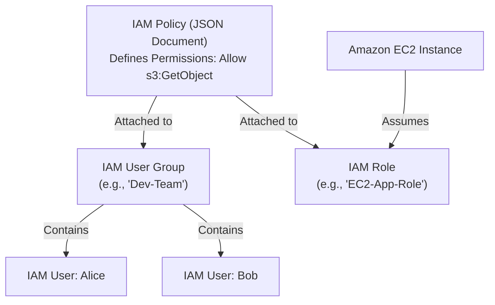
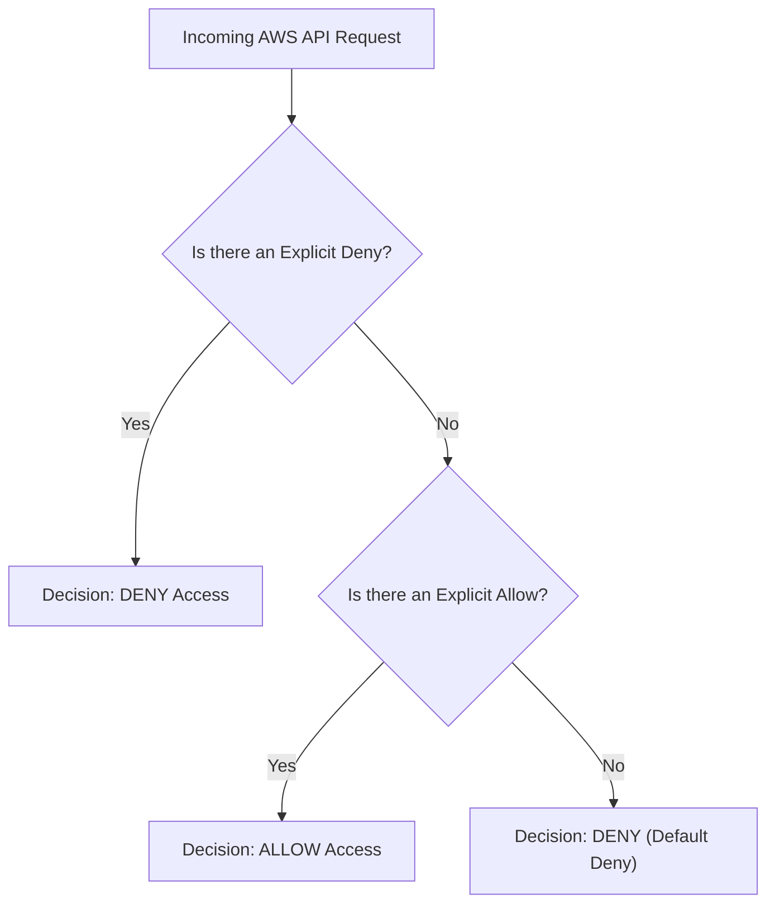
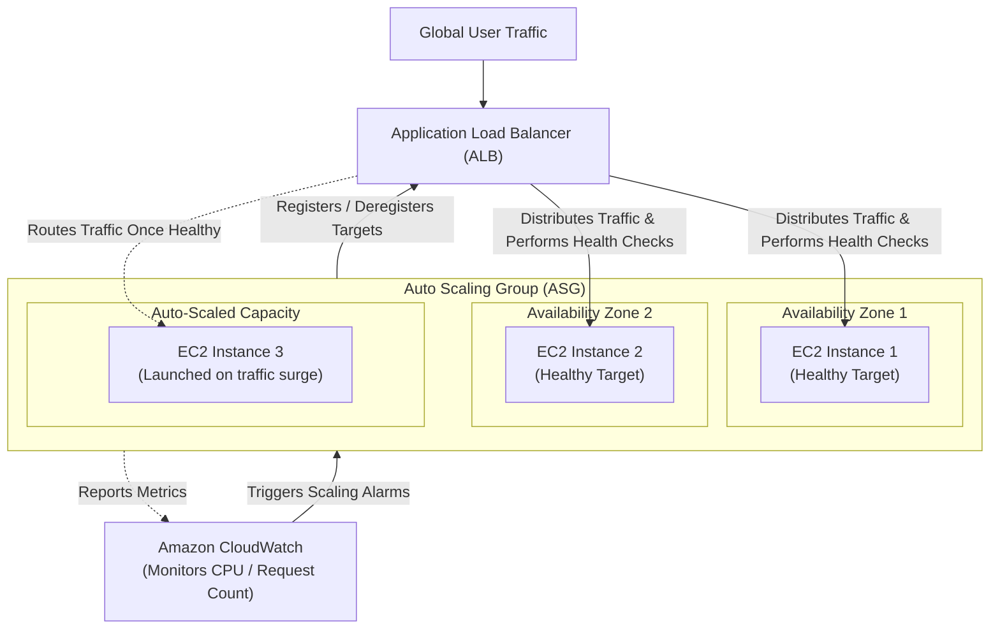
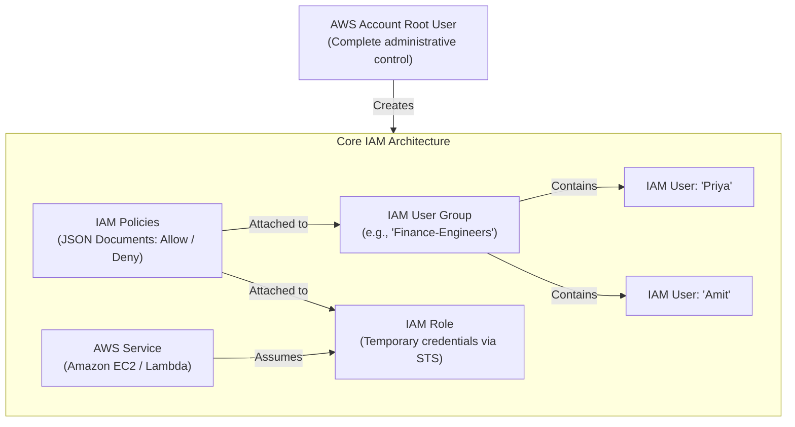
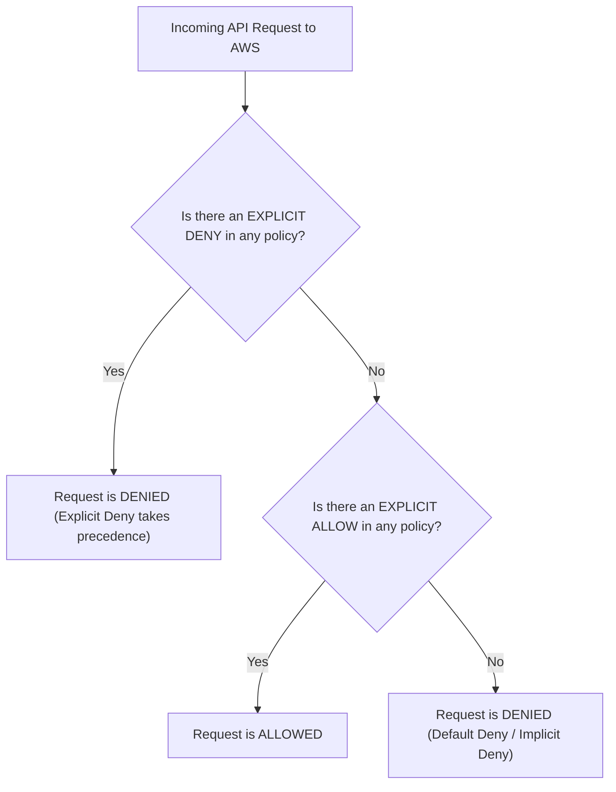
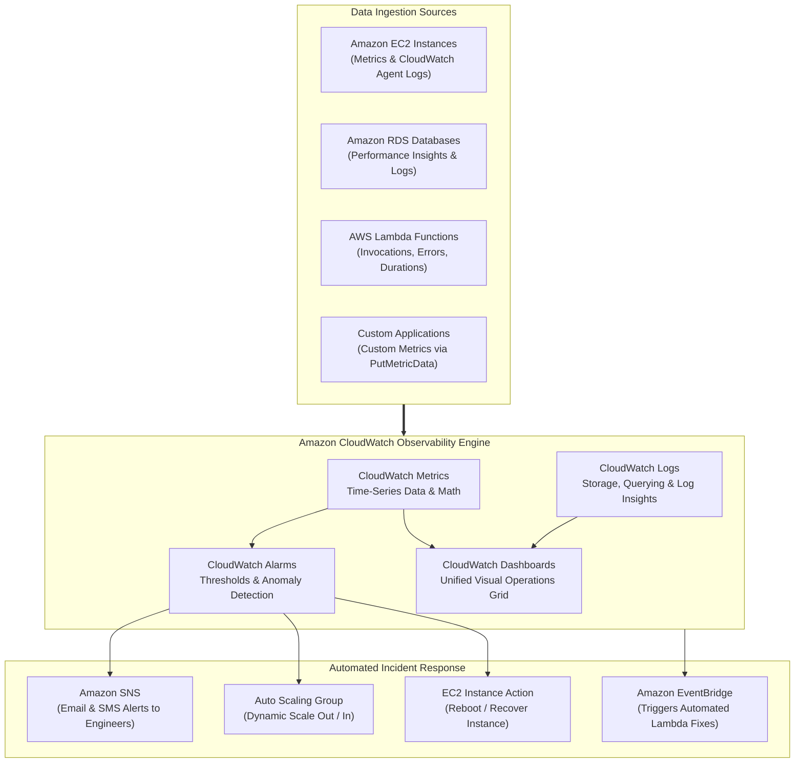
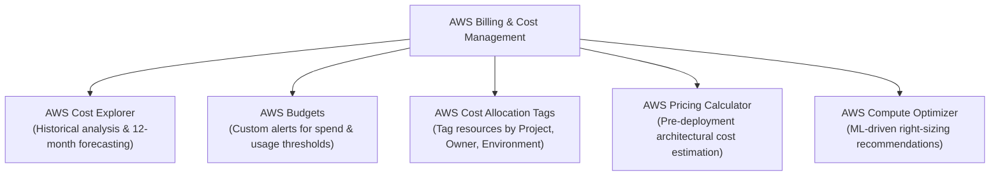
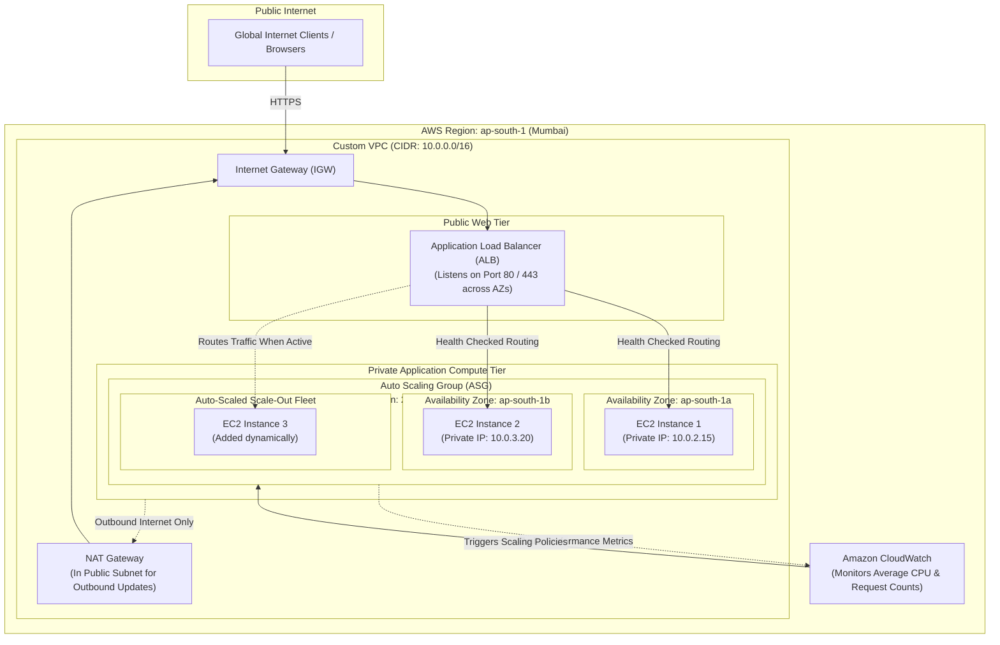
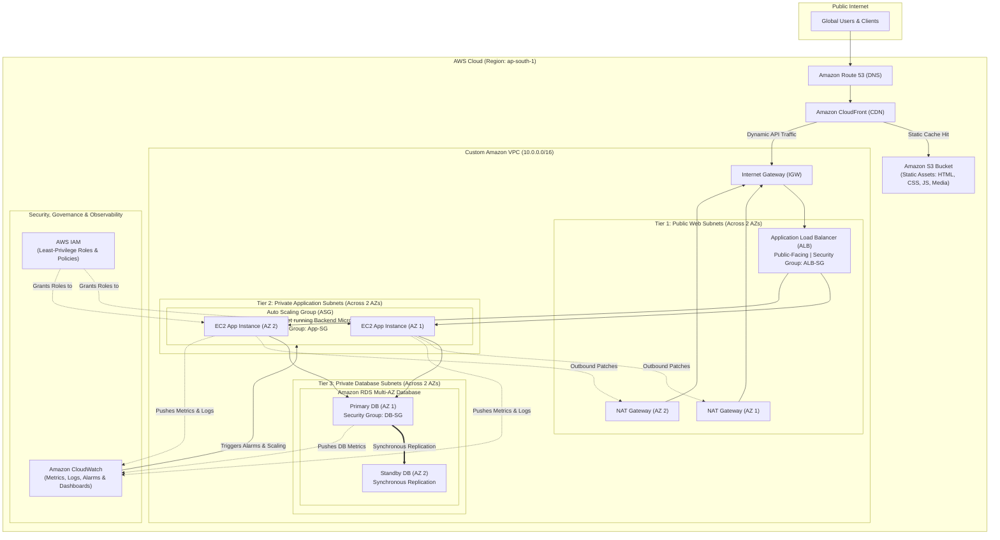

# Unit 6: AWS Security, Monitoring, Scaling, and Billing

---

# SECTION A – Very Short Answer Questions

---

## Q39. What is AWS Identity and Access Management (IAM)?

**Definition:**

AWS Identity and Access Management (IAM) is a foundational web service that provides fine-grained identity and access control across all AWS resources.

It allows administrators to securely control authentication (who can sign in) and authorization (what permissions they have) to AWS services and resources, without any additional charge.

**Example:**

An administrator creates an IAM user for a developer named "Rahul", attaches an IAM policy granting read-only access to Amazon S3, and enforces Multi-Factor Authentication (MFA) on his account.

**Key Points:**
1. Global AWS service (does not require region selection).
2. Manages **Authentication** (identity verification) and **Authorization** (permission control).
3. Core entities include **Users**, **User Groups**, **Roles**, and **Policies**.
4. Enforces the security principle of **Least Privilege** (granting only necessary permissions).
5. Supports Multi-Factor Authentication (MFA) and identity federation (Single Sign-On).

---

## Q40. Define Amazon CloudWatch.

**Definition:**

Amazon CloudWatch is a fully managed monitoring and observability service designed for DevOps engineers, developers, site reliability engineers (SREs), and IT managers.

It collects monitoring and operational data in the form of **logs**, **metrics**, and **events**, providing a unified view of AWS resources, applications, and services running on AWS and on-premises servers.

**Example:**

A CloudWatch alarm monitors the CPU utilization of an EC2 instance; if CPU utilization exceeds 80% for 5 consecutive minutes, it triggers an Amazon SNS notification to the operations team and signals Auto Scaling to launch an additional instance.

**Key Points:**
1. Unified observability platform for metrics, logs, and events.
2. Standard metrics collected automatically at 5-minute intervals (1-minute with Detailed Monitoring).
3. Allows creation of automated alarms with automated threshold actions.
4. Generates centralized operational dashboards for real-time visualization.
5. Ingests, searches, and analyzes application log streams using **CloudWatch Logs Insights**.

---

# SECTION B – Short and Medium Answer Questions

---

## Q75. Explain AWS IAM and its importance in cloud security.

**Definition:**

AWS Identity and Access Management (IAM) is the central security service that controls access to AWS services and resources. It serves as the primary security gateway for controlling who can access your cloud infrastructure and what actions they are permitted to perform.

---

### Why IAM is Critical to Cloud Security:

1. **Centralized Access Control:**
   - Provides a single point of control for managing identities, credentials, and API access across all AWS services globally.

2. **Enforcement of the Principle of Least Privilege:**
   - By default, all newly created IAM identities have **zero permissions** (implicit deny). Permissions must be explicitly granted, ensuring users and applications access only the resources required for their roles.

3. **Elimination of Shared Root Account Usage:**
   - Promotes security best practices by locking away the AWS Root Account and creating dedicated IAM users or federated roles for daily operational tasks.

4. **Temporary Security Credentials via IAM Roles:**
   - Eliminates hardcoded API access keys in source code. Applications running on EC2 or Lambda obtain temporary, auto-rotating security credentials via IAM Roles.

5. **Multi-Factor Authentication (MFA):**
   - Adds an essential layer of defense requiring a physical or virtual security token (such as Google Authenticator or a YubiKey) in addition to a password.

6. **Granular Attribute-Based Access Control (ABAC):**
   - Uses tags attached to users and resources to dynamically enforce access rules (e.g., allow developers to modify only resources tagged `Environment=Development`).

**Conclusion:**

AWS IAM is the first line of defense in the AWS Cloud, preventing unauthorized access and enforcing the principle of least privilege across the organization.

---

## Q76. Differentiate between IAM users, groups, roles, and policies.

**Definition:**

AWS IAM manages access using four primary building blocks: **Users** (individuals), **User Groups** (collections of users), **Roles** (temporary credentials for entities), and **Policies** (JSON permission documents).

---

### Comparison of Core IAM Entities:

| Feature / Entity | IAM User | IAM User Group | IAM Role | IAM Policy |
| :--- | :--- | :--- | :--- | :--- |
| **Definition** | An individual identity representing a person or service | A collection of IAM users grouped together | An identity assumed temporarily by trusted entities | A JSON document defining explicit permissions |
| **Credentials** | Long-term: Password (Console) & Access Keys (CLI) | None (cannot log in directly) | **Temporary** security credentials (auto-rotating) | None (attached to Users, Groups, or Roles) |
| **Primary Purpose** | Day-to-day access for specific individuals | Simplifies permission management for multiple users | Temporary access for EC2, Lambda, or cross-account | Defines allowed or denied actions and resources |
| **Login Capability**| Yes (AWS Console / CLI) | No | Assumed programmatically (via AWS STS) | No |
| **Example** | `john.doe` (DevOps engineer) | `Developers-Group`, `Admins` | `EC2-S3-ReadAccess-Role` | `AmazonS3ReadOnlyAccess` policy |

---

### How They Interact in Practice:



**Text Representation:**
```text
[ IAM Policy (JSON Document) ]  <=== Defines allowed API actions
         |               |
         | Attached to   | Attached to
         v               v
  [ IAM Group ]     [ IAM Role ] <=== Assumed temporarily by [ EC2 Instance ]
    - Alice                (Generates temporary credentials)
    - Bob
```

**Conclusion:**

Policies define *what* is allowed; Users, Groups, and Roles define *who* receives those permissions.

---

## Q77. Explain how IAM policies are implemented to control access to AWS resources.

**Definition:**

An IAM Policy is a formal JSON (JavaScript Object Notation) document that explicitly defines permissions by specifying what actions are allowed or denied on which AWS resources.

---

### Core Structure of an IAM Policy (The PARC Model):

Every policy statement is composed of standard elements:
- **Effect:** Specifies whether the policy allows or denies access (`Allow` or `Deny`).
- **Principal:** The user, account, service, or role that is allowed or denied access (used primarily in resource-based policies).
- **Action:** The specific API operations allowed or denied (e.g., `s3:GetObject`, `ec2:RunInstances`).
- **Resource:** The Amazon Resource Name (ARN) identifying the specific target resource (e.g., `arn:aws:s3:::company-bucket/*`).
- **Condition (Optional):** Specifies conditions under which the policy is in effect (e.g., require MFA or restrict access to specific IP ranges).

---

### Practical Policy Example:

```json
{
    "Version": "2012-10-17",
    "Statement": [
        {
            "Sid": "AllowS3ReadWithIPRestriction",
            "Effect": "Allow",
            "Action": [
                "s3:GetObject",
                "s3:ListBucket"
            ],
            "Resource": [
                "arn:aws:s3:::corporate-finance-bucket",
                "arn:aws:s3:::corporate-finance-bucket/*"
            ],
            "Condition": {
                "IpAddress": {
                    "aws:SourceIp": "203.0.113.0/24"
                }
            }
        }
    ]
}
```

---

### IAM Policy Evaluation Logic:

AWS evaluates policies using a strict decision framework:
1. **Default Deny:** All requests are denied by default.
2. **Explicit Deny Takes Precedence:** If any matching policy contains an explicit `Deny`, the request is denied immediately, overriding any `Allow` statements.
3. **Explicit Allow:** If no explicit `Deny` exists and an explicit `Allow` is found, the request is permitted.



---

### Types of IAM Policies:
1. **Identity-Based Policies:** Attached directly to IAM users, groups, or roles (managed or inline).
2. **Resource-Based Policies:** Attached directly to AWS resources (e.g., S3 Bucket Policies, KMS Key Policies).
3. **Service Control Policies (SCPs):** Organization-level boundaries used in AWS Organizations.

**Conclusion:**

IAM policies provide granular control over cloud API calls through JSON policy definitions and deterministic evaluation logic.

---

## Q78. Explain Amazon CloudWatch and its role in monitoring AWS resources.

**Definition:**

Amazon CloudWatch is a monitoring and observability service that collects, analyzes, and correlates operational data across AWS resources and applications. It provides insights that help teams respond to system-wide performance changes and optimize resource utilization.

---

### Core Pillars of Amazon CloudWatch:

1. **CloudWatch Metrics:**
   - Fundamental time-series data points tracking resource performance.
   - Built-in metrics (collected automatically at no extra cost):
     - *EC2:* `CPUUtilization`, `NetworkIn`, `NetworkOut`, `DiskReadBytes`.
     - *RDS:* `DatabaseConnections`, `FreeStorageSpace`, `ReadLatency`.
     - *ELB:* `TargetResponseTime`, `HTTPCode_Target_5XX_Count`.
   - Custom metrics can be published via the AWS CLI or CloudWatch API.

2. **CloudWatch Logs:**
   - Centralized repository for ingesting, monitoring, and storing system and application log files.
   - The **CloudWatch Unified Agent** installed on EC2 instances streams OS logs (e.g., `/var/log/messages`, `/var/log/httpd/access_log`) directly to CloudWatch.
   - **CloudWatch Logs Insights** allows fast, interactive querying of log data using a dedicated query syntax.

3. **CloudWatch Alarms:**
   - Continuously monitor metric values against predefined static thresholds or machine-learning anomaly detection bands.
   - **Three Alarm States:**
     - `OK`: Metric is within acceptable boundaries.
     - `ALARM`: Metric has breached the configured threshold for defined evaluation periods.
     - `INSUFFICIENT_DATA`: Metric data is missing or not yet available.
   - **Automated Actions:**
     - Send email/SMS alerts via **Amazon SNS**.
     - Trigger **EC2 Auto Scaling** actions (scale out / scale in).
     - Execute **EC2 Actions** (stop, terminate, reboot, or recover instance).

4. **CloudWatch Dashboards:**
   - Customizable operational dashboards providing real-time visual charts, graphs, and widgets combining metrics and logs across regions.

5. **CloudWatch Events / Amazon EventBridge:**
   - Delivers a real-time stream of system events describing operational changes across AWS resources, triggering automated Lambda functions or systems workflows.

**Conclusion:**

Amazon CloudWatch transforms raw operational data into actionable insights, enabling automated monitoring, alerting, and auto-scaling across the AWS environment.

---

## Q79. Explain Cloud Economics and AWS Billing. Discuss the factors affecting cloud costs.

**Definition:**

Cloud Economics examines the financial advantages and cost models of moving computing workloads from traditional on-premises data centres to the cloud.

The fundamental financial shift is from **Capital Expenditure (CapEx)**—purchasing expensive physical servers upfront—to **Operational Expenditure (OpEx)**—paying only for resources consumed on a variable pay-as-you-go basis.

---

### Key Financial Principles of AWS Cloud Economics:

1. **Pay-as-you-go:** Pay only for resources actively consumed without long-term contracts.
2. **Save when you commit:** Significant discounts (up to 72%) via Savings Plans and Reserved Instances for steady-state usage.
3. **Pay less by using more:** Volume-based tiered discounts where unit costs decrease as usage scales (e.g., S3 storage tiers).
4. **Economies of scale:** AWS passes infrastructure cost efficiencies back to customers as recurring price reductions.

---

### Major Factors Affecting AWS Cloud Costs:

1. **Compute Resources:**
   - Instance types, vCPU and RAM configurations, operational run duration (seconds/hours), and purchasing model (On-Demand, Spot, Savings Plans).
2. **Storage Capacity:**
   - Volume type (SSD vs. HDD), allocated capacity (GB/TB per month), and storage tier (S3 Standard vs. Glacier Deep Archive).
3. **Data Transfer (Outbound Bandwidth):**
   - Inbound data transfer into AWS is **free**.
   - Data transfer between services within the same Availability Zone is typically free.
   - **Outbound Data Transfer (Data Transfer OUT):** Traffic leaving AWS to the internet is billed per GB and is a major cost driver for media-heavy applications.
4. **API Requests and Operations:**
   - Incurred per thousand or million requests (e.g., S3 PUT/GET calls, DynamoDB read/write capacity units, Lambda invocations).

---

### Core AWS Billing and Cost Management Tools:

| AWS Billing Tool | Primary Function | Business Value |
| :--- | :--- | :--- |
| **AWS Cost Explorer** | Visual tool to analyze historical spending and forecast future costs | Identifies cost trends, spikes, and spending anomalies |
| **AWS Budgets** | Set custom cost and usage thresholds with automated email alerts | Prevents unexpected overspending with automated notifications |
| **AWS Cost & Usage Report**| Comprehensive, granular billing dataset exported to Amazon S3 | Detailed accounting analysis and internal cost allocation |
| **AWS Cost Allocation Tags**| Metadata tags (e.g., `Project=Alpha`, `Owner=Finance`) attached to resources | Enables internal chargeback and team-by-team expense tracking |

**Conclusion:**

Understanding cloud economics and tracking cost drivers allows organizations to optimize cloud spend through right-sizing, automated scheduling, and commitment discounts.

---

## Q80. Explain how Elastic Load Balancing and Auto Scaling work together to improve application availability and performance.

**Definition:**

Elastic Load Balancing (ELB) and Amazon EC2 Auto Scaling work together as an automated architectural pair to deliver **High Availability**, **Fault Tolerance**, and **Elastic Scalability**.

While ELB acts as the entry point distributing incoming traffic across healthy targets, Auto Scaling dynamically expands or contracts the compute instance fleet to match real-time workload demands.

---

### Coordinated Architecture Overview:



---

### Key Synergies Between ELB and Auto Scaling:

1. **Automated Target Registration and Deregistration:**
   - When Auto Scaling launches a new EC2 instance, it automatically registers it with the ELB Target Group.
   - Once the instance passes initial health checks, ELB begins sending it traffic.
   - During scale-in events, ELB initiates **Connection Draining (Deregistration Delay)**, completing in-flight requests gracefully before the instance is terminated.

2. **Automated Health Monitoring and Self-Healing:**
   - ELB sends periodic health check requests (e.g., `GET /health`) to every instance.
   - If an application crashes, ELB marks the instance `Unhealthy` and immediately stops routing traffic to it.
   - Auto Scaling detects the failed ELB status, terminates the failed instance, and launches an identical replacement instance from the Launch Template.

3. **Dynamic Demand-Driven Scaling:**
   - During traffic spikes, instance CPU utilization or ELB request counts rise.
   - CloudWatch triggers an alarm that instructs Auto Scaling to add instances across multiple Availability Zones.
   - When traffic drops, Auto Scaling removes unnecessary instances, minimizing infrastructure costs.

4. **Geographic Redundancy Across Availability Zones:**
   - Auto Scaling distributes instances evenly across multiple Availability Zones.
   - If an entire Availability Zone experiences an outage, ELB routes traffic away from the affected zone, while Auto Scaling launches replacement instances in the healthy zones.

**Conclusion:**

Integrating Elastic Load Balancing with Auto Scaling provides a resilient, self-healing architecture that dynamically scales to maintain high availability and performance.

---

# SECTION C – Long Answer Questions

---

## Q96. Explain AWS IAM in detail. Describe users, groups, roles, and policies with suitable examples and explain how IAM policies are implemented.

### 1. Introduction to AWS IAM

AWS Identity and Access Management (IAM) is a central web service that manages authentication and authorization across the AWS Cloud.

IAM provides a centralized management layer to control:
- **Authentication:** Verifying the identity of users, systems, or services attempting to access AWS.
- **Authorization:** Determining the specific actions and resources an authenticated identity is permitted to access.

---

### 2. Comprehensive Breakdown of Core IAM Entities



**Text Representation:**
```text
+---------------------------------------------------------------------------------+
|                        AWS Account Security Perimeter                           |
|                                                                                 |
|   [ AWS Root Account ] (Used only for initial setup & billing management)       |
|            |                                                                    |
|            v Creates & Governs                                                  |
|   +-------------------------------------------------------------------------+   |
|   |                      IAM Identity Architecture                          |   |
|   |                                                                         |   |
|   |   [ IAM User Group: Developers ]      [ IAM Role: LambdaDynamoDBRole ]  |   |
|   |     - IAM User: Priya (CLI/Console)     - Temporary auto-rotated creds  |   |
|   |     - IAM User: Amit  (CLI/Console)     - Assumed by: AWS Lambda        |   |
|   |                  |                                   |                  |   |
|   |                  v                                   v                  |   |
|   |   +-----------------------------------------------------------------+   |   |
|   |   |                   Attached IAM JSON Policies                    |   |   |
|   |   |   { "Effect": "Allow", "Action": "dynamodb:*", "Resource": "*" }|   |   |
|   |   +-----------------------------------------------------------------+   |   |
|   +-------------------------------------------------------------------------+   |
+---------------------------------------------------------------------------------+
```

#### A. The Root User:
- Created when the AWS account is first established.
- Has unrestricted administrative access to all resources and billing information.
- **Best Practice:** Lock away root credentials, enable MFA, and never use the root user for everyday administrative tasks.

#### B. IAM Users:
- Persistent identities representing specific individuals or operational services.
- Configured with long-term credentials:
  - **Console Access:** Username and password.
  - **Programmatic Access:** Access Key ID and Secret Access Key (used with the AWS CLI and SDKs).

#### C. IAM User Groups:
- Collections of IAM users used to apply permissions to multiple users at once.
- Groups cannot contain other groups, and users inherit permissions from all groups they belong to.

#### D. IAM Roles:
- Secure identities that do not use permanent credentials.
- Assumed temporarily by authorized entities (such as EC2 instances, Lambda functions, or external federated users).
- When assumed, the **AWS Security Token Service (STS)** generates short-lived, auto-rotating temporary credentials, eliminating the need to embed hardcoded access keys in application source code.

---

### 3. In-Depth JSON Policy Implementation

IAM Policies are written in JSON and define access permissions using standard structural elements:

```json
{
    "Version": "2012-10-17",
    "Statement": [
        {
            "Sid": "AllowS3InvoiceBucketOperations",
            "Effect": "Allow",
            "Action": [
                "s3:GetObject",
                "s3:PutObject",
                "s3:ListBucket"
            ],
            "Resource": [
                "arn:aws:s3:::corporate-invoices-2026",
                "arn:aws:s3:::corporate-invoices-2026/*"
            ],
            "Condition": {
                "Bool": {
                    "aws:MultiFactorAuthPresent": "true"
                }
            }
        },
        {
            "Sid": "ExplicitDenyDelete",
            "Effect": "Deny",
            "Action": "s3:DeleteObject",
            "Resource": "arn:aws:s3:::corporate-invoices-2026/*"
        }
    ]
}
```

#### Key Elements Explained:
1. **Version:** Defines the policy language version (`2012-10-17`).
2. **Statement:** An array containing one or more permission blocks:
   - **Sid (Statement ID):** An optional human-readable label.
   - **Effect:** Specifies `Allow` or `Deny`.
   - **Action:** Specifies the API operations being granted or denied.
   - **Resource:** The target resource identified by its Amazon Resource Name (ARN).
   - **Condition:** Granular restrictions (e.g., requiring MFA or restricting access to corporate IP ranges).

---

### 4. Policy Evaluation Engine Workflow

When an API request is received, AWS evaluates all applicable policies using a structured evaluation process:



---

### 5. IAM Security Best Practices Checklist:

1. **Lock Away the AWS Root User:** Enable MFA and avoid using the root user for everyday tasks.
2. **Apply the Principle of Least Privilege:** Grant only the permissions necessary to perform a given task.
3. **Use IAM Roles for Applications:** Attach roles to EC2 instances and Lambda functions instead of storing access keys in code.
4. **Mandate Multi-Factor Authentication (MFA):** Require MFA for all console users, particularly administrators.
5. **Rotate Access Credentials Periodically:** Enforce regular password expiration and access key rotation.
6. **Audit Permissions Regularly:** Use **IAM Access Analyzer** and **AWS CloudTrail** to identify and remove unused credentials and permissions.

### Conclusion

AWS IAM provides centralized, granular access control across the cloud environment. By combining least-privilege JSON policies, IAM Roles for compute workloads, and MFA enforcement, organizations maintain strong security governance in the cloud.

---

## Q97. Explain Amazon CloudWatch in detail. Discuss its components, metrics, alarms, logs, dashboards, and applications in monitoring AWS resources.

### 1. Introduction to Amazon CloudWatch

Amazon CloudWatch is an observability and monitoring service that provides real-time operational visibility into applications and infrastructure running across AWS and on-premises environments.

It acts as the central observability engine in AWS, collecting and correlating monitoring data across three key dimensions: **Metrics** (numerical time-series data), **Logs** (detailed text records), and **Events/Traces** (system state change notifications).

---

### 2. High-Level Architecture of Amazon CloudWatch



**Text Representation:**
```text
+---------------------------------------------------------------------------------+
|                               DATA COLLECTION LAYER                             |
|  [ EC2 Instances ]     [ RDS Databases ]     [ Lambda ]     [ Custom Apps ]     |
+---------------------------------------------------------------------------------+
                                         |
                                         v
+---------------------------------------------------------------------------------+
|                     AMAZON CLOUDWATCH OBSERVABILITY ENGINE                      |
|                                                                                 |
|   +-----------------------+     +-----------------------+                       |
|   |   CloudWatch Metrics  |     |    CloudWatch Logs    |                       |
|   |  - CPU, Disk, Network |     |  - System & App Logs  |                       |
|   |  - 1-minute to 5-min  |     |  - CloudWatch Insights|                       |
|   +-----------------------+     +-----------------------+                       |
|              |                             |                                    |
|              v                             v                                    |
|   +-----------------------------------------------------+                       |
|   |              CloudWatch Dashboards                  |                       |
|   |        (Real-time consolidated visualization)       |                       |
|   +-----------------------------------------------------+                       |
|              |                                                                  |
|              v                                                                  |
|   +-----------------------+                                                     |
|   |   CloudWatch Alarms   | ===> Breaches trigger automated actions             |
|   +-----------------------+                                                     |
+---------------------------------------------------------------------------------+
                                         |
                                         v
+---------------------------------------------------------------------------------+
|                           AUTOMATED ACTIONS LAYER                               |
|  [ Amazon SNS (Alerts) ]   [ Auto Scaling (Expand) ]   [ EC2 Auto-Recovery ]     |
+---------------------------------------------------------------------------------+
```

---

### 3. Detailed Breakdown of CloudWatch Components

#### A. CloudWatch Metrics
- Quantitative data points representing system performance measured over time.
- Metrics are defined by a **Namespace**, **Metric Name**, and up to 30 **Dimensions** (key-value metadata pairs such as `InstanceId=i-0123456789`).
- **Monitoring Types:**
  - *Basic Monitoring (Default):* Collects metrics at 5-minute intervals at no additional charge.
  - *Detailed Monitoring:* Collects metrics at 1-minute intervals for workloads requiring granular tracking.
  - *Custom Metrics:* Applications can push business-level metrics (e.g., `ItemsSoldPerMinute`, `UserRegistrations`) using the `PutMetricData` API.

#### B. CloudWatch Logs
- Centralizes application and operating system log files into organized **Log Groups** and **Log Streams**.
- The **CloudWatch Unified Agent** installed on servers streams system logs (e.g., `/var/log/syslog`) and application logs (e.g., Apache `access_log`) automatically.
- **CloudWatch Logs Insights:** A fast, interactive query engine using a purpose-built query language to search and visualize log data:
  ```text
  fields @timestamp, @message
  | filter @message like /Error/
  | sort @timestamp desc
  | limit 25
  ```

#### C. CloudWatch Alarms
- Continuously evaluate metrics against defined threshold rules over specified evaluation periods.
- **Alarm States:**
  - `OK`: Metric is within acceptable boundaries.
  - `ALARM`: Metric has breached the threshold for configured periods.
  - `INSUFFICIENT_DATA`: Data collection is incomplete or missing.
- **Automated Actions:**
  - Send email or SMS notifications via **Amazon SNS**.
  - Trigger **Auto Scaling** policies to add or remove EC2 instances.
  - Execute **EC2 Actions** (recover, stop, reboot, or terminate failed instances).

#### D. CloudWatch Dashboards
- Customizable visual dashboards that display metrics and log query results across multiple AWS Regions in a single view.
- Provides widgets such as line charts, stacked area charts, single-value callouts, and log tables for continuous operational monitoring.

---

### 4. Summary Table of Key CloudWatch Metrics by Service

| AWS Service | Primary Monitored Metrics | What It Indicates |
| :--- | :--- | :--- |
| **Amazon EC2** | `CPUUtilization`, `StatusCheckFailed`, `NetworkIn/Out` | Virtual server computing load and underlying hardware health |
| **Amazon RDS** | `DatabaseConnections`, `FreeStorageSpace`, `ReadLatency` | Database connection limits, storage exhaustion, and query performance |
| **Application Load Balancer**| `TargetResponseTime`, `HTTPCode_Target_5XX_Count`, `RequestCount`| Application latency, server-side crashes, and incoming traffic load |
| **AWS Lambda** | `Invocations`, `Duration`, `Errors`, `Throttles` | Function execution frequency, execution run times, and failures |
| **Amazon S3** | `BucketSizeBytes`, `NumberOfObjects` | Daily storage capacity consumption and object counts |

---

### 5. Enterprise Applications of CloudWatch

1. **Automated Infrastructure Healing:**
   - Detects hardware degradation using the `StatusCheckFailed_System` metric and triggers an automated EC2 recovery action that migrates the virtual server to healthy underlying hardware without changing its IP address or EBS volumes.
2. **Dynamic Workload Scaling:**
   - Pairs with Auto Scaling Groups to add instances when CPU utilization or incoming request counts exceed target thresholds.
3. **Application Root Cause Analysis:**
   - Correlates metric spikes (e.g., an increase in HTTP 500 errors on an ALB) with log entries captured by CloudWatch Logs Insights to identify faulty code deployments or database connection timeouts.

### Conclusion

Amazon CloudWatch provides an integrated observability platform that combines metrics, logs, alarms, and dashboards to support automated alerting, self-healing, and operational visibility across AWS environments.

---

## Q98. Explain AWS Cloud Economics and Billing. Discuss different cost factors, pricing considerations, billing management, and cost optimization practices.

### 1. Introduction to Cloud Economics

Cloud Economics examines the financial advantages and cost models of moving computing workloads from traditional on-premises data centres to the cloud.

The fundamental shift is the transition from **Capital Expenditure (CapEx)**—purchasing physical servers, networking hardware, cooling systems, and facilities upfront—to **Operational Expenditure (OpEx)**—paying only for resources consumed on a variable pay-as-you-go basis.

---

### 2. Traditional On-Premises (CapEx) vs. AWS Cloud (OpEx)

| Evaluation Dimension | Traditional On-Premises Computing | AWS Cloud Computing |
| :--- | :--- | :--- |
| **Financial Model** | **CapEx (Capital Expenditure):** Large upfront investment | **OpEx (Operational Expenditure):** Variable pay-as-you-go |
| **Capacity Planning** | Provisioned for peak anticipated demand (idle hardware) | Elastic capacity that scales dynamically with demand |
| **Hardware Lifecycle** | 3–5 year procurement, setup, and depreciation cycles | Provisioned or terminated within seconds via software APIs |
| **Data Centre Facilities**| Costs for power, cooling, real estate, physical security | Included in AWS service pricing |
| **Opportunity Cost** | Slow procurement delays new application rollouts | Fast experimentation and global deployment in minutes |

---

### 3. Key Factors Affecting AWS Cloud Costs

1. **Compute Resources:**
   - Sizing of vCPUs and RAM.
   - Run duration (billed per second or minute).
   - Selected purchasing model (On-Demand, Reserved Instances, Savings Plans, or Spot Instances).
2. **Storage Allocation:**
   - Selected storage technology (EBS block storage, EFS shared filesystems, S3 object storage).
   - Storage classes (S3 Standard vs. S3 Glacier Deep Archive).
   - Provisioned IOPS and throughput performance tiers.
3. **Data Transfer (Bandwidth Costs):**
   - **Inbound Data Transfer (Data Transfer IN):** Free across all services.
   - **Intra-AZ Data Transfer:** Free between services within the same Availability Zone.
   - **Inter-AZ / Inter-Region Data Transfer:** Billed at low per-GB rates.
   - **Outbound Data Transfer (Data Transfer OUT to Internet):** Billed on a tiered per-GB pricing model.
4. **Request Volume and Invocations:**
   - Billed per thousand or million requests (e.g., S3 PUT/GET requests, DynamoDB read/write capacity units, API Gateway calls).

---

### 4. AWS Billing and Cost Governance Framework



**Text Representation:**
```text
+---------------------------------------------------------------------------------+
|                       AWS Billing & Cost Management Suite                       |
|                                                                                 |
|   [ AWS Pricing Calculator ]   ===> Estimates costs prior to architecture setup |
|   [ Cost Allocation Tags ]     ===> Categorizes costs by Project, Team, or Env  |
|   [ AWS Cost Explorer ]        ===> Analyzes spending trends and forecasts costs|
|   [ AWS Budgets ]              ===> Generates email/SMS alerts before overspend |
|   [ AWS Compute Optimizer ]    ===> Identifies over-provisioned / idle resources|
+---------------------------------------------------------------------------------+
```

#### Detailed Breakdown of Cost Management Tools:
- **AWS Cost Explorer:** Visual interface to inspect historical spending patterns, drill down by service or tag, and forecast cloud spend for up to 12 months.
- **AWS Budgets:** Allows setting custom cost or usage limits. Sends notifications via Amazon SNS or email when actual or forecasted spend exceeds defined thresholds (e.g., 85% of monthly budget).
- **AWS Cost Allocation Tags:** Metadata tags (e.g., `Environment=Production`, `CostCenter=Engineering`) assigned to resources to enable detailed cost breakdown and internal chargeback.
- **AWS Compute Optimizer:** Uses machine learning to analyze historical resource utilization, identifying over-provisioned or idle EC2 instances and recommending right-sized alternatives.

---

### 5. Proven Cost Optimization Best Practices

1. **Right-Sizing Compute and Storage:**
   - Regularly review CloudWatch utilization metrics. Downsize or terminate underutilized EC2 instances and idle EBS volumes.
2. **Adopt Modern Purchasing Models:**
   - Combine **Spot Instances** (up to 90% savings for stateless workloads) with **Compute Savings Plans** (up to 72% savings for steady-state baseline capacity).
3. **Automate Resource Scheduling:**
   - Automatically stop non-production development and testing instances outside business hours using AWS Instance Scheduler or Lambda.
4. **Implement S3 Lifecycle Policies:**
   - Automatically transition older objects from S3 Standard to S3 Standard-IA or Glacier to reduce long-term storage costs.
5. **Leverage AWS Graviton Processors:**
   - Migrate workloads to ARM-based AWS Graviton instances to achieve up to 40% better price-performance compared to comparable x86 instances.

### Conclusion

AWS Cloud Economics replaces large, risky capital investments with flexible operational spending. By leveraging cost governance tools, monitoring usage, and right-sizing resources, organizations can maximize the business value of their cloud investments.

---

## Q99. Explain how to design a scalable and highly available AWS architecture using EC2, Elastic Load Balancing, and Auto Scaling with a neat diagram.

### 1. Introduction

High Availability (HA) ensures that an application remains operational and accessible even during hardware failures, software crashes, or data centre outages. Scalability ensures the application automatically handles traffic surges without performance degradation.

In AWS, a scalable, highly available compute architecture is achieved by integrating three core services across multiple Availability Zones:
1. **Amazon EC2:** Provides the resizable virtual compute capacity.
2. **Elastic Load Balancing (ALB):** Distributes incoming traffic evenly across healthy compute instances.
3. **Amazon EC2 Auto Scaling:** Dynamically scales compute capacity up or down based on load and automatically replaces failed instances.

---

### 2. Scalable Multi-AZ Architecture Diagram



**Text Representation:**
```text
+-----------------------------------------------------------------------------------------+
|                                AWS REGION (ap-south-1)                                  |
|                                                                                         |
|  [ Internet Gateway (IGW) ] <====== (Public Inbound Client Traffic)                     |
|            |                                                                            |
|            v                                                                            |
|  +-----------------------------------------------------------------------------------+  |
|  | PUBLIC SUBNETS (Across AZ 1 & AZ 2)                                               |  |
|  |                                                                                   |  |
|  |     [ Application Load Balancer (ALB) ] (SSL Termination & Target Routing)        |  |
|  +-----------------------------------------------------------------------------------+  |
|            |                                   |                                        |
|            | (Internal Routed Traffic)         |                                        |
|            v                                   v                                        |
|  +-----------------------------------------------------------------------------------+  |
|  | PRIVATE SUBNETS: Auto Scaling Group (Min: 2, Desired: 2, Max: 8)                  |  |
|  |                                                                                   |  |
|  |   [ AZ 1: ap-south-1a ]               [ AZ 2: ap-south-1b ]                       |  |
|  |   +-----------------------+           +-----------------------+                   |  |
|  |   |    EC2 Web Server 1   |           |    EC2 Web Server 2   |                   |  |
|  |   | (Private Subnet 1)    |           | (Private Subnet 2)    |                   |  |
|  |   +-----------------------+           +-----------------------+                   |  |
|  |               \                                   /                               |  |
|  |                +---------------------------------+                                |  |
|  |                                  |                                                |  |
|  |                                  v                                                |  |
|  |             [ Dynamically Scaled EC2 Instance 3 ]                                 |  |
|  +-----------------------------------------------------------------------------------+  |
+-----------------------------------------------------------------------------------------+
                                      ^
                                      | (Scale-Out / Scale-In Trigger)
                        [ Amazon CloudWatch Monitoring ]
```

---

### 3. Step-by-Step Architectural Design Principles

#### A. Multi-AZ Network Foundation
- Deploy a custom VPC with at least two public subnets and two private subnets spanning two separate Availability Zones (`ap-south-1a` and `ap-south-1b`).
- The **Application Load Balancer** is deployed in the public subnets, acting as the single public entry point.
- Compute **EC2 instances** are deployed exclusively in the private subnets, shielded from direct internet access.

#### B. Elastic Load Balancing Configuration
- **Listener Configuration:** Listens on port 80 (HTTP) and automatically redirects to port 443 (HTTPS) using an SSL/TLS certificate from AWS Certificate Manager (ACM).
- **Target Group:** Targets are registered dynamically by the Auto Scaling Group.
- **Health Checks:** Configured to ping `/health` every 15 seconds. If an instance fails two consecutive health checks, the ALB immediately stops routing traffic to it.

#### C. EC2 Launch Template Configuration
- Defines the base configuration for all instances:
  - Latest **Amazon Linux 2023 AMI**.
  - Sized appropriately (e.g., `t3.medium`).
  - An attached **IAM Role** allowing the instance to push logs to CloudWatch.
  - A **User Data script** that installs dependencies and launches the application automatically upon boot.
  - A **Security Group** permitting inbound traffic on application ports only from the ALB's Security Group.

#### D. Auto Scaling Group Parameters and Policies
- **Capacity Boundaries:**
  - *Minimum Capacity:* 2 (guarantees multi-AZ redundancy).
  - *Desired Capacity:* 2.
  - *Maximum Capacity:* 8 (prevents unexpected billing surges).
- **Target Tracking Policy:** Configured to maintain average CPU utilization across the fleet at **60%**:
  - *Traffic Surge:* When CPU utilization exceeds 60%, Auto Scaling provisions additional EC2 instances across the Availability Zones and registers them with the ALB.
  - *Traffic Lull:* When CPU utilization drops below 60%, Auto Scaling deregisters excess instances via connection draining and terminates them safely.

---

### 4. Operational Failure Scenarios and System Response

| Failure Scenario | How the Architecture Automatically Recovers | Result |
| :--- | :--- | :--- |
| **Individual Software Crash** | ALB health check fails; Auto Scaling terminates the failed instance and launches a fresh replacement from the Launch Template. | Zero downtime; healthy instances continue handling traffic. |
| **Sudden Traffic Surge** | CloudWatch detects average CPU exceeding 60%; Auto Scaling provisions additional instances across Availability Zones. | Response times remain stable; traffic is distributed evenly. |
| **Complete AZ Outage** | An entire AWS data centre fails. The ALB routes traffic exclusively to healthy instances in the surviving AZ; Auto Scaling launches replacement instances in the healthy AZ. | Workload survives complete data centre failure with minimal disruption. |

### Conclusion

Combining Amazon EC2, Elastic Load Balancing, and Auto Scaling across multiple Availability Zones provides a self-healing, highly available, and dynamically scalable cloud infrastructure.

---

## Q100. Design an AWS-based web application architecture using VPC, EC2, S3, RDS, IAM, CloudWatch, and Elastic Load Balancing. Explain the role of each service, security considerations, monitoring, and scalability.

### 1. Architectural Blueprint & Scenario

This architecture represents an enterprise-grade, multi-tier production web application (e.g., an e-commerce platform). It separates workloads into distinct presentation, application, and database tiers, implementing defense-in-depth security, high availability across multiple Availability Zones, and automated monitoring.

---

### 2. Complete End-to-End Architecture Diagram



---

### 3. Role of Each AWS Service in the Architecture

#### 1. Amazon Virtual Private Cloud (VPC):
- Provisions a logically isolated virtual network (`10.0.0.0/16`) divided into three distinct tiers across two Availability Zones:
  - **Public Subnets (`10.0.1.0/24`, `10.0.2.0/24`):** Hosts the Application Load Balancer and NAT Gateways.
  - **Private Application Subnets (`10.0.3.0/24`, `10.0.4.0/24`):** Hosts the backend EC2 application instances.
  - **Private Database Subnets (`10.0.5.0/24`, `10.0.6.0/24`):** Hosts the Amazon RDS database cluster.

#### 2. Amazon S3 (with Amazon CloudFront):
- **Amazon S3** stores static assets (HTML, CSS, JavaScript, and user-uploaded media files) serverlessly with 11 9s durability.
- **Amazon CloudFront** caches static assets at global Edge Locations close to users, offloading traffic from the backend compute instances.

#### 3. Elastic Load Balancing (Application Load Balancer):
- Deployed across the public subnets to act as the single secure entry point for dynamic API requests.
- Terminates SSL/TLS certificates managed via AWS Certificate Manager (ACM) and routes traffic to healthy EC2 instances in the private subnets.

#### 4. Amazon EC2 & Auto Scaling:
- Hosts the core application services (e.g., Java Spring Boot, Node.js, or Python backends) inside private subnets.
- The **Auto Scaling Group** automatically maintains desired instance capacity, scaling out during traffic surges and scaling in during periods of low activity.

#### 5. Amazon RDS (Relational Database Service):
- Managed relational database deployed in a **Multi-AZ** configuration across two Availability Zones.
- The primary instance handles read/write operations in AZ 1, synchronously replicating data to a standby instance in AZ 2 for automated failover.

#### 6. AWS Identity and Access Management (IAM):
- Enforces the principle of least privilege across the entire architecture.
- EC2 instances assume an **IAM Instance Profile (Role)** that grants temporary credentials to access the S3 bucket and push logs to CloudWatch, eliminating hardcoded access keys.

#### 7. Amazon CloudWatch:
- Collects metrics and logs across all architectural tiers:
  - Tracks ALB response times and HTTP 5xx error counts.
  - Monitors EC2 instance CPU utilization and memory consumption.
  - Tracks RDS database connections and available storage space.
- Triggers automated alarms and auto-scaling events when operational thresholds are breached.

---

### 4. Security Considerations (Defense in Depth)

1. **Network Layer Isolation:**
   - Database and application servers reside exclusively in private subnets with no public IP addresses, preventing direct internet scanning and unauthorized access.
2. **Layered Security Groups (Chained Firewall Rules):**
   - **ALB-SG:** Accepts inbound HTTP (port 80) and HTTPS (port 443) from `0.0.0.0/0`.
   - **App-SG:** Accepts inbound application traffic (port 8080) **only** from `ALB-SG`.
   - **DB-SG:** Accepts inbound database connections (port 3306) **only** from `App-SG`.
3. **Encryption at Rest and in Transit:**
   - *In Transit:* All external user traffic is encrypted using HTTPS/TLS.
   - *At Rest:* S3 objects are encrypted with SSE-KMS, EBS boot volumes are encrypted with AWS KMS keys, and RDS database storage is encrypted with KMS.
4. **Credential-Free Application Access:**
   - Applications obtain temporary access credentials using **IAM Roles for EC2**, eliminating the risk of hardcoded secret keys in code repositories.

---

### 5. High Availability and Scalability Mechanics

1. **Multi-AZ Geographic Redundancy:**
   - Every architectural tier (ALB, EC2, and RDS) is distributed across at least two physically separate Availability Zones. If a data centre experiences an outage, the architecture continues operating without interruption.
2. **Automated Elastic Scaling:**
   - Auto Scaling adds EC2 instances dynamically during peak traffic and removes them during low-traffic periods, maintaining optimal performance while minimizing infrastructure costs.
3. **Database High Availability:**
   - The RDS Multi-AZ configuration maintains a synchronous standby replica in a second Availability Zone, failing over automatically in 60–120 seconds if the primary database fails.

---

### 6. Architectural Summary Matrix

| Tier | Component | Placement | Redundancy | Security Controls |
| :--- | :--- | :--- | :--- | :--- |
| **Edge / CDN** | CloudFront & Route 53 | Global Edge Network | Global Anycast | AWS Shield (DDoS) & AWS WAF |
| **Static Storage**| Amazon S3 | Regional Multi-AZ | 11 9s Durability | S3 Block Public Access & Bucket Policies |
| **Public Routing** | Application Load Balancer | Public Subnets (AZ 1 & 2) | Multi-AZ | ALB-SG (Ports 80/443), SSL Termination |
| **Application** | EC2 Auto Scaling Fleet | Private Subnets (AZ 1 & 2)| Multi-AZ Dynamic | App-SG (Inbound from ALB only), IAM Roles |
| **Database** | Amazon RDS MySQL | Private Subnets (AZ 1 & 2)| Multi-AZ Synchronous | DB-SG (Inbound from App-SG only), KMS Encryption |
| **Monitoring** | Amazon CloudWatch | Global / Regional | Managed AWS Engine| Alarms, Dashboards, Metric-driven Auto Scaling |

### Conclusion

This three-tier architecture combines Amazon VPC network isolation, Elastic Load Balancing, Auto Scaling, and RDS Multi-AZ redundancy to deliver a scalable, fault-tolerant, and secure foundation for enterprise cloud applications.
